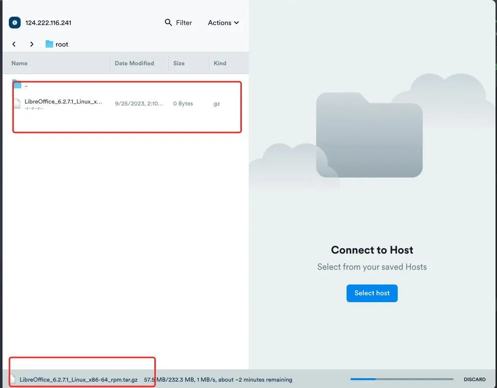
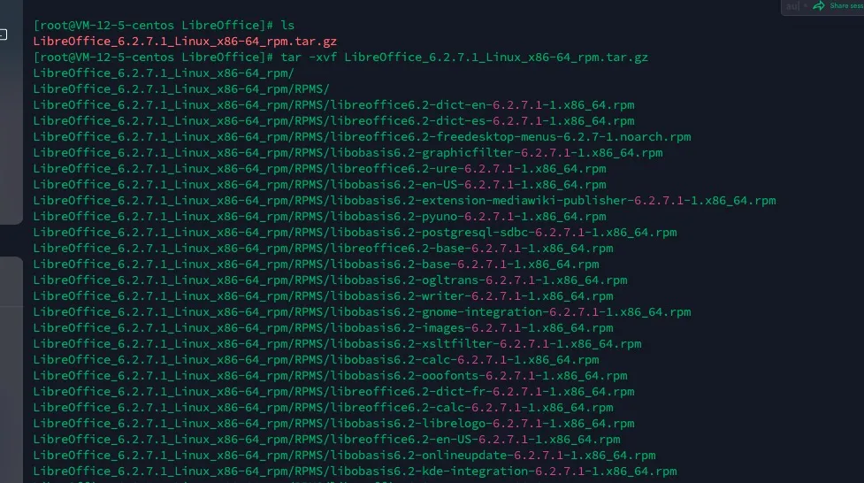
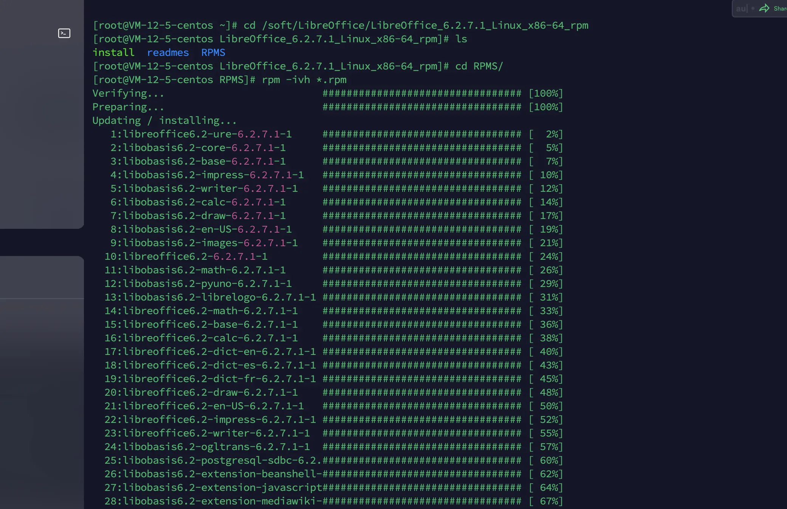
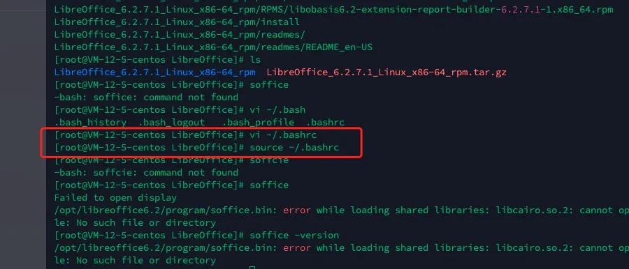
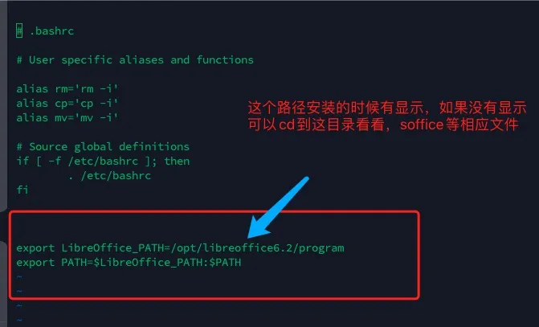
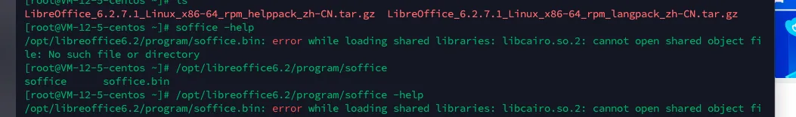
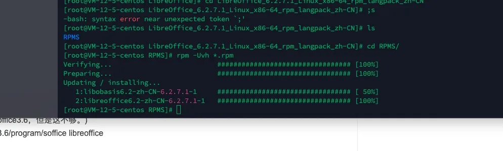

+++
date = '2025-12-11T10:30:52+08:00'
draft = true
title = 'LibreOffice安装教程'
tags = ["教程","libreOffice"]
series = ["教程"]
categories = ["libreOffice"]
+++
2. 使用文件上传工具将libreOffice 上传至服务器

2.  将文件解压

3. 进行软件的安装   **rpm -ivh *.rpm**

4. 配置项目的路径

这个是打开配置文件的命令和使配置文件生效的命令

5. 执行报错

6. 安装依赖

yum install alsa-lib-devel

yum install gtk2

7. 安装完成

因为没有出现乱码，所以未使用两个中文插件包

教程和上面的几乎一致   rpm -Uvh *.rpm

bashrc    、 profile 两个配置文件

