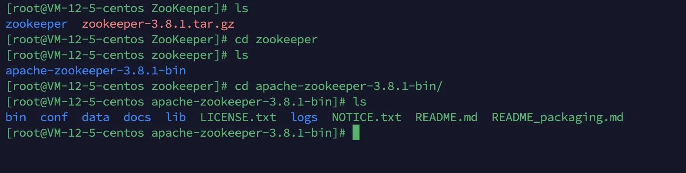

+++
date = '2025-12-10T12:31:52+08:00'
draft = true
title = 'Zookeeper安装教程'
tags = ["教程","Zookeeper"]
series = ["教程"]
categories = ["Zookeeper"]
+++
# Zookeeper安装教程
## 软件下载
因为公司需要使用 KafKa 来进行接数据，所以需要安装，但是前置条件是需要安装这个 ZooKeeper

:::tips
1.  需要提前安装 java
2.  准备Zookeeper安装包
3.  参考资料   [https://blog.csdn.net/Eternal_Blue/article/details/94762494](https://blog.csdn.net/Eternal_Blue/article/details/94762494)

:::

## 软件安装
:::tips

1. 将压缩文件解压后.
2. 创建两个文件夹 data、logs
3. 将 conf文件夹下的  zoo_sample.cfg 改名字为 zoo.cfg

将zoo.cfg的  
	dataDir=/usr/local/zookeeper/apache-zookeeper-3.5.5/data  改为你创建的那个 data文件夹

4. 启动命令  bin/zkServer.sh start
5. 使用JPS命令就可以查询到进程信息，QuorumPeerMain就是Zookeeper的进程

补充命令

重启命令    bin/zkServer.sh restart

停止命令    bin/zkServer.sh stop

客户端启动  bin/zkCli.sh

:::

