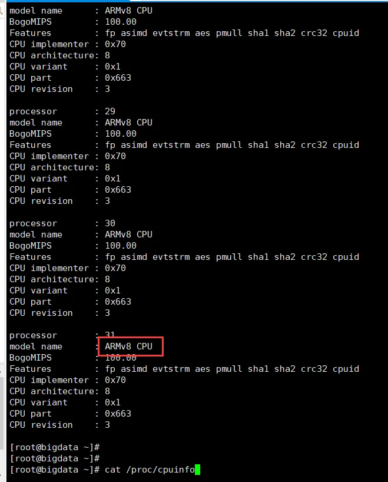
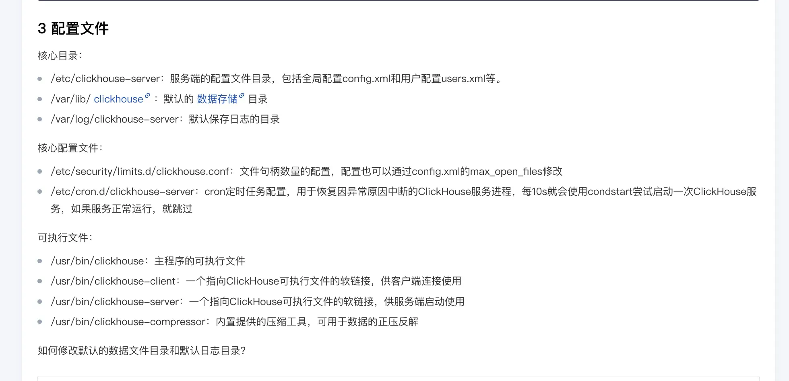

+++
date = '2025-12-15T10:45:52+08:00'
draft = true
title = 'clickhouse安装教程'
tags = ["clickhouse","安装教程"]
series = ["安装教程"]
categories = ["数据库", "clickhouse"]
+++


## 软件下载
软件下载地址 [https://packages.clickhouse.com/rpm/stable/](https://packages.clickhouse.com/rpm/stable/)

按照不同的cpu内核

:::info
cat /proc/cpuinfo

:::



下载对应的 rpm包

:::info
<font style="color:rgb(51, 51, 51);">clickhouse-client-19.17.10.1-1.el7.x86_64.rpm </font>

<font style="color:rgb(51, 51, 51);">clickhouse-common-static-19.17.10.1-1.el7.x86_64.rpm </font>

<font style="color:rgb(51, 51, 51);">clickhouse-server-19.17.10.1-1.el7.x86_64.rpm </font>

:::

## 软件安装
#### <font style="color:rgb(77, 77, 77);">安装clickhouse</font>
```shell
rpm -ivh clickhouse-common-static-19.17.10.1-1.el7.x86_64.rpm
rpm -ivh clickhouse-server-19.17.10.1-1.el7.x86_64.rpm
rpm -ivh clickhouse-client-19.17.10.1-1.el7.x86_64.rpm
```


####  
## 软件启动
:::info
service clickhouse-server start

:::

+ <font style="color:rgb(51, 51, 51);">基于默认配置启动，默认读取/etc/clickhouse-server/config.xml配置文件</font>
+ <font style="color:rgb(51, 51, 51);">基于指定配置启动，需要手动切换到clickhouse用户启动</font>

:::info
# 切换到clickhouse用户

su clickhouse

# 如果报错：This account is currently not available，需要先激活clickhouse用户

usermod -s /bin/bash clickhouse

# 手动指定一个配置文件并启动clickhouse服务

clickhouse-server --config-file=/etc/clickhouse-server/config-ch5.xml

:::

<font style="color:rgb(51, 51, 51);"></font>


