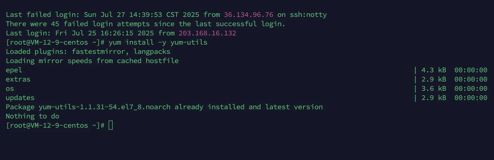
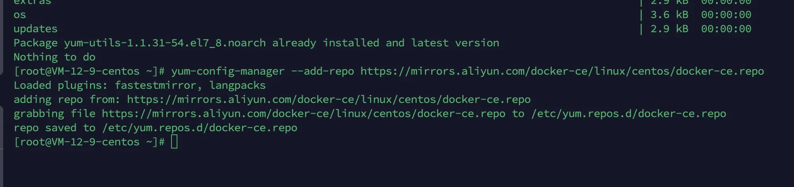
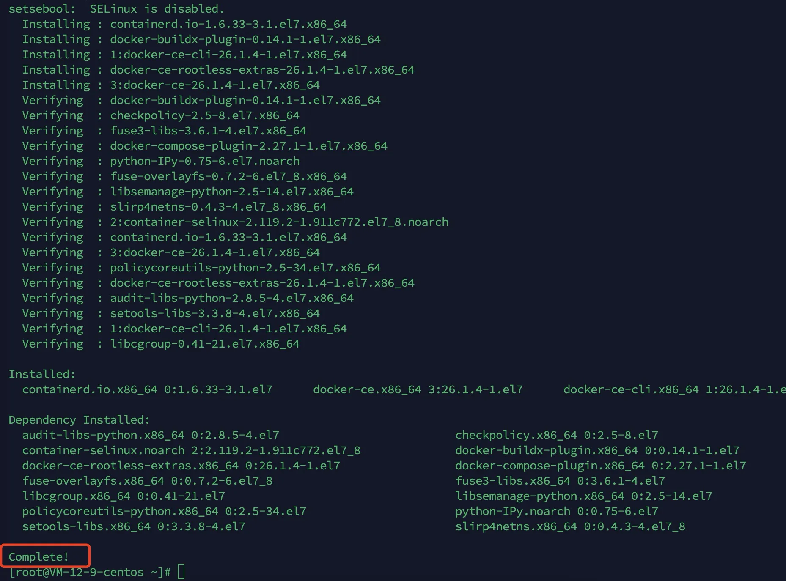
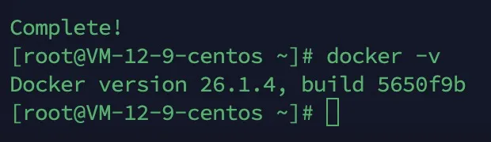
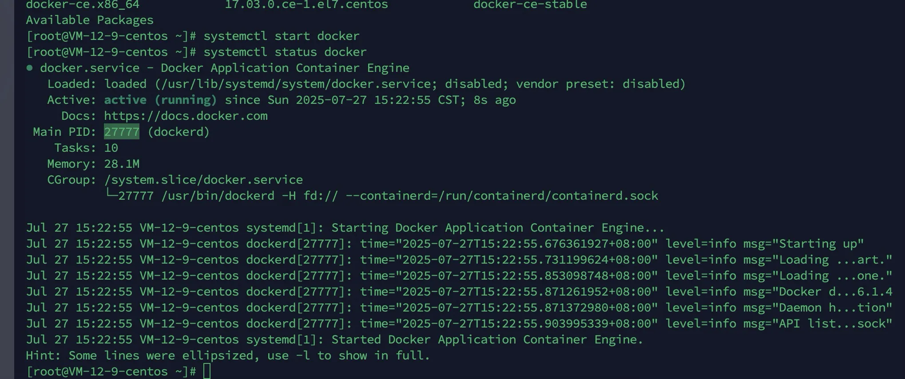

+++
date = '2025-12-15T10:57:52+08:00'
draft = true
title = 'docker安装教程'
tags = ["docker","安装教程"]
series = ["安装教程"]
categories = ["自动部署", "docker"]
+++


## 设置存储库
###  安装 yum-uti
```shell
yum install -y yum-utils
```



### <font style="color:rgb(79, 79, 79);"> 添加稳定的存储库</font>
```plain
yum-config-manager --add-repo https://mirrors.aliyun.com/docker-ce/linux/centos/docker-ce.repo
```



## 安装 Docker
###  安装最新版本
```plain
yum -y install docker-ce docker-ce-cli containerd.io
```



###  查看 Docker 版本
```plain
docker -v
```



###  安装指定版本
####  列出可用版本
```plain
yum list docker-ce --showduplicates | sort -r
```

####  安装指定版本（例如 17.12.0）
```plain
yum install docker-ce-17.12.0 docker-ce-cli-17.12.0 containerd.io
```

##  启动与管理 Docker 服务
### 3.1 启动 Docker
```plain
systemctl start docker
```

###  停止 Docker
```plain
systemctl stop docker
```

####  重启 Docker
```plain
systemctl restart docker
```

####  查看 Docker 状态
```plain
systemctl status docker
```



```shell
由于不可描述之原因，docker 官方已经禁止大陆访问其服务器，
因此，搜索镜像时应当采用 ${镜像源域名}/${搜索关键字} 的模式，
这里假设您的 registry-mirrors 配置了 docker.1ms.run ：


docker search docker.1ms.run/<Keyword>
```

####  设置开机自启
```plain
systemctl enable docker
```

##  配置镜像加速器
###  创建或编辑配置文件 /etc/docker/daemon.json
```shell
mkdir -p /etc/docker
cat > /etc/docker/daemon.json << EOF
{
    "registry-mirrors": [
        "https://docker.unsee.tech",
        "https://dockerpull.org",
        "https://docker.1panel.live",
        "https://dockerhub.icu"
    ]
}
EOF
```

###  重启 Docker 服务
```shell
systemctl daemon-reload
systemctl restart docker
```

####  查看加速器地址
```shell
docker info | grep -A 10 "Registry Mirrors"
```

##  修改 Docker 默认存储目录
###  停止 Docker 服务
```shell
systemctl stop docker
```

###  创建新目录并设置权限
```shell
mkdir -p /data/docker
```

###  如果已有数据，移动到新目录
```shell
rsync -aH /var/lib/docker/ /data/docker/
```

###  修改配置文件
```shell
sed -i'/}/i\,"data-root": "/data/docker"' /etc/docker/daemon.json
```

###  启动 Docker 服务
```shell
systemctl start docker
```

###  验证配置
```shell
docker info | grep "Docker Root Dir"
```

##  卸载 Docker
###  卸载主要组件
```shell
yum remove docker-ce docker-ce-cli containerd.io -y
```

###  删除所有数据（可选）
```shell
rm -rf /var/lib/docker
 
rm -rf /etc/docker
```

###  手动检查与清理
```shell
如果修改过其他文件（如 daemon.json），手动清理：

rm -rf /etc/docker/daemon.json
```

###  注意事项
```shell
卸载前备份重要数据（镜像、容器等）。
清理后重新安装时，建议删除旧数据以避免冲突。
```


