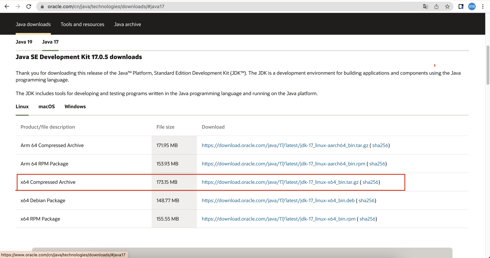
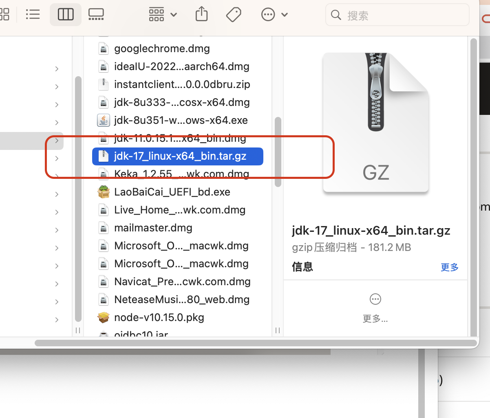
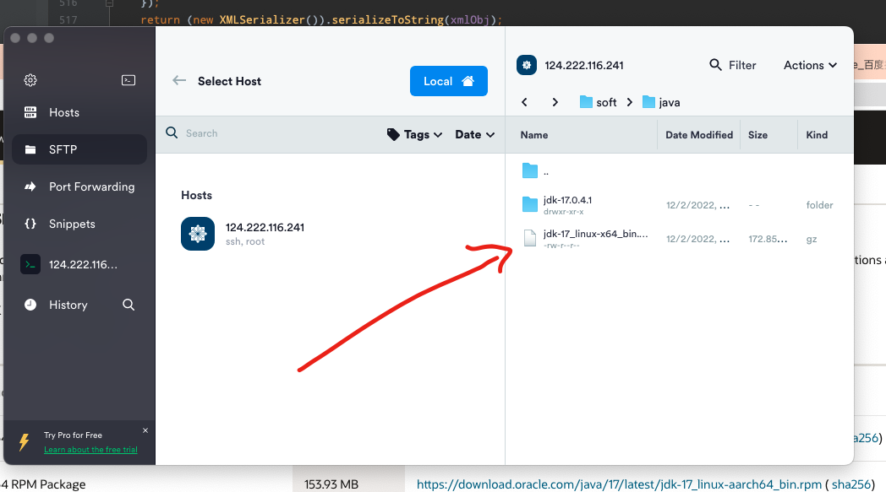
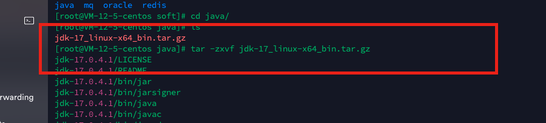
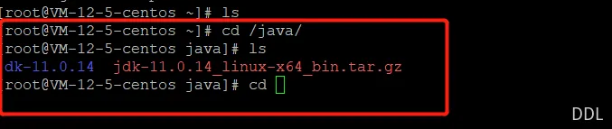
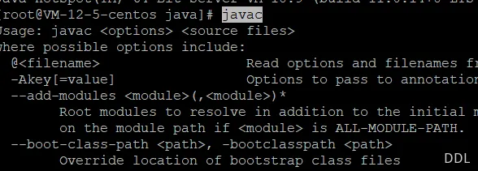

+++
date = '2025-12-10T10:31:52+08:00'
draft = true
title = 'jdk安装教程'
tags = ["教程","java"]
series = ["教程"]
categories = ["java"]
+++
# 基于Cen8的jdk安装教程
## 软件下载
### 下载
[https://www.oracle.com/cn/java/technologies/downloads/#java17](https://www.oracle.com/cn/java/technologies/downloads/#java17)  访问链接，选择下载，需要输入账号、密码。可以使用QQ邮箱进行申请账号。

下载完成文件如下。



### 上传到服务器
我使用的是Termius 将文件直接拖拽上去就可以了。




## 软件安装
将文件进行解压

```shell
tar -zxvf jdk-17_linux-x64_bin.tar.gz
```



### <font style="color:rgb(0, 0, 0);">修改配置文件</font>
```shell
vim /etc/profile
```

将这行代码放入其中，使用 i 可以进行插入

```shell
export JAVA_HOME=/soft/java/jdk-17.0.4.1
export PATH=$JAVA_HOME/bin:$PATH
export CLASSPATH=.:$JAVA_HOME/lib/dt.jar:$JAVA_HOME/lib/tools.jar
```

<font style="color:rgb(0, 0, 0);">JAVA_HOME的路径是你jdk解压的路径</font>

<font style="color:rgb(0, 0, 0);"></font> 

<font style="color:rgb(0, 0, 0);"></font>

<font style="color:rgb(0, 0, 0);"></font>

<font style="color:rgb(0, 0, 0);">，结尾的时候点击ESC，然后输入：wq退出vim。</font>

### <font style="color:rgb(0, 0, 0);">让配置文件生效</font>
```shell
source /etc/profile
```

<font style="color:rgb(0, 0, 0);">输入这条命令让配置生效。</font>

## <font style="color:rgb(0, 0, 0);">软件测试</font>
<font style="color:rgb(0, 0, 0);"></font>

<font style="color:rgb(0, 0, 0);"></font>

<font style="color:rgb(171, 178, 191);background-color:rgb(40, 44, 52);">update-alternatives </font><font style="color:rgb(238, 153, 0);">--config</font><font style="color:rgb(97, 174, 238);">java  切换java版本</font>  


