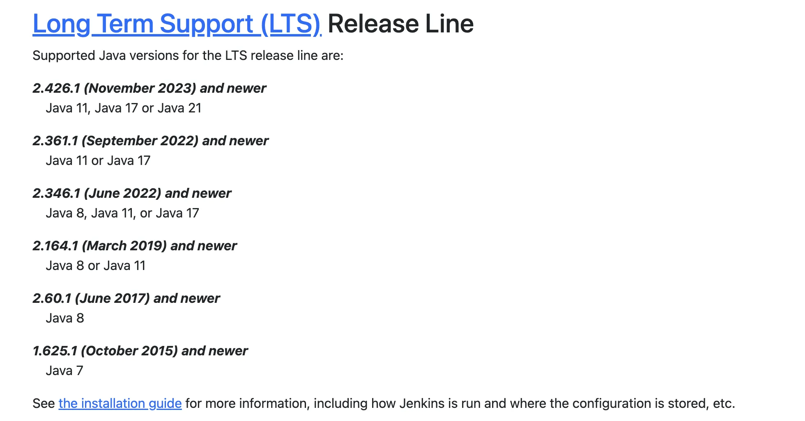
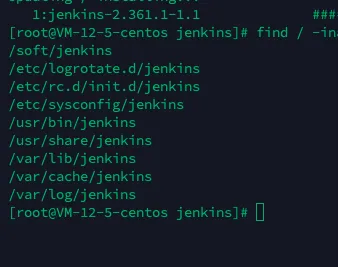
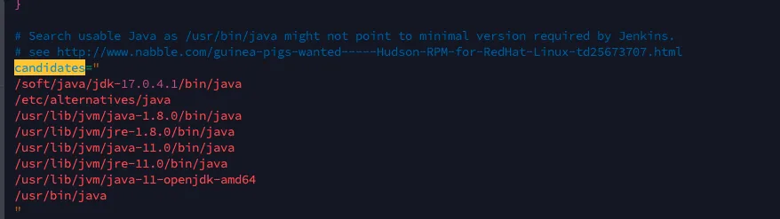
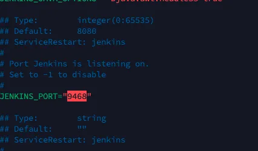
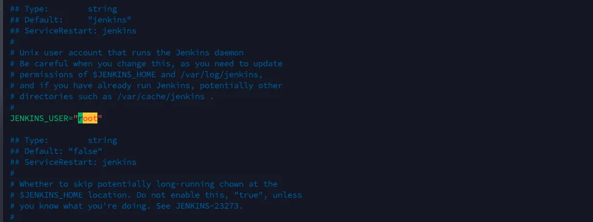
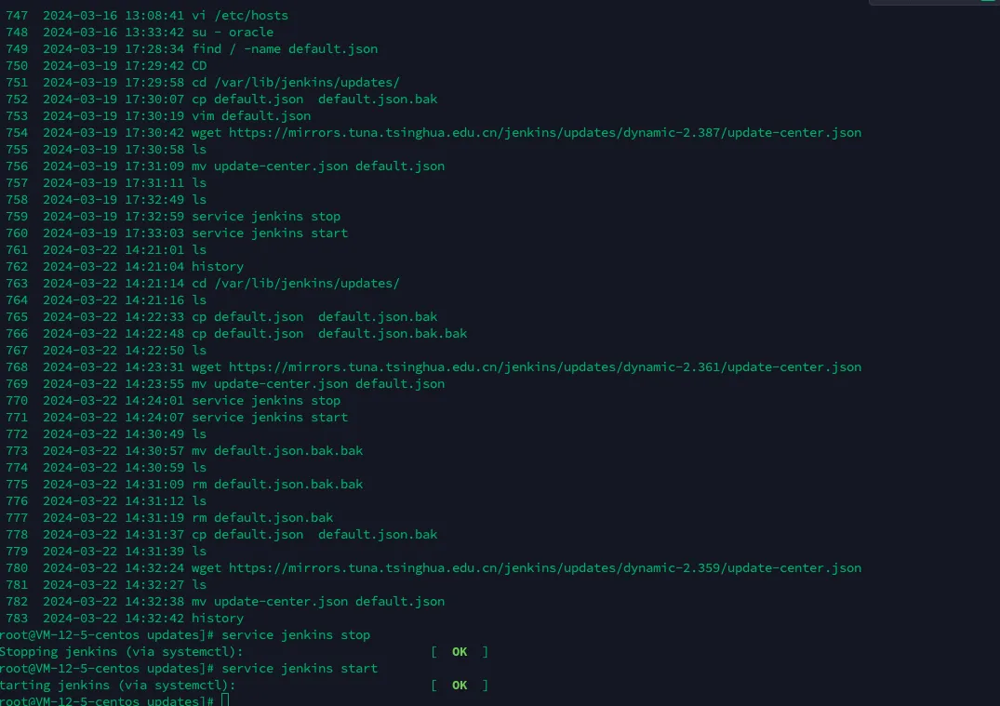

+++
date = '2025-12-12T16:33:52+08:00'
draft = true
title = 'jenkins安装教程'
tags = ["jenkins", "安装教程"]
series = ["安装教程"]
categories = ["自动部署", "jenkins"]
+++


## 软件下载
Red Hat/Fedora/Alma/Rocky/CentOS 软件下载    [https://mirrors.jenkins.io/redhat-stable/](https://mirrors.jenkins.io/redhat-stable/)

下载LTS版本，按照不同的java版本安装不同版本的jenkins



## 软件安装
#### <font style="color:rgb(77, 77, 77);">安装jenkins</font>
```shell
rpm -ivh jenkins-2.361.1-1.1.noarch.rpm
```

#### <font style="color:rgb(77, 77, 77);">自动安装Jenkins完成之后，Jenkins安装后的目录有</font>
```shell
find / -iname jenkins    
```



## <font style="color:rgb(79, 79, 79);">软件配置</font>
#### <font style="color:rgb(79, 79, 79);">在jenkins配置文件中配置jdk环境变量</font>
```shell
vim /etc/init.d/jenkins
echo $JAVA_HOME      # 结果  /soft/java/jdk-17.0.4.1/bin/java
```



#### <font style="color:rgb(79, 79, 79);">配置Jenkins的端口</font>
```shell
vim /etc/sysconfig/jenkins   					# 端口: 9468
vim /usr/lib/systemd/system/jenkins.service			# 端口: 9468
```



#### <font style="color:rgb(79, 79, 79);">修改jenkins默认的操作用户</font>
```shell
vim /etc/sysconfig/jenkins   				
vim /usr/lib/systemd/system/jenkins.service		
```



```shell
chown -R root /var/log/jenkins
chgrp -R root /var/log/jenkins
chown -R root /var/lib/jenkins
chgrp -R root /var/lib/jenkins
chown -R root /var/cache/jenkins
chgrp -R root /var/cache/jenkins
```

```shell
vim /usr/lib/systemd/system/jenkins.service
修改java_home的路径
```


## <font style="color:rgb(79, 79, 79);">软件启动</font>
```shell
service jenkins start
```

```shell
cat /var/lib/jenkins/secrets/initialAdminPassword
```

service jenkins states

ef36f989220c44da8a55f94053a846b8

<font style="color:rgb(0, 0, 0);background-color:rgb(238, 238, 238);">firewall-cmd --permanent --zone=public --add-port=9468/tcp</font>

<font style="color:rgb(0, 0, 0);background-color:rgb(238, 238, 238);">17:25:52</font>

<font style="color:rgb(0, 0, 0);background-color:rgb(238, 238, 238);">/usr/share/java/jenkins.war</font>




```shell
sudo docker pull jenkins
```

```shell
docker images
```

```shell
docker run -itd -u root \
-p 12347:8080 \
-p 50000:50000 \
--name="jenkins" \
--restart always \
--privileged=true \
-v /soft/jenkins:/var/jenkins_home \
-v /soft/java/jdk-17.0.4.1/bin/java:/app/java/jdk-17.0.4.1/bin/java \
-v /soft/java/jdk-17.0.4.1:/app/java/jdk-17.0.4.1 \
-v /soft/maven/apache-maven-3.9.9:/app/maven/apache-maven-3.9.9 \
-v /soft/jenkins/repo:/soft/jenkins/repo 091ba5742e7e


apt install -y telnet  
apt install vim
如果出现github网络问题
git config --global --unset http.proxy 
git config --global --unset https.proxy
然后重启jenkins的docker


om.oracle.database.jdbc:ojdbc11:jar 异常

mvn install:install-file \
-DgroupId=com.oracle.database.jdbc \
-DartifactId=ojdbc11 \
-Dversion=12.2.0.3 \
-Dpackaging=jar 
-Dfile=/app/maven/apache-maven-3.9.9/lib/ojdbc11-12.2.0.3.jar \
-DgeneratePom=true

```


```bash
# 代理设置
mkdir ~/clash

cd ~/clash 

wget "https://github.com/DustinWin/proxy-tools/releases/download/Clash-Premium/clashpremium-release-linux-amd64.tar.gz"

wget -O config.yaml "些你自己的地址哈"
# 需要下载db上传上去
chmod +x clash
./clash -d .

# clash运行目录
/root/.config


sudo vi /etc/profile.d/proxy.sh


# Socks5 代理配置
export ALL_PROXY=socks5://127.0.0.1:7891
export http_proxy=$ALL_PROXY
export https_proxy=$ALL_PROXY

sudo chmod +x /etc/profile.d/proxy.sh
source /etc/profile.d/proxy.sh
```

