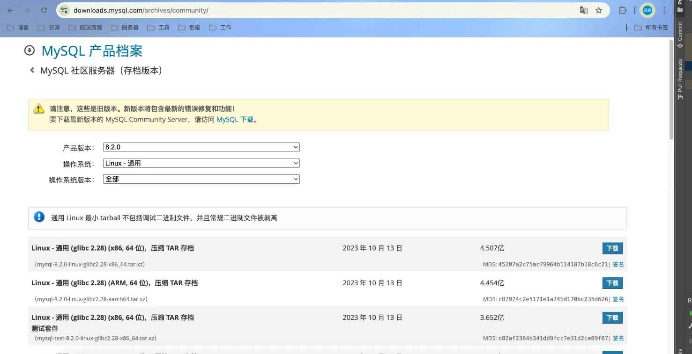

+++
date = '2025-12-15T10:54:52+08:00'
draft = true
title = 'mysql安装教程'
tags = ["mysql","安装教程"]
series = ["安装教程"]
categories = ["数据库", "mysql"]
+++


##  软件下载
1. 下载地址

[https://downloads.mysql.com/archives/community/](https://downloads.mysql.com/archives/community/)



选择相应的系统和版本  mysql-8.2.0-linux-glibc2.28-x86_64.tar

2. 解压

因为是综合版本，所以需要两次解压

```shell
# 解压tar包
tar -xvf mysql-8.2.0-linux-glibc2.28-x86_64.tar
# 解压tar.xz包
tar -xvf mysql-8.2.0-linux-glibc2.28-x86_64.tar.xz
# 解压文件夹重新命名
mv mysql-8.2.0-linux-glibc2.28-x86_64 mysql-8.2.0
```


## 软件安装
```shell
# 跳转至 mysql-8.2.0 
cd mysql-8.2.0
# 创建data目录
mkdir data
# 创建mysql用户
groupadd mysql
# 将文件夹赋权给mysql用户
useradd -g mysql mysql
chown -R mysql.mysql /soft/mysql/mysql-8.2.0
# 初始化数据库
cd bin/
./mysqld --user=mysql --basedir=/soft/mysql/mysql-8.2.0  --datadir=/soft/mysql/mysql-8.2.0/data  --lower-case-table-names=1 --initialize
rpm -qa|grep libaio
cd /soft/mysql/mysql-8.2.0
vim /etc/my.cnf
cd ..
cp -a ./support-files/mysql.server /etc/init.d/mysql
chmod +x /etc/init.d/mysql
chkconfig --add mysql
service mysql start
chown -R mysql.mysql /soft/mysql/mysql-8.2.0/data/
chown -R 755  /soft/mysql/mysql-8.2.0/data/
service mys
cd /soft/mysql/mysql-8.2.0/
cd data/
service mysql start
chown -R mysql.mysql /soft/mysql/mysql-8.2.0/
ln -s /soft/mysql/mysql-8.2.0/bin/mysql /usr/bin

```


先安装的，教程没写教程有点问题


[https://blog.csdn.net/Liuyiyi6110309/article/details/111281798](https://blog.csdn.net/Liuyiyi6110309/article/details/111281798)


