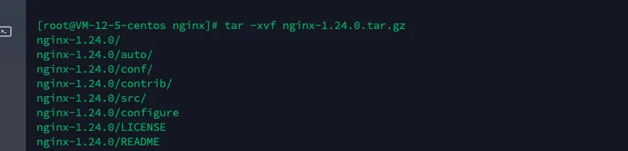
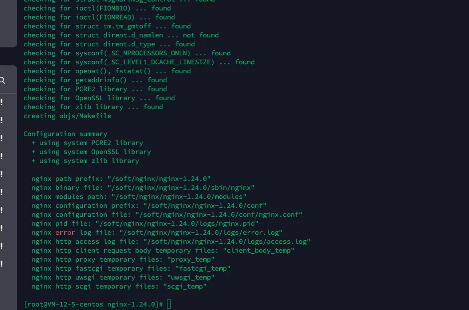

+++
date = '2025-12-15T10:48:52+08:00'
draft = true
title = 'nginx安装教程'
tags = ["nginx","安装教程"]
series = ["安装教程"]
categories = ["自动部署", "nginx"]
+++


## 软件下载
1. 下载地址

[https://nginx.org/en/download.html](https://nginx.org/en/download.html)

[https://github.com/nginx/nginx/tags](https://github.com/nginx/nginx/tags)

下载相应系统的版本，最近看到的几个版本都是  “1.24.0” 可以下这个，如果有其他要求，可以下载相应的版本，下载下来格式是     ****.tar.gz

## 软件安装
1. 将文件上传至nginx上去，放到需要安装的位置。
2. 解压nginx


```shell
tar -xvf nginx-1.24.0.tar.gz
```

:::info
命令进行解压

:::



3. 配置nginx

```shell
./configure --prefix=/usr/local/nginx  --with-http_ssl_module --with-http_stub_status_module
```




_注意:_  
情况一： error:the HTTP rewrite module requires the PCRE library。  
执行下面命令 `bash yum -y install pcre-devel`

```shell
http://downloads.sourceforge.net/project/pcre/pcre/8.40/pcre-8.40.tar.gz
```

情况二： error: SSL modules require the OpenSSL library.  
执行下面命令 `bash yum -y install openssl openssl-devel` 解决报错后，继续执行./configure --with-http_stub_status_module --with-http_ssl_module命令

```shell
https://pkgs.org/download/openssl-devel
```

4.  编译nginx

```shell
#编译
make
```

5. 编译安装nginx

```shell
#进行编译安装
make install
```

## 软件启动
```bash
/usr/local/nginx/sbin/nginx -c /usr/local/nginx/conf/nginx.conf
```

## 软件验证
ip:80 进行测试


```bash
启动：cd /nginx/sbin && ./nginx
停止：./nginx -s stop
重启:./nginx -s reload
检查配置正确性:./nginx -t
查看Nginx版本信息：./nginx -v
```


[https://www.zhihu.com/question/484249657/answer/3579140390](https://www.zhihu.com/question/484249657/answer/3579140390)


