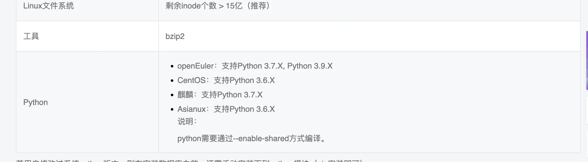

+++
date = '2025-12-12T16:31:52+08:00'
draft = true
title = 'opengauss安装教程'
tags = ["opengauss", "安装教程"]
series = ["安装教程"]
categories = ["数据库","opengauss"]
+++


## 软件下载
### 官网 [https://opengauss.org/zh/download/](https://opengauss.org/zh/download/)
官网版本分为 LTS (长期支持) 版本和PreView(预览版)版本 。

暂时采用企业版本(<font style="color:rgb(0, 0, 0);">Enterprise-Edition</font>)进行使用，后续如果出现问题(规则性问题)，再使用个人版本(<font style="color:rgb(0, 0, 0);">Simplified</font>)。

### <font style="color:rgb(77, 77, 77);">兼容</font>
数据库兼容性比较差，只能支持几款操作系统  在centos 8系统无法进行安装。

centos 7.6

openEuler-20.03-LTS  aarch64

openEuler-20.03-LTS  x86

kylin- V10  aarch64

### <font style="color:rgb(77, 77, 77);">选型</font>
针对使用的系统架构和操作系统，进行选型。


<font style="background-color:#F9EFCD;">首先区分的是操作系统架构因为麒麟系统是arm所以使用了 AArch64  但是安装时却抛出架构是x86架构。所以最终使用 x86架构的。</font>

其次是<font style="color:rgb(0, 0, 0);">操作系统，因为操作系统是麒麟所以选用了 openEuler 20.03 LTS版本。</font>

### <font style="color:rgb(77, 77, 77);">提前准备</font>
注意 需要提前安装python 3.6+

<font style="background-color:#F9EFCD;">这里注意，因为操作说明说是 3.6+ 就可以，但是不同操作系统需要使用不一样的 python。</font>



## <font style="color:rgb(77, 77, 77);">软件安装</font>
<font style="color:rgb(77, 77, 77);">按照上问的选型，选择不同的python，下文是python的下载路径，自行选型。</font>

[https://www.python.org/ftp/python/](https://www.python.org/ftp/python/3.8.1/)

### <font style="color:rgb(77, 77, 77);">首先登录机器，使用SFTP将python上传上去。</font>
### <font style="color:rgb(77, 77, 77);">安装</font>
```shell
# 创建目录
mkdir /usr/local/python3
# 移动文件到创建的目录下
mv Python-3.7.4.tar.xz /usr/local/python3/
# 跳转到目录下
cd /usr/local/python3/
# 解压文件
tar -xvf Python-3.7.4.tar.xz
# 跳转到目录下
cd Python-3.7.4/
# 设置安装路径
./configure --prefix=/usr/local/python3/Python-3.7.4/ --enable-shared 
# 安装
make && make install
# 建立软连接
ln -s /usr/local/python3/Python-3.7.4/bin/python3.7 /usr/bin/python3
ln -s /usr/local/python3/Python-3.7.4/bin/pip3.7 /usr/bin/pip3
# 配置python3.7的lib到ldconfig
vi /etc/ld.so.conf.d/python3.conf
# 添加内容
/usr/local/python3/Python-3.7.4/lib
# 让配置生效
ldconfig
# 验证配置是否生效
python3 -V
# 配置环境变量
vi ~/.bash_profile
# 添加内容
export PYTHON_HOME=/usr/local/python3/Python-3.7.4
export PATH=$PYTHON_HOME/bin:$PATH
# 让配置生效
source ~/.bash_profile
# 验证配置是否生效
echo $PYTHON_HOME
```

### <font style="color:rgb(77, 77, 77);"> 安装 opengauss </font>


```shell
# 创建目录
mkdir -p /usr/local/teleware/openGauss/
# 移动文件到创建的目录下
mv openGauss-5.0.1-openEuler-64bit-all.tar.gz /usr/local/teleware/openGauss/
# 跳转到目录下
cd /usr/local/telewave/openGauss/
# 关闭防火墙
vim /etc/selinux/config
SELINUX=disabled
reboot
systemctl status firewalld
systemctl disable firewalld.service
systemctl stop firewalld.service
systemctl status firewalld
# 设置字符集参数
vim /etc/profile
export LANG="zh_CN.UTF-8"
# 创建用户和组
groupadd dbgrp
useradd -g dbgrp omm
passwd omm
# 为安装路径及文件授权
chown 755 -R /usr/local/telewave/
# 为omm用户授权安装路径权限
chown -R omm:dbgrp /usr/local/telewave/openGauss/
# 首先配置xml
vi cluster_config.xml
# 添加内容
------- 看下文  cluster_config.xml  需要确认 hostname 是否一致 本文hostname为 host-172-19-135-6
可以使用 hostname 命令查询
# 解压文件 首先要解压，下载的文件，然后里面有两个新文件
tar -xvf openGauss-5.0.1-openEuler-64bit-all.tar.gz
tar -xvf openGauss-5.0.1-openEuler-64bit-om.tar.gz
# 跳转到目录下
cd script/
# 执行前置脚本gs_preinstall
./gs_preinstall -U omm -G dbgrp -X /usr/local/telewave/openGauss/cluster_config.xml 
# 再给用户赋一遍权   
# 为安装路径及文件授权
chown 755 -R /usr/local/telewave/
# 为omm用户授权安装路径权限
chown -R omm:dbgrp /usr/local/telewave/openGauss/
# 切换用户
su - omm
# 安装openGauss
gs_install -X /usr/local/telewave/openGauss/cluster_config.xml
# 最后安装完成
```

```shell
<?xml version="1.0" encoding="UTF-8"?>
<ROOT>
    <!-- openGauss整体信息 -->
    <CLUSTER>
        <!-- 数据库名称 -->
        <PARAM name="clusterName" value="dbCluster" />
        <!-- 数据库节点名称(hostname) -->
        <PARAM name="nodeNames" value="host-172-19-135-6" />
        <!-- 数据库安装目录-->
        <PARAM name="gaussdbAppPath" value="/home/omm/app" />
        <!-- 日志目录-->
        <PARAM name="gaussdbLogPath" value="/home/omm/log" />
        <!-- 临时文件目录-->
        <PARAM name="tmpMppdbPath" value="/home/omm/tmp" />
        <!-- 数据库工具目录-->
        <PARAM name="gaussdbToolPath" value="/home/omm/tools" />
        <!-- 数据库core文件目录-->
        <PARAM name="corePath" value="/home/omm/corefile" />
        <!-- 节点IP，与数据库节点名称列表一一对应 -->
        <PARAM name="backIp1s" value="172.19.135.6"/>
    </CLUSTER>
    <!-- 每台服务器上的节点部署信息 -->
    <DEVICELIST>
        <!-- 节点1上的部署信息 -->
        <DEVICE sn="node1_hostname">
            <!-- 节点1的主机名称 -->
            <PARAM name="name" value="host-172-19-135-6"/>
            <!-- 节点1所在的AZ及AZ优先级 -->
            <PARAM name="azName" value="AZ1"/>
            <PARAM name="azPriority" value="1"/>
            <!-- 节点1的IP，如果服务器只有一个网卡可用，将backIP1和sshIP1配置成同一个IP -->
            <PARAM name="backIp1" value="172.19.135.6"/>
            <PARAM name="sshIp1" value="172.19.135.6"/>

            <!--dbnode-->
            <PARAM name="dataNum" value="1"/>
            <PARAM name="dataPortBase" value="15400"/>
            <PARAM name="dataNode1" value="/home/omm/install/data"/>
            <PARAM name="dataNode1_syncNum" value="0"/>
        </DEVICE>
    </DEVICELIST>
</ROOT>
```

<font style="color:rgb(92, 99, 112);"> </font>

## <font style="color:rgb(77, 77, 77);">问题汇总</font>
### <font style="color:rgb(77, 77, 77);">python软链接</font>
如果系统有python 2.* 是不可以直接使用的，需要进行版本替换，替换为3.7 (本文)，如果已经存在相应软连接，可以直接删除对应的软连接。

### <font style="color:rgb(77, 77, 77);">赋权</font>
如果在 omm 用户下执行 gs_install -X /usr/local/telewave/openGauss/cluster_config.xml 抛出用户权限不够，不能够使用python的问题，千万不要把所有 /usr/bin的权限给 omm，系统会崩溃。我是崩溃了重新安装的，第二次就没问题了。

### <font style="color:rgb(77, 77, 77);">内存</font>
如果 omm 用户安装 opengauss 的时候抛出内存不够问题，

cat /opt/huawei/install/data/dn/postgresql.conf  | grep shared_buffers

然后调整相关配置

<font style="color:rgb(92, 99, 112);"></font>

<font style="color:rgb(92, 99, 112);"></font>

<font style="color:rgb(92, 99, 112);">omm用户密码为: Telewave@1234   群组:dbgrp</font>

数据库密码  Telewave@1234

<font style="color:rgb(0, 0, 0);background-color:rgb(250, 250, 250);">数据库密码权限设置： </font>

<font style="color:rgb(0, 0, 0);background-color:rgb(250, 250, 250);"> gs_guc reload </font><font style="color:rgb(166, 127, 89);">-</font><font style="color:rgb(0, 0, 0);background-color:rgb(250, 250, 250);">N </font><font style="color:rgb(0, 119, 170);">all</font><font style="color:rgb(166, 127, 89);">-</font><font style="color:rgb(0, 0, 0);background-color:rgb(250, 250, 250);">I </font><font style="color:rgb(0, 119, 170);">all</font><font style="color:rgb(166, 127, 89);">-</font><font style="color:rgb(0, 0, 0);background-color:rgb(250, 250, 250);">c </font><font style="color:rgb(80, 161, 79);">"password_policy=1"     密码要求高</font>

<font style="color:rgb(0, 0, 0);background-color:rgb(250, 250, 250);"> gs_guc reload </font><font style="color:rgb(166, 127, 89);">-</font><font style="color:rgb(0, 0, 0);background-color:rgb(250, 250, 250);">N </font><font style="color:rgb(0, 119, 170);">all</font><font style="color:rgb(166, 127, 89);">-</font><font style="color:rgb(0, 0, 0);background-color:rgb(250, 250, 250);">I </font><font style="color:rgb(0, 119, 170);">all</font><font style="color:rgb(166, 127, 89);">-</font><font style="color:rgb(0, 0, 0);background-color:rgb(250, 250, 250);">c </font><font style="color:rgb(80, 161, 79);">"password_policy=0"     密码要求低</font>

<font style="color:rgb(77, 77, 77);"></font>

<font style="color:rgb(77, 77, 77);"></font>

<font style="color:rgb(77, 77, 77);">实际使用中的过程记录 </font>

<font style="color:rgb(77, 77, 77);">给数据库用户赋权</font>

:::info
<font style="color:rgb(77, 77, 77);">当导出数据存在权限问题的时候：permission denied for relation pg_user </font>

<font style="color:rgb(77, 77, 77);">可以使用下面这个命令进行赋权让导出功能成功。</font>

<font style="color:rgb(77, 77, 77);">grant select ON pg_user TO kffxdt;</font>

<font style="color:rgb(77, 77, 77);">grant 权限 来自 某个用户 给 某个用户;</font>

:::

<font style="color:rgb(77, 77, 77);">登录数据库需要切换权限</font>

:::info
从root用户切换到omm用户（也就是数据库用户）

su - omm

:::

连接数据库

:::info
当到达数据库用户下，执行下面命令就可以进入到数据中

gsql -d postgres -p 15400

当需要退出用户的时候，不是exit哦

\q

才是退出命令

:::

数据库的状态和重启命令

:::info
当数据库需要重启或者查看运行状态的时候

<font style="color:rgb(51, 51, 51);">进行数据库重启的命令    gs_om -t restart</font>

<font style="color:rgb(51, 51, 51);">进行数据库启动的命令    gs_om -t start  </font>

<font style="color:rgb(51, 51, 51);">进行数据库状态查询的命令  gs_om -t status --detail</font>

:::

<font style="color:rgb(77, 77, 77);"></font>

<font style="color:rgb(77, 77, 77);">参考资料</font>

[<font style="color:rgb(77, 77, 77);">https://blog.csdn.net/weixin_43312382/article/details/127664709</font>](https://blog.csdn.net/weixin_43312382/article/details/127664709)

[<font style="color:rgb(77, 77, 77);">https://docs-opengauss.osinfra.cn/zh/docs/5.0.0/docs/InstallationGuide/%E5%88%9D%E5%A7%8B%E5%8C%96%E5%AE%89%E8%A3%85%E7%8E%AF%E5%A2%83.html</font>](https://docs-opengauss.osinfra.cn/zh/docs/5.0.0/docs/InstallationGuide/%E5%88%9D%E5%A7%8B%E5%8C%96%E5%AE%89%E8%A3%85%E7%8E%AF%E5%A2%83.html)

[<font style="color:rgb(77, 77, 77);">https://blog.csdn.net/weixin_53267215/article/details/135825275</font>](https://blog.csdn.net/weixin_53267215/article/details/135825275)

[<font style="color:rgb(77, 77, 77);">https://blog.51cto.com/bjdong/2527670</font>](https://blog.51cto.com/bjdong/2527670)

[https://www.cnblogs.com/mcxw/p/openGauss_opt.html](https://www.cnblogs.com/mcxw/p/openGauss_opt.html)   （操作类的教程）

<font style="color:rgb(77, 77, 77);"></font>

