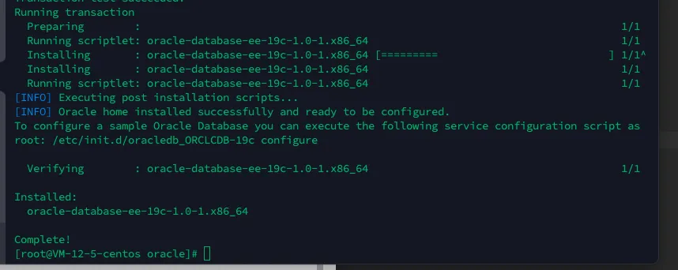
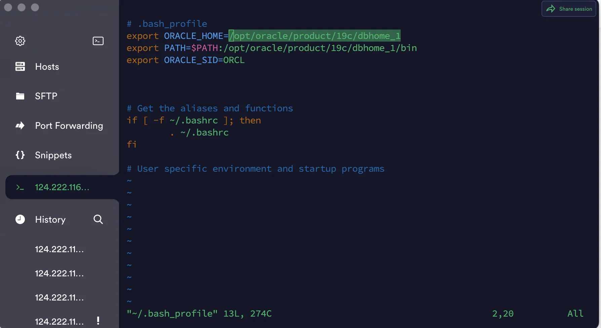
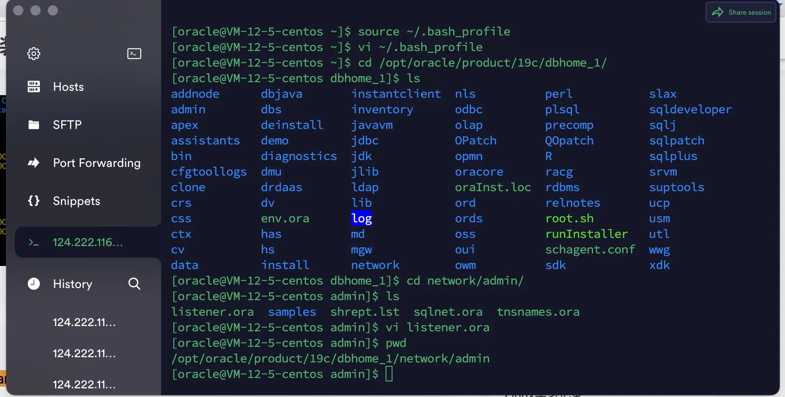

+++
date = '2025-12-11T10:30:52+08:00'
draft = true
title = 'oracle19c安装教程'
tags = ["教程","数据库"]
series = ["教程"]
categories = ["oracle"]
+++
# <font style="color:#000000;">在腾讯云centos8环境下安装oracle19c的问题</font>
## <font style="color:#000000;">软件下载</font>
### <font style="color:#000000;">将yum进行更新、安装解压工具</font>
```shell
wget -O /etc/yum.repos.d/CentOS-Base.repo https://mirrors.aliyun.com/repo/Centos-vault-8.5.2111.repo  

yum makecache

yum install unzip   （可以不进行安装）
yum -y install vim  （可以不进行安装）
```

### 配置hosts文件
通过查询ip名称查询本机ip，将本机ip配置在hosts中,最后执行生效指令

```shell
ifconfig

vim /etc/hosts

增加下面这几行,后面安装的时候会有情况。

10.0.12.5 VM-12-5-centos VM-12-5-centos
10.0.12.5 localhost.localdomain localhost
10.0.12.5 localhost4.localdomain4 localhost4

systemctl restart NetworkManager    ( 原因是由于centos8 已经替换了原来的network, 新版的叫：NetworkManager )
```

### oracle下载
把oracle的两个文件下载下来，然后放入服务器。

```shell
链接: https://pan.baidu.com/s/1SEhno0ygrT26jZOazbXWvA 提取码: ol28
```

## 软件安装
首先执行安装 preinstall 指令，然后安装在执行 oracle 安装命令。

```shell
yum localinstall -y oracle-database-preinstall-19c-1.0-1.el8.x86_64.rpm

yum localinstall -y oracle-database-ee-19c-1.0-1.x86_64.rpm 
```

oracle安装完成的截图



<font style="color:rgb(0, 0, 0);">可以通过此文件修改实例名称SID名称等更详细的信息</font>

```shell
cat /etc/init.d/oracledb_ORCLCDB-19c
/etc/init.d/oracledb_ORCLCDB-19c configure    #使配置文件生效
```

让配置生效

```shell
/etc/init.d/oracledb_ORCLCDB-19c configure
```

###  新建数据库用户
切换到 oracle 用户下

```shell
su - oracle
# 进入 sql
sqlplus / as sysdba
# 切换一个什么鬼，否则就无法创建正常用户，只能创建 C##用户
alter session set container=ORCLPDB1;
# 然后创建用户，赋予权限
create user zhangsan identified by zhangsan;
grant create session to zhangsan;
grant connect,resource to zhangsan;
grant unlimited tablespace to zhangsan;
grant create table to zhangsan;//授予创建表的权限
grant drop any table to zhangsan;//授予删除表的权限
grant insert any table to zhangsan;//插入表的权限
grant update any table to zhangsan;//修改表的权限
grant create view to zhangsan ; //创建视图权限	
```

### 开启防火墙
因为我的防火墙是直接在腾讯云处配置的，所以就不进行展示了。


## 问题汇总
### 出现问题 ：ORA-01109: database not open
解决的方案： [https://blog.csdn.net/KorleYao/article/details/117920564](https://blog.csdn.net/KorleYao/article/details/117920564)

明明启动了数据库，可是还是报错database not open

```java
一般是oracle12c 及以上会出现这种问题。
装的数据库是CDB和PDB一起的，但是网上说的startup启动数据库的时候其实只是默认只启动了数据库容器就是CDB，这个时候如果你要连接PDB数据库的时候就会提示ORA-01109: database not open。
解决方式如下：
1.sqlplus / as sysdba 进入数据库 sqlplus / as sysdba
2.select name,open_mode from v$pdbs查看数据库状态，这里的ORCLPDB1是我要连接的数据库，目前是MOUNT状态
3.使用命令alter pluggable database ORCLPDB1 open;把他打开就行了。
```


### 数据库运行一段时间就出现监听消失等情况，有如下解决方案。
找到安装路径






```plain
防火墙端口
// 查询开启防火墙的端口
firewall-cmd --list-port
// 新开启防火墙端口
firewall-cmd --zone=public --add-port=6379/tcp --permanent
```

### Unable to check for available memoryx
修改 <font style="color:rgb(255, 0, 0);">/etc/init.d/oracledb_ORCLCDB-18c</font><font style="color:rgb(18, 18, 18);"> 里面的参数</font>

:::color1
<font style="color:rgb(18, 18, 18);">$SU -s /bin/bash $ORACLE_OWNER -c "$DBCA -silent -createDatabase -gdbName $ORACLE_SID -templateName $TEMPLATE_NAME -characterSet $CHARSET -createAsContainerDatabase $CREATE_AS_CDB -numberOfPDBs $NUMBER_OF_PDBS -pdbName $PDB_NAME </font><font style="color:rgb(255, 0, 0);">-J-Doracle.assistants.dbca.validate.ConfigurationParams=false</font><font style="color:rgb(18, 18, 18);"> -createListener $LISTENER_NAME:$LISTENER_PORT -datafileDestination $ORACLE_DATA_LOCATION -sid $ORACLE_SID -autoGeneratePasswords -emConfiguration DBEXPRESS -emExpressPort $EM_EXPRESS_PORT"</font>

:::

5.4 本地数据库 <font style="color:rgba(0, 0, 0, 0.85);">ORA-12541: TNS:no listener</font>

1. <font style="color:rgba(0, 0, 0, 0.85);">修改host文件</font>
2. <font style="color:rgba(0, 0, 0, 0.85);">修改listener.ora</font>
3. <font style="color:rgba(0, 0, 0, 0.85);">重启  TNS Listner</font>
4. <font style="color:rgba(0, 0, 0, 0.85);">lsnrctl status</font>
5. <font style="color:rgba(0, 0, 0, 0.85);">lsnrctl stop</font>
6. <font style="color:rgba(0, 0, 0, 0.85);">lsnrctl start</font>

5.5 远程数据库 <font style="color:rgba(0, 0, 0, 0.85);">ORA-12541: TNS:no listener</font>

initotcdb

1. 进入oracle用户

su oracle

2. 进入oracle

sqlplus  "/as sysdba"

3. 关闭数据库

shutdown abort

4. 开启数据库

startup

5. 然后执行下面两行

注意防火墙是否开启，需要开启相应的sid

<font style="color:rgb(56, 58, 66);background-color:rgb(250, 250, 250);">show pdbs; </font>

alter pluggable database ORCLPDB1 open;

6. 执行下面几行

<font style="color:rgba(0, 0, 0, 0.85);">lsnrctl status</font>

<font style="color:rgba(0, 0, 0, 0.85);">lsnrctl stop</font>

<font style="color:rgba(0, 0, 0, 0.85);">lsnrctl star</font>

7. 进入oracle

alter system register;


<font style="color:#000000;">本文参考的资料有：</font>

<font style="color:#000000;">https://blog.csdn.net/weixin_45173986/article/details/119352569</font>

<font style="color:#000000;">https://www.jianshu.com/p/bee09f464bb4</font>

<font style="color:#000000;">https://www.jianshu.com/p/90c89e7fb4e5</font>

