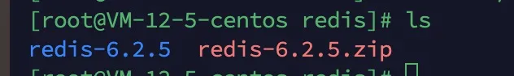
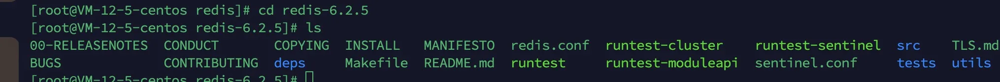
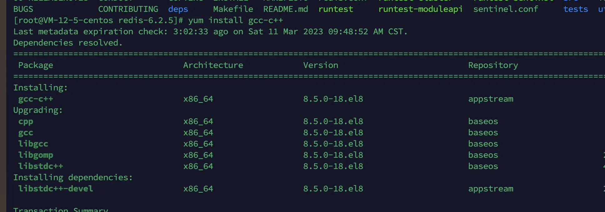
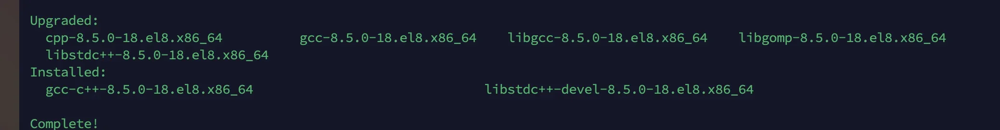
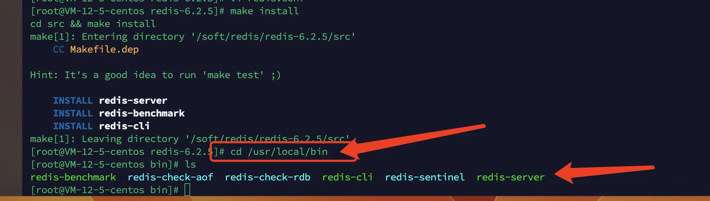
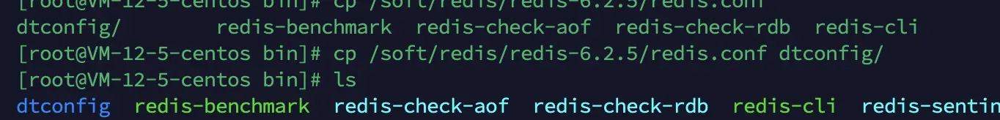
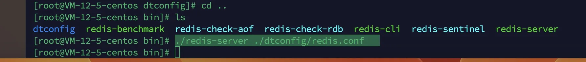
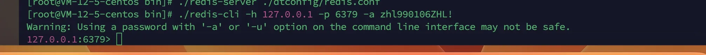
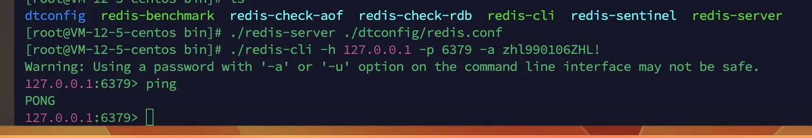

+++
date = '2025-12-12T08:31:52+08:00'
draft = true
title = 'Redis安装教程'
tags = ["Redis", "安装教程"]
series = ["安装教程"]
categories = ["中间件","Redis"] 
+++


# redis 安装教程
## 软件下载
### 下载与上传
我使用的是本地下载然后将文件上传至服务器的方式进行处理的。文件如下：



## 软件安装
将文件解压  unzip + 文件名，将文件解压后内容如下，结构和目录非常清晰。



bin文件和conf文件是我们要重点关注的东西，readme是了解这个下东西的基本介绍。

```java
// 安装 前置gcc (redis 是基于c++编写的)
yum install gcc-c++
```





```java
// 在redis的目录下执行 ( 下面两个依次执行 )  安装命令，确实是否是免安装版本
make 
make install
// 安装完成后，在相应目录下出现文件如下：
```



将redis的配置文件移动到该目录下



然后就是修改配置文件

```java
// 端口配置
port 6379
// 允许后台运行
daemonize yes
// 允许所有 ip 访问
bind 0.0.0.0
// 设置登录密码
requirepass zhl990106ZHL!
```

启动redis

```java
./redis-server ./dtconfig/redis.conf 
./redis-cli -h 127.0.0.1 -p 6379 -a zhl990106ZHL!
```







这样就安装完成了

