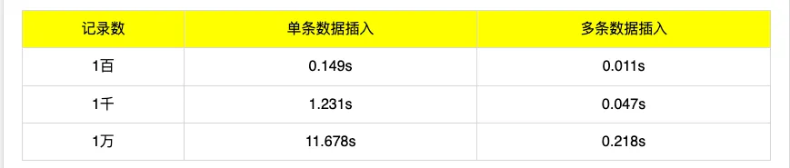
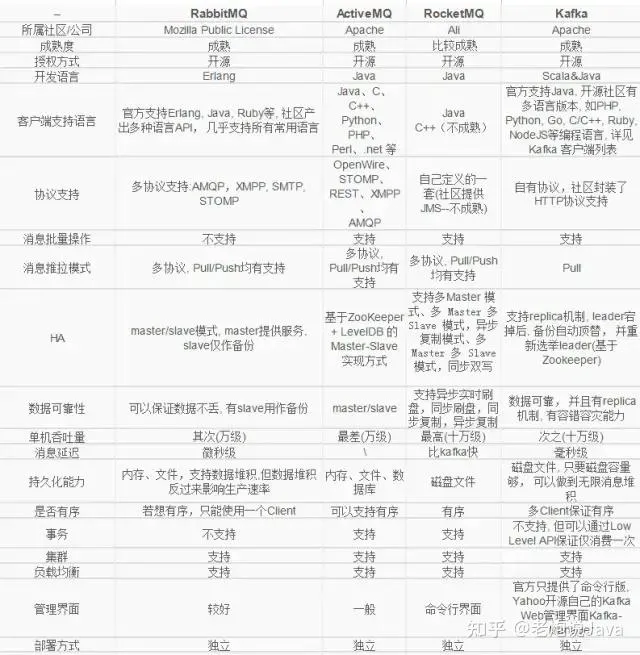
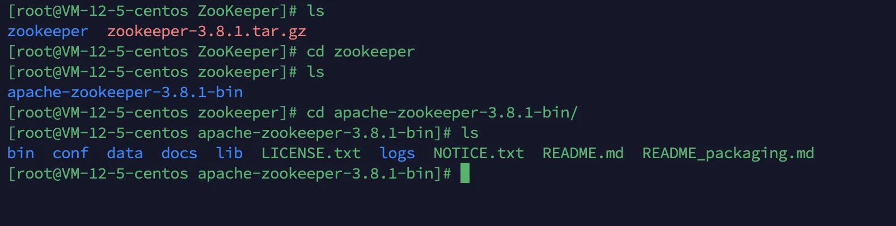

+++
date = '2026-10-21T09:06:52+08:00'
draft = true
title = 'Kafka使用简述'
tags = ["kafka","使用教程"]
series = ["使用教程"]
categories = ["数据接入", "kafka"]
+++

# Kafka使用教程
## <font style="color:rgb(79, 79, 79);">1. Kafka简介</font>
:::color1
Kafka是由Apache软件基金会开发的一个开源流处理平台，由Scala和Java编写。Kafka是一种高吞吐量的分布式发布订阅消息系统，它可以处理消费者在网站中的所有动作流数据。 这些数据通常是由于吞吐量的要求而通过处理日志和日志聚合来解决。 对于实时性要求比较高的日志数据和离线分析系统，Kafka就成为一种解决工具。

:::

### <font style="color:rgb(79, 79, 79);">1.1 主要特性</font>
:::color1
1. 通过O(1)的磁盘数据结构提供消息的持久化，这种结构对于即使数以TB的消息存储也能够保持长时间的稳定性能。
2. 高吞吐量，即使是非常普通的硬件Kafka也可以支持每秒数百万的消息。
3. 支持通过Kafka服务器和消费机集群来分区消息。
4. 支持Hadoop并行数据加载。

:::

:::color4
1. 因为数据存储形式为顺序io这样磁盘读取速度，减少了寻址的时间，但是这样就有一个缺陷，无法删除数据。
2. 采用了MMFile的，采用分页存储进行提高I/O利用率。

:::

### <font style="color:rgb(79, 79, 79);">1.2 消息队列的种类</font>
:::color1
<font style="color:rgb(0, 0, 0);">MQ分为两种: </font>

1. <font style="color:rgb(0, 0, 0);">P2P : peer to peer  点对点 				不可以重复消费    （梧州的消费方式与之类似）</font>
2. <font style="color:rgb(0, 0, 0);">Pub/Sub : 发布与订阅 					可以重复消费	   (广州局的消费方式与之类似)</font>

:::

### 1.3 kafka的服务
:::color1
topic : 主题，kafka处理的消息分为不同的分类，分类就是按照主题来划分。

broker：消息服务器的代理。kafka集群中的一个节点一般我都门都叫做一个broker；主要是用来存储消息。存在硬盘中。

partition：分区。Topic的在物理上的分组。一个topic在broker上被分为1个或者多个partition。分区在创建主题的时候指定的。

message：消息，通信的基本单位，每个消息属于某一个partition

Producer: 生产者，消息和数据都是由这个组件产生的，由它发送到kafka集群中的。

Consumer：消费者，消息和数据都是由这个组件来消费的。

Zookeeper: 他需要zk来做分布式协调

:::

## <font style="color:rgb(79, 79, 79);">2. Kafka使用</font>
kafka安装的教程在最后，首先安装Zookeeper然后再安装kafka。

### 2.1 依赖引入
:::color1
1. kafka的消费，首先是引入kafka的依赖。

:::

```java
<!-- 这是kafka的jar包  -->
<!-- https://mvnrepository.com/artifact/org.apache.kafka/kafka-streams -->
<dependency>
<groupId>org.apache.kafka</groupId>
<artifactId>kafka-streams</artifactId>
<version>3.4.0</version>
</dependency>
<!-- https://mvnrepository.com/artifact/org.springframework.kafka/spring-kafka -->
<dependency>
<groupId>org.springframework.kafka</groupId>
<artifactId>spring-kafka</artifactId>
<version>2.8.6</version>
</dependency>
```

### 2.2 消费者代码
```java
package com.xy.kafkatest.service.kafka;

import com.alibaba.fastjson.JSON;
import com.alibaba.fastjson.JSONObject;
import org.apache.kafka.clients.consumer.ConsumerRecord;
import org.springframework.beans.factory.annotation.Value;
import org.springframework.jdbc.core.JdbcTemplate;
import org.springframework.kafka.annotation.KafkaListener;
import org.springframework.stereotype.Component;


@Component
public class ReceiveKafkaData {

    @Value("${kafka.topic.name}")
    private String topicName;

    //    static {
    JdbcTemplate jdbcTemplate = new JdbcTemplate(DataSourceConfig.getDataSource());
    //    }


    private static String[] parsePatterns = {"yyyy-MM-dd","yyyy年MM月dd日",
                                             "yyyy-MM-dd HH:mm:ss", "yyyy-MM-dd HH:mm", "yyyy/MM/dd",
                                             "yyyy/MM/dd HH:mm:ss", "yyyy/MM/dd HH:mm", "yyyyMMdd"};

    /**
     *  消费
     *  his_hospital_1 是获取数据的标识，可在我kafka的发送博客中查看
     *  topics 里的数据在 我kafka的发送博客中
     *  TopicMessageDTO 在 kafka的发送博客中也有提到。不同的系统要把这个类复制过来
     *  SurgeryOrder你的数据对象而已 自己定义的要跟发送的数据一直
     *  @param record
     */
    @KafkaListener(topics = "#{'${kafka.topic.name}'.split(',')}" )
    public void consumerHisData(ConsumerRecord<String, String> record){
        // System.out.println("consumerHisData record :" + record);
        // Topic  通过这个获取表名称
        String topic = record.topic();
        // System.out.println("consumerHisData topic :" + topic);
        // TimeStamp  时间格式
        long timestamp = record.timestamp();
        // System.out.println("consumerHisData timestamp :" + timestamp);
        // value提前输出下
        // System.out.println("consumerHisData value :" + record.value());
        // value 数据
        JSONObject jsonObject = JSON.parseObject(record.value());      //转换成object
        // System.out.println("consumerHisData jsonObject :" + jsonObject);
        // 将topic解析了  获取表明   BLINK_DATASERVICE_{znaqydfx}_
        String tableName = topic.replace("BLINK_DATASERVICE_znaqydfx_", "");
        tableName = tableName.replace("GX_DSJPT_", "");
        tableName = changeTableName(tableName);
        // System.out.println("consumerHisData tableName :" + tableName);
        // 解析value到sql中
        StringBuffer sql = new StringBuffer("insert into " + tableName + "(");
        for (String key : jsonObject.keySet()){
            sql.append(key + ",");
        }
        sql.deleteCharAt(sql.length() - 1);
        sql.append(") values(");
        for (String key : jsonObject.keySet()){
            // Boolean flag = checkDate(jsonObject.get(key).toString());
            if (jsonObject.get(key) == null || jsonObject.get(key).equals("null") || jsonObject.get(key).equals("NULL")){
                sql.append(jsonObject.get(key) + ",");
            }else {
                sql.append("'" + jsonObject.get(key) + "',");
            }

        }
        sql.deleteCharAt(sql.length() - 1);
        sql.append(")");
        // System.out.println(sql.toString());

        try {
            jdbcTemplate.execute(sql.toString());
        }catch (Exception e){
            e.printStackTrace();
        }
    }

    public String changeTableName(String tableName) {
        if (tableName.equals("MK_CU_ELEC_CUST") || tableName.equals("MK_CU_ELEC_CUST_POWER") || tableName.equals("MK_PG_RUN_TRANSF") || tableName.equals("MK_CU_RUN_IT") ||
            tableName.equals("MK_SV_IMP_CUST") || tableName.equals("MK_MC_EMS_TERM_RELA_RECORD") || tableName.equals("MK_CU_RUN_METER") || tableName.equals("MK_MC_METER_TECH_PARAM") ||
            tableName.equals("MK_MC_METER_FAULT_DEAL_TASK") || tableName.equals("MK_CU_MP") || tableName.equals("MK_CU_CHECK_RUN_TRANSF") || tableName.equals("MK_SV_CHECK_PLAN_DET") ||
            tableName.equals("MK_SV_STEAL_INF") || tableName.equals("MK_SV_CHECK_RECORD") || tableName.equals("MK_SV_CHECK_REFORM_INF") || tableName.equals("MK_SV_REFORM_DET") ||
            tableName.equals("MK_SV_ACCI_SURVEY") || tableName.equals("MK_CA_MP_INF") || tableName.equals("MK_BI_ARREARS_RECORD")){
            return "YXXT_" + tableName;
        }else if (tableName.equals("KH_YDKH_LS_04") || tableName.equals("DW_YXBYQ_LS_04") || tableName.equals("KH_JLDYXBYQGX_LS_04") || tableName.equals("KH_JLDDNBGX_LS_04") ||
            tableName.equals("KH_JLD_LS_04") || tableName.equals("FH_JLDFHJZ_LS_04") || tableName.equals("PBYX_BYQFZL_LS_04") || tableName.equals("SB_YXDNB_LS_04")) {
            return "JLXT_" + tableName.replace("_LS_04","");
        }
            return null;
        }

    }
```

### 2.3 消费者主题
```yaml
kafka:
  topic:
    # kafka 接数的 topic
    name: BLINK_DATASERVICE_znaqydfx_GX_DSJPT_MK_CU_ELEC_CUST,BLINK_DATASERVICE_znaqydfx_GX_DSJPT_MK_CU_ELEC_CUST_POWER,BLINK_DATASERVICE_znaqydfx_GX_DSJPT_MK_PG_RUN_TRANSF,BLINK_DATASERVICE_znaqydfx_GX_DSJPT_MK_CU_RUN_IT,BLINK_DATASERVICE_znaqydfx_GX_DSJPT_MK_SV_IMP_CUST,BLINK_DATASERVICE_znaqydfx_GX_DSJPT_MK_MC_EMS_TERM_RELA_RECORD,BLINK_DATASERVICE_znaqydfx_GX_DSJPT_MK_CU_RUN_METER,BLINK_DATASERVICE_znaqydfx_GX_DSJPT_MK_MC_METER_TECH_PARAM,BLINK_DATASERVICE_znaqydfx_GX_DSJPT_MK_MC_METER_FAULT_DEAL_TASK,BLINK_DATASERVICE_znaqydfx_GX_DSJPT_MK_CU_MP,BLINK_DATASERVICE_znaqydfx_GX_DSJPT_MK_CU_CHECK_RUN_TRANSF,BLINK_DATASERVICE_znaqydfx_GX_DSJPT_MK_SV_CHECK_PLAN_DET,BLINK_DATASERVICE_znaqydfx_GX_DSJPT_MK_SV_STEAL_INF,BLINK_DATASERVICE_znaqydfx_GX_DSJPT_MK_SV_CHECK_RECORD,BLINK_DATASERVICE_znaqydfx_GX_DSJPT_MK_SV_CHECK_REFORM_INF,BLINK_DATASERVICE_znaqydfx_GX_DSJPT_MK_SV_REFORM_DET,BLINK_DATASERVICE_znaqydfx_GX_DSJPT_MK_SV_ACCI_SURVEY,BLINK_DATASERVICE_znaqydfx_GX_DSJPT_MK_CA_MP_INF,BLINK_DATASERVICE_znaqydfx_GX_DSJPT_MK_BI_ARREARS_RECORD,BLINK_DATASERVICE_znaqydfx_GX_DSJPT_KH_YDKH_LS_04,BLINK_DATASERVICE_znaqydfx_GX_DSJPT_DW_YXBYQ_LS_04,BLINK_DATASERVICE_znaqydfx_GX_DSJPT_KH_JLDYXBYQGX_LS_04,BLINK_DATASERVICE_znaqydfx_GX_DSJPT_KH_JLDDNBGX_LS_04,BLINK_DATASERVICE_znaqydfx_GX_DSJPT_KH_JLD_LS_04,BLINK_DATASERVICE_znaqydfx_FH_JLDFHJZ,BLINK_DATASERVICE_znaqydfx_GX_DSJPT_PBYX_BYQFZL_LS_04,BLINK_DATASERVICE_znaqydfx_GX_DSJPT_SB_YXDNB_LS_04
```

### 2.4 生产者代码
```java
/**
 * 送检订单推送到kafka
 * @param orderList 要发送的数据 T泛型
 * @param hospitalId 医院id
 * @param submitType 发送的 数据类型
 */
@ApiOperation("业扩工单走廊-工单详细信息列表")
@PostMapping("/kafkaTest")
private <T> void sendToKafka(@RequestBody Map<String,Object> map) {
    List<T> orderList = (List<T>) map.get("orderList");
    Integer hospitalId = (Integer) map.get("hospitalId");
    String submitType = (String) map.get("submitType");
    String topic = (String) map.get("topic");


    TopicMessageDTO<List<T>> topicMessageDTO = new TopicMessageDTO<>();
    // 获取kafka的标识 由 his_hospital_+ 医院id（hospitalId）
    topicMessageDTO.setTopicName(topic);
    topicMessageDTO.setMessageType(submitType);
    topicMessageDTO.setActionCode("created");
    topicMessageDTO.setTimestamp(new Date().toString());
    topicMessageDTO.setKeyValue(hospitalId+"");
    topicMessageDTO.setHospitalId(hospitalId);
    topicMessageDTO.setData(orderList);
    kafkaProducerService.send(topicMessageDTO);
}
```

```java
package com.xy.springsecurity.service.kafka;

import com.alibaba.fastjson.JSON;
import org.apache.commons.lang3.StringUtils;
import org.springframework.kafka.core.KafkaTemplate;
import org.springframework.stereotype.Service;

import javax.annotation.Resource;

@Service
public class KafkaProducerService {

    @Resource
    private KafkaTemplate<String,Object> kafkaTemplate;

    /**
     * 异步发送kafka消息
     * @param topicMessageDTO
     * @return
     */
    public void synchronousSend(TopicMessageDTO topicMessageDTO){
        if(StringUtils.isNotEmpty(topicMessageDTO.getKeyValue())){
            kafkaTemplate.send(topicMessageDTO.getTopicName()
                               ,topicMessageDTO.getKeyValue(), JSON.toJSONString(topicMessageDTO));
        }else {
            kafkaTemplate.send(topicMessageDTO.getTopicName(), JSON.toJSONString(topicMessageDTO));
        }
    }
    // 一般用这个方法
    public boolean send(TopicMessageDTO topicMessageDTO){
        try {
            if(StringUtils.isNotEmpty(topicMessageDTO.getKeyValue())){
                kafkaTemplate.send(topicMessageDTO.getTopicName()
                                   ,topicMessageDTO.getKeyValue(),JSON.toJSONString(topicMessageDTO)).get();
            }else {
                kafkaTemplate.send(topicMessageDTO.getTopicName(),JSON.toJSONString(topicMessageDTO)).get();
            }
        } catch (Exception e) {

            //            throw new MyException(ExceptionMsg.KAFAK_SEND_ERROR.getCode(),ExceptionMsg.KAFAK_SEND_ERROR.getMsg());
        }
        return true;
    }
}
```

## <font style="color:rgb(79, 79, 79);">3. Kafka使用中的问题和解决方案</font>
### 3.1 数据接入缓慢
:::color1
通过分析，数据接入瓶颈主要由于insert语句导致。

1. 采用批量插入语句进行插入。
2. 采用异步方式进行插入。 	

:::

<!-- 这是一张图片，ocr 内容为：单条数据插入 记录数 多条数据插入 1百 0.149S 0.011S 1千 1.231S 0.047S 1万 11.678S 0.218S -->


[https://www.modb.pro/db/619137](https://www.modb.pro/db/619137)

[http://anyun.org/a/jishuguanzhu/DataBase/Mysql/2014/1217/3941.html](http://anyun.org/a/jishuguanzhu/DataBase/Mysql/2014/1217/3941.html)


### 3.2 数据接入方式不一致
:::color1
广州局的kafka数据接入是实时发送数据，并进行接受。

在梧州项目中，是需要首先执行请求，然后第三方按照请求进行sql拼接，取得数据，传到kafka，我们再接受。

:::

### 3.3 数据不能重复接收
:::color1
在梧州项目中，要接入最近几年的数据，单次接入数据量比较大，但是因为表结构有异常，然后重新修改表结构，导致部分数据有异常，所以就只能等数据接完重新接入。

方案：1. 后面就接入一个月数据，作为测试数据，将表结构修改好后，清空表结构，再进行大量数据的接入。

:::

### 3.4 Kafka接入的数据出现乱码
:::color1
项目启动的时候需要增加   -Dfile.encoding=utf-8

:::


资料参考

[https://blog.csdn.net/m0_51197424/article/details/120766914](https://blog.csdn.net/m0_51197424/article/details/120766914)

[https://www.cnblogs.com/javammc/p/15230299.html](https://www.cnblogs.com/javammc/p/15230299.html)


<!-- 这是一张图片，ocr 内容为：RABBITMQ ROCKETMQ ACTIVEMQ KAFKA MOZLLA PUBLIC LICENSE 所属社区公司 APACHE APACHE AL 比较成熟 成款 成款度 成熟 成变热 开源 开源 授权方式 开源 开源 开发语言 SCALA&JAVA ERLANG JAVA JAVA 官方支持JAVA.开源社区有 JAVA,C 多语言版本,如PHP. C++. 官方支持ERLANG,JAVA,RUBY等,社区产 JAVA PYTHON. 客户端支持语言 PYTHON,GO,C/C++.RUBY. 出多种语言API,几乎支持所有常用语言 C++(不成熟) PHP NODEJS等编程语言,详见 PERL, NET等 KAFKA 客户端列表 OPENWIRE, 自己定义的一 STOMP 多协议支持:AMQP,XMPP,SMTP. 自有协议,社区封装了 协议支持 套(社区提供 REST,XMPP HTTP协议支持 STOMP JMS-不成熟 AMOP 支持 支持 支持 消息批量操作 不支持 多协议 多协议.PULL/PUSH 消息推拉模式 多协议,PUIL/PUSH均有支持 PULL/PUSH均有 PULL 均有支持 支持 支持多MASTER 模 式,多 MASTER 多 基于ZOOKEEPER 支持REPLICA机制,LEADER容 SLAVE 模式,异步 掉后,备份自动项替,并重 MASTER/SLAVE模式,MASTER提供服务. LEVEIDB的 HA 复制模式,多 新选举LEADER(基于 SLAVE仅作备份 MASTER-SLAVE 多SLAVE MASTER 实现方式 ZOOKEEPER) 模式,同步双写 支持异步实时刷 数据可靠,并且有REPLICA 盘,同步刷盘,同 可以保证数据不丢.有SLAVE用作备份 数据可靠性 MASTER/SLAVE 机制,有容错容灾能力 步复制,异步复制 其次万级) 最差(万级) 次之(十万级) 最高(十万级) 单机香吐量 比KATKA快 消息延迟 毫秒级 徽秒级 磁盘文件,只要磁盘容量 内存,文件,支持数据堆积,但数据堆积 内存,文件,数 磁盘文件 持久化能力 够,可以做到无限消息堆 反过来影响生产速率 据库 多CLIENT保证有序 是否有序 若想有序,只能使用一个CLIENT 可以支持有序 有序 不支持,但可以通过LOW 不支持 事务 支持 支持 LEVEL API保证仅消费一次 支持 集群 支持 支持 支持 负载均衡 支持 支持 支持 支持 官方只提供了命令行版 YAHOO开源自己的KA 较好 命令行界面 管理界面 一般 WEB管理界面KAFKA 知乎@老购说LAVA 独立 独立 独立 部署方式 独立 -->



# Zookeeper安装教程
## 1. 概述
因为公司需要使用 KafKa 来进行接数据，所以需要安装，但是前置条件是需要安装这个 ZooKeeper

## <font style="color:#000000;">2. 提前准备</font>
:::tips
1.  需要提前安装 java 
2.  准备Zookeeper安装包
3.  参考资料   [https://blog.csdn.net/Eternal_Blue/article/details/94762494](https://blog.csdn.net/Eternal_Blue/article/details/94762494) 

:::

## 3. 开始安装
:::tips
<!-- 这是一张图片，ocr 内容为：ZOOKEEPER]# LS [ROOT@VM-12-5-CENTOS Z ZOOKEEPER-3.8.1.TAR.GZ ZOOKEEPER [ROOT@VM-12-5-CENTOS ZOOKEEPER]# CD ZOOKEEPER [ROOT@VM-12-5-CENTOS ZOOKEEPER]# LS APACHE-ZOOKEEPER-3.8.1-BIN [ROOT@VM-12-5-CENTOS ZOOKEEPER]# CD APACHE-ZOOKEEPER-3.8.1-BIN/ [ROOT@VM-12-5-CENTOS APACHE-ZOOKEEPER-3.8.1-BIN]# LS LIB NOTICE.TXT  README.MD  README_PACKAGING.MD LOGS LICENSE.TXT BIN CONF DATA DOCS APACHE-ZOOKEEPER-3.8.1-BIN]# [ROOT@VM-12-5-CENTOS -->


1. 将压缩文件解压后.
2. 创建两个文件夹 data、logs
3. 将 conf文件夹下的  zoo_sample.cfg 改名字为 zoo.cfg 

将zoo.cfg的<font style="color:rgb(150, 152, 150);">  
</font><font style="color:rgb(150, 152, 150);">	dataDi</font><font style="color:rgb(196, 196, 200) !important;">r=/usr/local/zookeeper/apache-zookeeper-</font><font style="color:rgb(222, 147, 95);">3.5.5</font><font style="color:rgb(196, 196, 200) !important;">/</font><font style="color:rgb(178, 148, 187);">data  改为你创建的那个 data文件夹</font>

4. 启动命令  bin/zkServer.sh start
5. 使用JPS命令就可以查询到进程信息，QuorumPeerMain就是Zookeeper的进程


补充命令 


重启命令    bin/zkServer.sh restart

停止命令    bin/zkServer.sh stop

客户端启动  bin/zkCli.sh

:::


# <font style="color:rgb(34, 34, 38);">kafka软件安装</font>
## 1. 概述
因为需要做数据接入功能的开发，所以使用到了kafka的工具。不过测试不好测试，所以就在远程服务器安装一个kafka，来进行测试，故记录此次安装过程为以后做积累。

## 2. 提前准备
:::tips
1. 需要安装 Zookeeper 
2. 将程序包放入服务器上。(程序包很好搞)

:::

## 3. 开始安装
:::tips
1. 将压缩包解压   

tar -xzf kafka_2.11-0.11.0.2.tgz

2. 进入文件下，修改  vi config/server.properties 

<!-- 这是一张图片，ocr 内容为：# CD KAFKA_2.11-0.11.0.2 [ROOT@VM-12-5-CENTOS KAFKA]# CD WEL [ROOTQVM-12-5-CENTOS KAFKA_2.11-0.11.0.2]# LS  LICENSE  NOTICE  SITE-DOCS G LIBS LI BIN CONFIG [ROOTAVM-12-5-CENTOS KAFKA_2.11-0.11.0.2]# VI CONFIG/SERVER.PROPERTIES [ROOT@VM-12-5-CENTOS KAFKA_2.11-0.11.0.2]# -->


修改这个的  <font style="color:rgb(0, 0, 0);">zookeeper.connect=192.168.1.202:2181</font>

修改  vi bin/kafka-run-class.sh 去查看问题，因为java的路径是分块安装的。

3. bin/kafka-server-start.sh config/server.properties 启动kafka
4.  去  /lib/systemd/system 下面新建一个 kafka.service 将命令放入

[Unit]

Description=kafkaservice

After=network.target


[Service]

WorkingDirectory=/soft/KafKa/kafka_2.11-0.11.0.2

ExecStart=/soft/KafKa/kafka_2.11-0.11.0.2/bin/kafka-server-start.sh config/server.properties

ExecStop=/soft/KafKa/kafka_2.11-0.11.0.2/bin/kafka-server-stop.sh

User=root

Group=root

Restart=always

RestartSec=10


[Install]

WantedBy=multi-user.target

4.  让自启动生效   systemctl enable kafka.service  
5.  立即启动服务   systemctl start kafka.service
6. 查看启动状态    systemctl status kafka.service

:::

