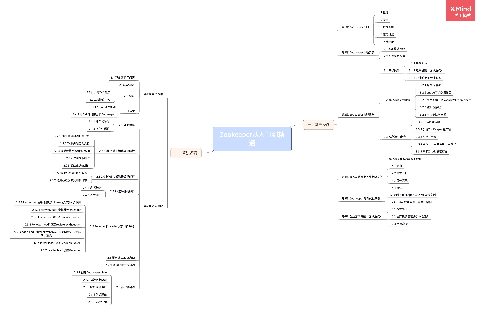
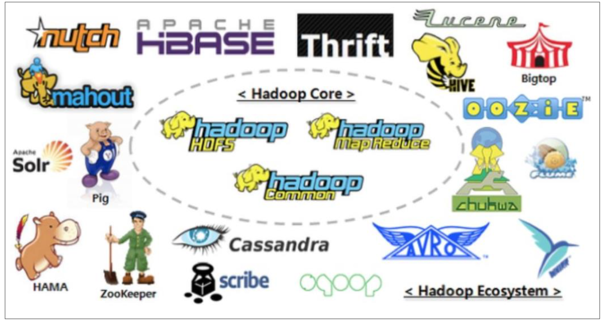

+++
date = '2025-12-09T10:00:00+08:00'
draft = true
title = 'Zookeeper使用教程'
tags = ["Zookeeper","使用教程"]
series = ["使用教程"]
categories = ["分布式", "Zookeeper"]
+++

# Zookeeper使用教程

本文尚硅谷平台，仅学习使用。

## 1 Zookeeper入门

### 1.1 概述

Zookeeper是一个开源的分布式的，为分布式框架提供协调服务的 Apache 项目。

**Zookeeper工作机制**

Zookeeper从设计模式角度来理解：是一个基于观察者模式设计的分布式服务管理框架，它负责存储和管理大家都关心的数据，然后接受观察者的注册，一旦这些数据的状态发生变化，Zookeeper就将负责通知已经在Zookeeper上注册的那些观察者做出相应的反应。

Zookeeper=文件系统+通知机制

### 1.2 Zookeeper特点

1. Zookeeper：一个领导者（Leader），多个跟随者（Follower）组成的集群。
2. 集群中只要有半数以上节点存活，Zookeeper集群就能正常服务。所以Zookeeper适合安装奇数台服务器。
3. 全局数据一致：每个Server保存一份相同的数据副本，Client无论连接到那个Server，数据都是一致的。
4. 更新请求顺序执行，来自同一个Client的更新请求按其发送顺序依次执行。
5. 数据更新原子性，一次数据更新要么成功，要么失败。
6. 实时性，在一定时间范围内，Client能读到最新数据。

### 1.3 数据结构

Zookeeper数据模型的结构与Unix文件系统很类似，整体上可以看做是一棵树，每个节点称作一个ZNode。每一个ZNode默认能够存储1MB的数据，每个ZNode都可以通过其路径唯一标识。

### 1.4 应用场景

提供的服务包括：统一命名服务、统一配置管理、统一集群管理、服务器节点动态上下线、软负载均衡等。

- **统一命名服务**：在分布式环境下，经常需要对应用/服务进行统一命名，便于识别。
- **统一配置管理**：分布式环境下，配置文件同步非常常见。可将配置信息写入Zookeeper上的一个ZNode，各个客户端服务器监听这个ZNode。
- **统一集群管理**：实时掌握每个节点的状态是必要的。可以将节点信息写入Zookeeper上的一个ZNode，监听这个ZNode可获取它的实时状态变化。
- **服务器动态上下线**：客户端能实时洞察到服务器上下线的变化。
- **负载均衡**：在Zookeeper中记录每台服务器的访问数，让访问数最少得服务器去处理最新的客户端请求。

### 1.5 下载地址

官网首页：Apache ZooKeeper

## 2 Zookeeper本地安装

### 2.1 本地模式安装

1. 安装前准备：安装JDK
2. 拷贝apache-zookeeper-3.5.7-bin.tar.gz安装包到Linux系统下
3. 解压到指定目录
4. 修改名称

**配置修改**

1. 将/opt/module/zookeeper-3.5.7/conf这个路径下的 zoo_sample.cfg 修改为 zoo.cfg
2. 打开 zoo.cfg 文件，修改dataDir 路径
3. 在/opt/module/zookeeper-3.5.7/这个目录上创建 zkData文件夹

**操作Zookeeper**

1. 启动Zookeeper
2. 查看进程是否启动
3. 查看状态
4. 启动客户端
5. 退出客户端
6. 停止Zookeeper

### 2.2 配置参数解读

Zookeeper中的配置文件 zoo.cfg 中参数含义解读如下：

- `tickTime=2000`: 通信心跳时间，Zookeeper服务器与客户端心跳时间，单位毫秒
- `initLimit=10`：LF初始通信时限，Leader和Follower初始链接时能容忍的最多心跳数（tickTime的数量）
- `syncLimit=5`：LF同步通信时限，Leader和Follower之间通信时间如果超过syncLimit * tickTime，Leader认为Follower死掉，从服务器列表中删除Follower。
- `dataDir`：保存Zookeeper中的数据，注意：默认的tmp目录，容易被linux系统定期删除，所以一般不用默认的tmp目录。
- `clientPort=2181`：客户端连接端口，通常不做修改。

## 3 Zookeeper基础操作

### 3.1 集群操作

#### 3.1.1 集群安装

1. 集群规划：在hadoop102、hadoop103和hadoop104三个节点上都部署Zookeeper
2. 解压安装
3. 配置服务器编号：在zkData目录下创建myid文件，添加与server对应的编号
4. 配置zoo.cfg文件
5. 集群操作：分别启动Zookeeper，查看状态

#### 3.1.2 选举机制（面试重点）

**SID**：服务器ID，用来唯一标识一台Zookeeper集群中的机器，每台机器不能重复，和myid一致。

**ZXID**：事务ID。用来标识一次服务器状态的变更。

**Epoch**：每个Leader任期的代号。

**第一次启动选举流程：**
1. 服务器1启动，发起一次选举，投给自己一票
2. 服务器2启动，服务器1发现服务器2的myid比自己大，更改选票为推举服务器2
3. 服务器3启动，服务器1和2都会更改选票为服务器3，服务器3当选Leader
4. 服务器4、5启动，服从多数，更改选票信息为服务器3

**非第一次启动选举规则：**
1. EPOCH大的直接胜出
2. EPOCH相同，事务id大的胜出
3. 事务id相同，服务器id大的胜出

### 3.2 客户端命令行操作

| 命令 | 功能描述 |
|------|----------|
| help | 显示所有操作命令 |
| ls path | 查看当前znode的子节点（可监听） |
| create | 普通创建（-s 含有序列，-e 临时） |
| get path | 获得节点的值（可监听） |
| set | 设置节点的具体值 |
| stat | 查看节点状态 |
| delete | 删除节点 |
| deleteall | 递归删除节点 |

### 3.3 客户端API操作

包括IDEA环境搭建、创建Zookeeper客户端、创建子节点、获取子节点并监听节点变化、判断ZNode是否存在等。

### 3.4 客户端向服务端写数据流程

## 4 服务器动态上下线监听案例

## 5 Zookeeper分布式锁案例

### 5.1 原生Zookeeper实现分布式锁案例

### 5.2 Curator框架实现分布式锁案例

## 6 企业面试真题（面试重点）

### 6.1 选举机制

### 6.2 生产集群安装多少zk合适？

### 6.3 常用命令

