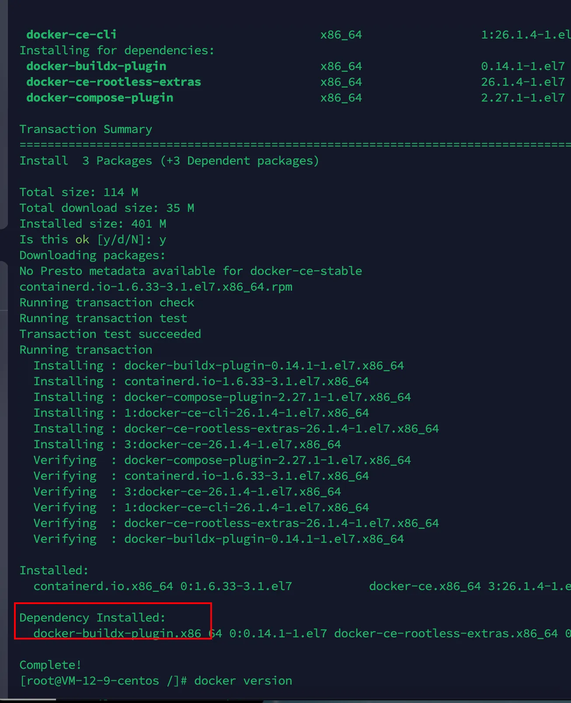
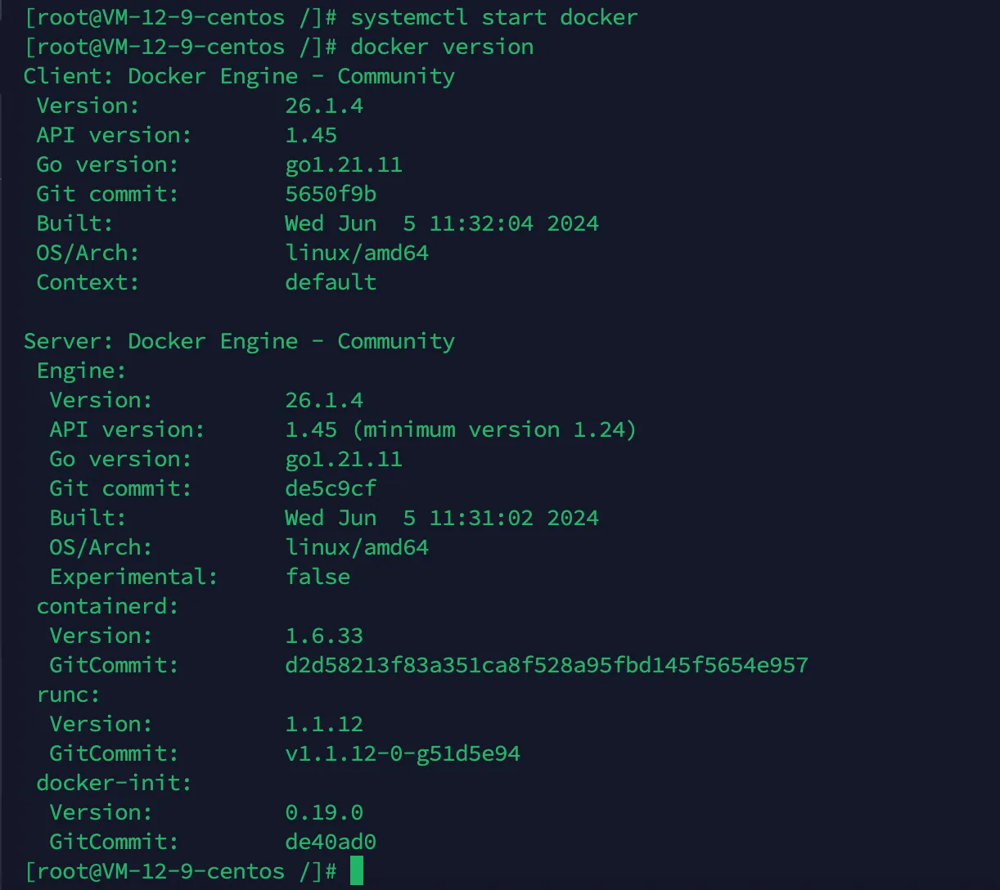
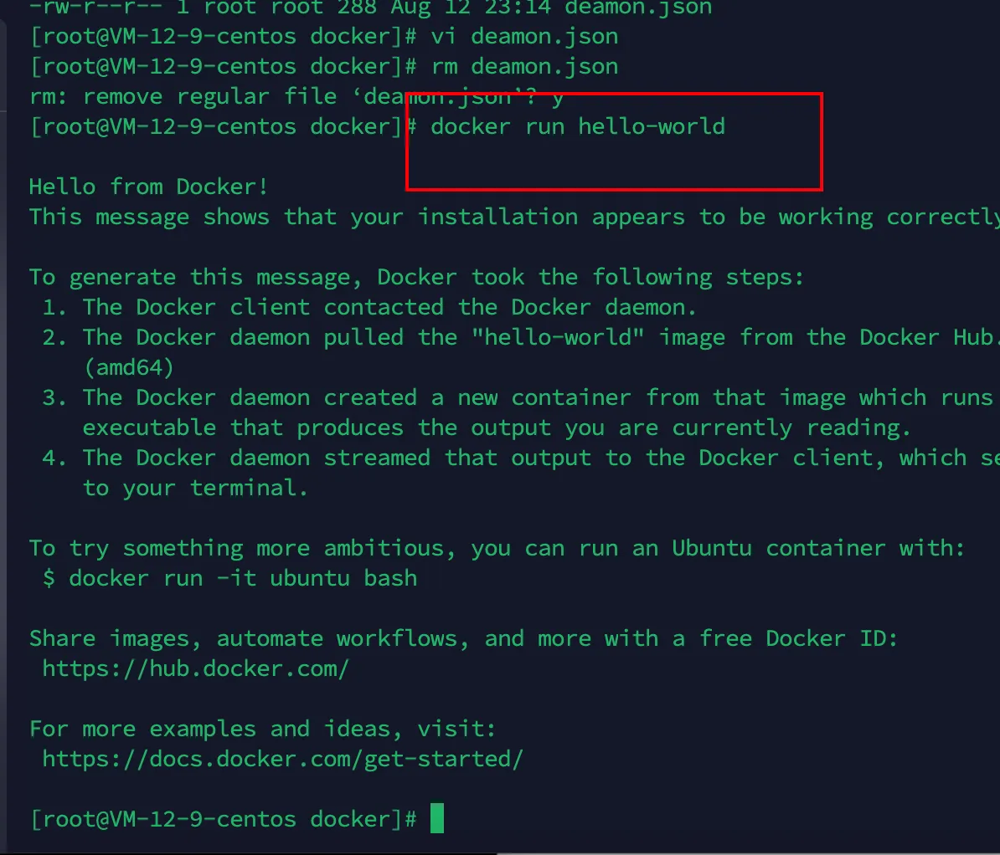
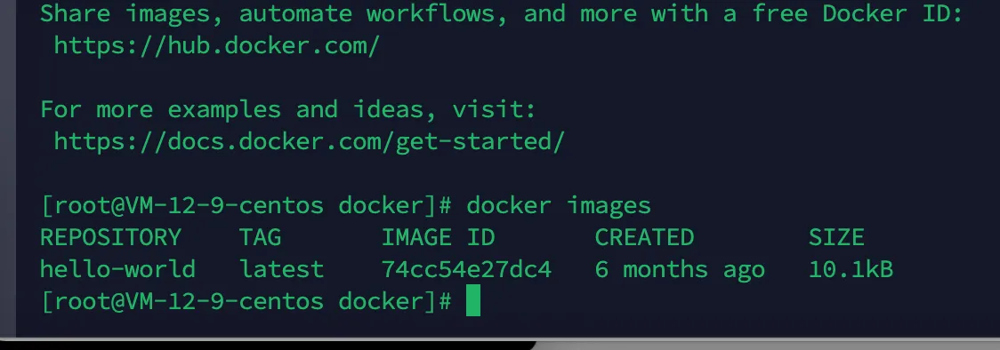
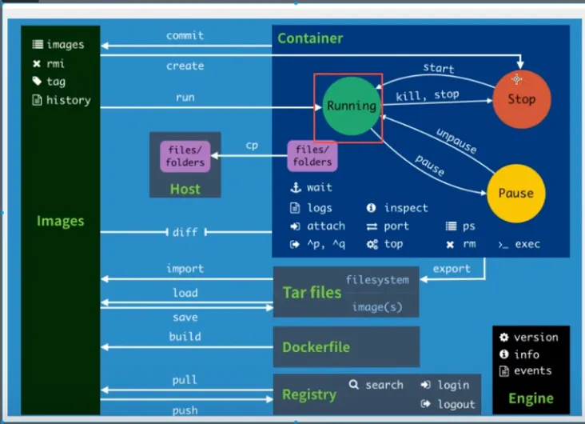
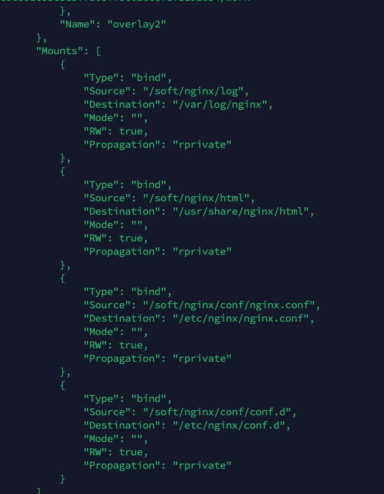

+++
date = '2026-02-04T08:06:52+08:00'
draft = true
title = 'docker使用教程'
tags = ["docker","使用教程"]
series = ["使用教程"]
categories = ["自动部署", "docker"]
+++


## 学习计划
使用三更的教学进行初步学习docker的使用  -  <font style="color:rgb(24, 25, 28);">Docker实战教程</font>

[Docker实战教程-从零到实战-Docker容器化-DockerFile&DockerCompose-挑战尚硅谷&黑马_哔哩哔哩_bilibili](https://www.bilibili.com/video/BV1FC4y157gK/?spm_id_from=333.1387.favlist.content.click&vd_source=0101ecad56b5fc14c743923002bbc428)

因为边工作边学习，所以很多知识都不是很深刻，所以继续使用- <font style="color:rgb(24, 25, 28);">Docker最新超详细版教程通俗易懂</font>

教程进行二次学习，了解使用过程中的相关细节。

[【狂神说Java】Docker最新超详细版教程通俗易懂_哔哩哔哩_bilibili](https://www.bilibili.com/video/BV1og4y1q7M4/?spm_id_from=333.337.search-card.all.click&vd_source=0101ecad56b5fc14c743923002bbc428)

来自好大哥们的资料。

[https://yeasy.gitbook.io/docker_practice/network/linking](https://yeasy.gitbook.io/docker_practice/network/linking)

## 概述
### docker为什么出现
一套系统两个多个环境

可能会出现，本地可以运行但是生产运行存在问题。   (思考，那如果部署多套环境，是不是数据库，redis，服务器型号等都要有一套一模一样的)

解析 环境一致，docker安装的时候环境一致，docker的目的。

传统的部署: 开发出jar包，运维人员进行部署。

现在的部署: 开发打包部署上线，一套流程做完。

隔离: docker核心思想，打包装箱，每个程序互相隔离。

## docker的安装
```shell
cat /etc/os-release
```

```shell
yum remove docker \
  docker-client \
  docker-client-latest \
  docker-common \
  docker-latest \
  docker-latest-logrotate \
  docker-logrotate \
  docker-engine
```

```shell
sudo yum install -y yum-utils
```

```shell
sudo yum-config-manager\
  --add-repo \
  http://mirrors.aliyun.com/docker-ce/linux/centos/docker-ce.repo
```

```shell
yum makecache fast
```

```shell
yum install docker-ce docker-ce-cli containerd.io
```

<!-- 这是一张图片，ocr 内容为： -->


```shell
systemctl start docker
```

<!-- 这是一张图片，ocr 内容为： -->


```shell
docker run hello-world
```

<!-- 这是一张图片，ocr 内容为： -->


```shell
docker images
```

<!-- 这是一张图片，ocr 内容为： -->


```shell
sudo yum remove docker-ce docker-ce-cli containerd.io

sudo rm -rf /var/lib/docker
```

## docker的常用命令
```shell
docker version   
docker info
docker --help
```

### docker命令


### 镜像命令
```shell
[root@VM-12-9-centos ~]# docker images
REPOSITORY    TAG       IMAGE ID       CREATED        SIZE
hello-world   latest    74cc54e27dc4   6 months ago   10.1kB

#注释
REPOSITORY  镜像的仓库源
TAG  				标签
IMAGE ID  	镜像id
CREATED			镜像创建时间
SIZE				镜像的大小

# 
  -a 	 --all		列出所有的镜像
  -q 	 --quiet	只显示进行的id
```

```shell
由于不可描述之原因，docker 官方已经禁止大陆访问其服务器，
因此，搜索镜像时应当采用 ${镜像源域名}/${搜索关键字} 的模式，
这里假设您的 registry-mirrors 配置了 docker.1ms.run ：


docker search docker.1ms.run/<Keyword>
```

```shell
docker pull mysql

docker pull mysql:xxx

[root@VM-12-9-centos ~]# docker pull mysql
Using default tag: latest					# 如果不写  tag，默认就是  latest
latest: Pulling from library/mysql
10aec8a104c7: Pull complete 			# 分层下载，docker image的核心 联合文件系统
c81e70a25040: Pull complete 
b9916866e45f: Pull complete 
cac9e6e2c9d6: Pull complete 
5d2f76605aa7: Pull complete 
31f7d8dc4024: Pull complete 
f15cc21449ca: Pull complete 
a22f87a7c498: Pull complete 
e55b6f427ac7: Pull complete 
fcb1221d0ce3: Pull complete 
Digest: sha256:a776e89aad2d425c248ccfb840115aaa52883499ff36512db4d503b11aae455a
Status: Downloaded newer image for mysql:latest
docker.io/library/mysql:latest		# 真实地址

```

```shell
docker rmi -f  容器id   # 按照id删除
docker rmi -f  ${docker image -aq}   # 全部删除
```

### 容器命令
```shell
docker pull centos
```

```shell
docker run [可选参数] image 

参数说明
--name="Name"			容器名字   
-d								后台方式运行
-it								使用交互方式运行
-p 								指定容器的端口  -p  8080:8080	
  -p 主机端口:容器端口
  -p 容器端口
  容器端口
-P								随机指定端口
```

```shell
docker run -it centos /bin/bash
```

```shell
exit
Ctrl + P + Q 
```

```shell
docker ps -a			# 全部
docker ps					# 当前运行的
docker ps -aq			# 全部 只显示编号
```

```shell
exit # 直接容器停止并退出
Ctrl + P + Q # 容器不停止退出
```

```shell
docker rm 容器id										# 删除指定容器
docker rm -rf ${docker ps -aq}		# 删除全部容器
docker ps -a -q|xargs docker rm		# 删除所有容器
```

```shell
docker start 容器id 		# 启动容器
docker restart 容器id	# 重启容器
docker stop 容器id			# 停止当前运行的容器
docker kill 容器id		 	# 强制停止当前容器
```

### 常用其他命令
```shell
docker run -d 容器名		# 启动完后，发现容器停止

# docker 容器使用后台运行，就必须要有一个前台进程，容器发现没有应用，就会自动停止。
# nginx，容器启动后，发现自己没有提供服务，就会立刻停止，就是没有程序了
```

```shell
docker logs -f -t --tail 容器id

# 自己编写一段shell脚本
"while true;do echo kuangshen;sleep 1;done"

docker logs -tf --tail 10 容器名称/容器id

# 追加命令
docker update --restart always mysql 
```

#### 查看容器内部的进程信息
```shell
docker top 容器名称/容器id
```

```shell
docker inspect --help

docker inspect id

```

进入当前正在运行的容器

```shell
docker ps
# 方式一
docker exec -it 容器id/容器名 /bin/bash
ps -ef 
# 方式二
docker attach  容器id/容器名
```

<!-- 这是一张图片，ocr 内容为： -->


## 作业练习
`Docker安装nginx`

```powershell
# 1. 搜索镜像 ( search ) 建议大家去docker搜索，可以看到帮忙文档
# 2. 下载镜像 ( pull )
# 3. 运行测试 
# 查看镜像
docker images
# 运行镜像
docker run -d --name nginx -p 9002:80 nginx
# -d 后台运行
# 测试镜像运行情况
curl localhost:9002
```

```powershell
docker run -it --rm tomcat:9.0

# 容器停止之后，容器就删除了(测试使用比较好)
```


## 容器数据卷
### 什么是数据卷
将应用和环境打包成一个镜像!

如果数据都在容器中，那么我们容器删除，数据就会丢失，需求，数据可以持久化

Mysql，容器删除了，= 删库

容器之间可以有一个数据共享技术！Docker 容器中产生的数据，同步到本地！

这个就是卷技术！

将容器内的目录挂载出来！类似同步机制

容器的持久化和同步操作！容器间也是可以数据共享的

使用数据卷

```shell
# 使用命令挂载 -v
docker run -it -v 主机目录地址:容器内目录 
# 这个-v 可以类似 -p

docker inspect 容器id # 查看容器详情
# Mounts 挂载
```

<!-- 这是一张图片，ocr 内容为： -->


:::info
如果容器没有启动，数据依旧会同步数据

:::

### 实战: 安装mysql
:::info
mysql的数据持久化问题

:::

```shell
# 获取镜像

# 运行容器，需要做数据挂载
docker run -d -p 3390:3306  \
-v /soft/mysql/conf:/etc/mysql/conf \
-v /soft/mysql/data:/var/lib/mysql \
-e MYSQL_ROOT_PASSWORD=zhl990106ZHL \
--name mysql \
mysql:latest

# 在本地测试创建一个数据库，查看一下我们映射的路径是否ok
```

 	假设我们将容器删除，我们挂载到本地的数据卷依旧存在，没有丢失。这就实现了容器数据持久化功能

### 匿名/具名挂载
```shell
# -v 容器内路径
docker run -d -P --name nginx01 -v /etc/nginx nginx
# 此时数据卷是乱码，所以是匿名挂载

# 通过 -v 卷名:容器内路径 挂载
# 查看卷名详情
docker volume inspect 卷名

# 查看数据卷
docker volume --help 

# 如何确定是具名挂载还是匿名挂载 
-v 容器内路径					# 匿名挂载
-v 卷名: 容器内路径  	# 具名挂载
-v /宿主机路径::容器内路径 		# 指定路径挂载

# 拓展
-v 容器内路径:ro
-v 容器内路径:rw

# 一旦设置了容器的权限，容器对我们挂载出来的就有限定了
readonly: ro
readwrite: rw

```

## DockerFile
```shell
# 方式二
# 使用 dockerFile 构建的一个镜像
# 通过脚本可以生成一个镜像 镜像是一层一层的，脚本是一个一个的命令
```

## Docker网络
# 外部访问容器
容器中可以运行一些网络应用，要让外部也可以访问这些应用，可以通过 `-P` 或 `-p` 参数来指定端口映射。

当使用 `-P` 标记时，Docker 会随机映射一个端口到内部容器开放的网络端口。

使用 `docker container ls` 可以看到，本地主机的 32768 被映射到了容器的 80 端口。此时访问本机的 32768 端口即可访问容器内 NGINX 默认页面。

```bash
$ docker run -d -P nginx:alpine

$ docker container ls -l
CONTAINER ID        IMAGE               COMMAND                  CREATED             STATUS              PORTS                   NAMES
fae320d08268        nginx:alpine        "/docker-entrypoint.…"   24 seconds ago      Up 20 seconds       0.0.0.0:32768->80/tcp   bold_mcnulty
```

同样的，可以通过 `docker logs` 命令来查看访问记录。

```bash
$ docker logs fa
172.17.0.1 - - [25/Aug/2020:08:34:04 +0000] "GET / HTTP/1.1" 200 612 "-" "Mozilla/5.0 (Windows NT 10.0; Win64; x64; rv:80.0) Gecko/20100101 Firefox/80.0" "-"
```

`-p` 则可以指定要映射的端口，并且，在一个指定端口上只可以绑定一个容器。支持的格式有 `ip:hostPort:containerPort | ip::containerPort | hostPort:containerPort`。

## 映射所有接口地址
使用 `hostPort:containerPort` 格式本地的 80 端口映射到容器的 80 端口，可以执行

```bash
$ docker run -d -p 80:80 nginx:alpine
```

此时默认会绑定本地所有接口上的所有地址。

## 映射到指定地址的指定端口
可以使用 `ip:hostPort:containerPort` 格式指定映射使用一个特定地址，比如 localhost 地址 127.0.0.1

```bash
$ docker run -d -p 127.0.0.1:80:80 nginx:alpine
```

## 映射到指定地址的任意端口
使用 `ip::containerPort` 绑定 localhost 的任意端口到容器的 80 端口，本地主机会自动分配一个端口。

```bash
$ docker run -d -p 127.0.0.1::80 nginx:alpine
```

还可以使用 `udp` 标记来指定 `udp` 端口

```bash
$ docker run -d -p 127.0.0.1:80:80/udp nginx:alpine
```

## 查看映射端口配置
使用 `docker port` 来查看当前映射的端口配置，也可以查看到绑定的地址

```bash
$ docker port fa 80
0.0.0.0:32768
```

注意：

+ 容器有自己的内部网络和 ip 地址（使用 `docker inspect` 查看，Docker 还可以有一个可变的网络配置。）
+ `-p` 标记可以多次使用来绑定多个端口

例如

```bash
$ docker run -d \
    -p 80:80 \
    -p 443:443 \
    nginx:alpine
```

 


