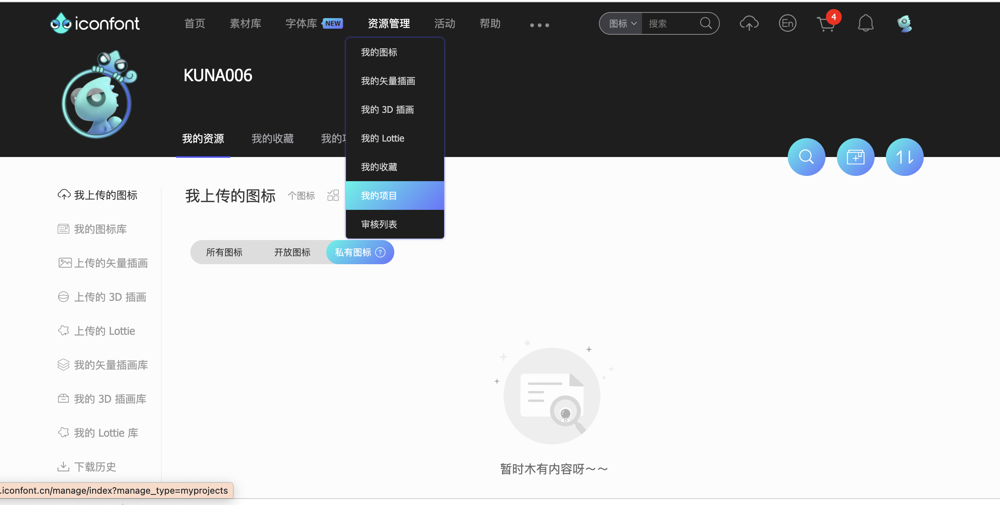
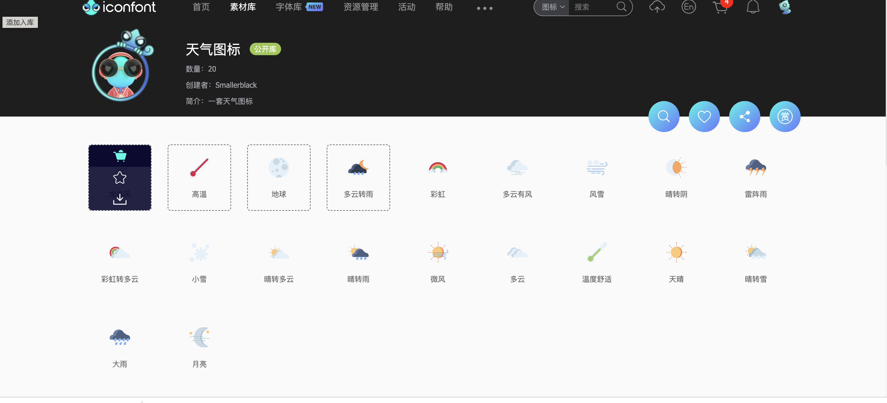
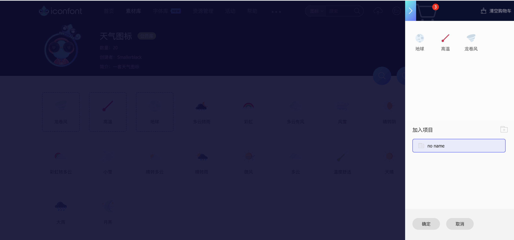
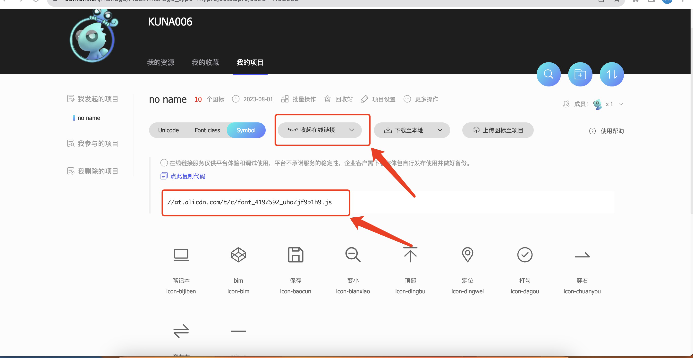

+++
date = '2023-08-01T10:00:00+08:00'
draft = true
title = 'icon网站使用教程'
tags = ["icon","使用教程"]
series = ["使用教程"]
categories = ["前端工具", "icon"]
+++

# icon网站使用教程

## 1 登录网站

https://www.iconfont.cn/

## 2 新建一个项目

## 3 选择图标-将图片添加至项目

### 3.1 将选中的图片添加至购物车

### 3.2 点击购物车，将购物车中图标加入项目

## 4 进入新建的项目

下面的在线连接就是项目的icon的js代码
