+++
date = '2026-03-19T09:06:52+08:00'
draft = true
title = 'kafka使用教程'
tags = ["kafka","使用教程"]
series = ["使用教程"]
categories = ["数据接入", "kafka"]
+++


本文手敲自尚硅谷平台，仅学习使用，内容尚未进行排版优化。

[bilibili](https://player.bilibili.com/player.html?bvid=BV1a4411B7V9&autoplay=0)

## kafka概述
### 定义
:::info
Kafka 是一个分布式的基于发布/订阅模式的消息队列（Message Queue），主要应用于大数据实时处理领域。

:::

### 消息队列
#### 传统消息队列的应用场景
<!-- 这是一张图片，ocr 内容为： -->
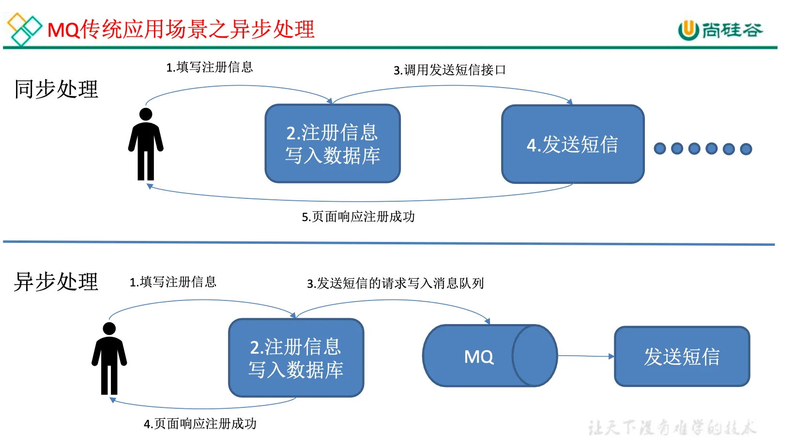


**使用消息队列的好处**

**1）解耦**

允许你独立的扩展或修改两边的处理过程，只要确保它们遵守同样的接口约束。

**2）可恢复性**

系统的一部分组件失效时，不会影响到整个系统。消息队列降低了进程间的耦合度，所以即使一个处理消息的进程挂掉，加入队列中的消息仍然可以在系统恢复后被处理。

**3）缓冲**

有助于控制和优化数据流经过系统的速度，解决生产消息和消费消息的处理速度不一致的情况。

**4）灵活性 & 峰值处理能力**

在访问量剧增的情况下，应用仍然需要继续发挥作用，但是这样的突发流量并不多见。如果为以能处理这类峰值访问为标准来投入资源随时待命无疑是巨大的浪费。使用消息队列能够使关键组件顶住突发的访问压力，而不会因为突发的超负荷的请求而完全崩溃。

**5）异步通信**

很多时候，用户不想也不需要立即处理消息。消息队列提供了异步处理机制，允许用户把一个消息放入队列，但并不立即处理它。想向队列中放入多少消息就放多少，然后在需要的时候再去处理他们。

#### 消息队列的两种模式
(1) 点对点模式 (一对一，消费者主动拉取数据，消息收到后消息清楚)

消息生产者生产消息发送到Queue中，然后消息消费者从Queue中取出并且消费消息。消息被消费之后，queue中不再有存储，所以消息消费者不可能消费到已经被消费的消息。Queue支持存在多个消费者，但是对一个消息而言，只会有一个消费者可以消费。

<!-- 这是一张图片，ocr 内容为： -->
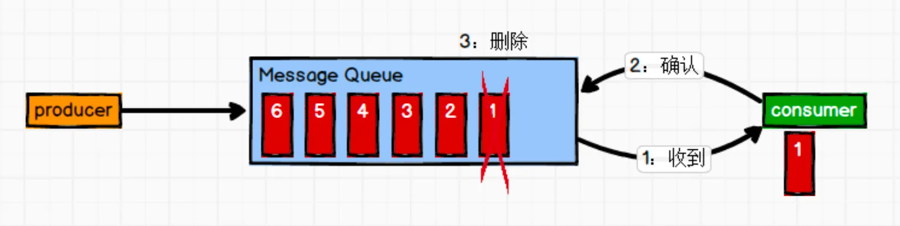

(2) 发布/订阅模式 (一对多， 消费者消费数据之后不会清除消息)

消息生产者(发布)将消息发布到topic中，同时有多个消息消费者(订阅)消费该消息。和点对点方式不同，发布到topic的消息会被所有订阅者消费。

<!-- 这是一张图片，ocr 内容为： -->
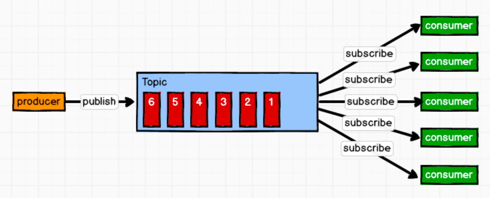

### Kafka 基础框架
<!-- 这是一张图片，ocr 内容为： -->
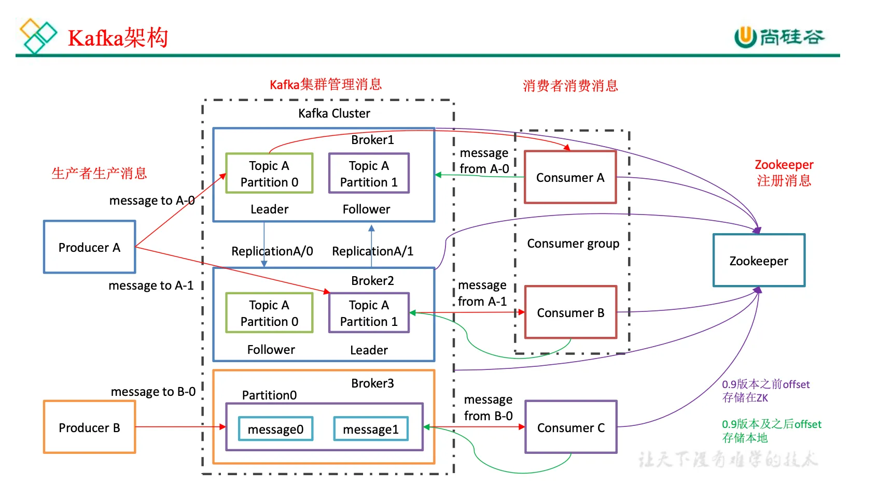

1）Producer ：消息生产者，就是向 kafka broker 发消息的客户端；

2）Consumer ：消息消费者，向 kafka broker 取消息的客户端；

3）Consumer Group (CG) ：消费者组，由多个consumer组成。消费者组内每个消费者负责消费不同分区的数据，一个分区只能由一个组内消费者消费；消费者组之间互不影响。所有的消费者都属于某个消费者组，即消费者组是逻辑上的一个订阅者。

4）Broker ：一台 kafka 服务器就是一个broker。一个集群由多个broker组成。一个broker可以容纳多个topic。

5）Topic ：可以理解为一个队列，生产者和消费者面向的都是一个topic。

6）Partition ：为了实现扩展，一个非常大的topic可以分布到多个broker（即服务器）上，一个topic可以分为多个 partition，每个partition是一个有序的队列。

7）Replica ：副本，为保证集群中的某个节点发生故障时，该节点上的partition数据不丢失，且kafka仍然能够继续工作，kafka提供了副本机制，一个topic的每个分区都有若干个副本，一个leader和若干个follower。

8）leader ：每个分区多个副本的 “主”，生产者发送数据的对象，以及消费者消费数据的对象都是leader。

9）follower ：每个分区多个副本中的 “从”，实时从leader中同步数据，保持和leader数据的同步。leader发生故障时，某个follower会成为新的 follower。

## kafka入门
### 安装部署
#### 集群规划
| hadoop102 | hadoop103 | hadoop104 |
| --- | --- | --- |
| Zookeeper | Zookeeper | Zookeeper |
| Kafka | Kafka | Kafka |


#### jar包下载
[kafka下载](https://kafka.apache.org/downloads.html)

<!-- 这是一张图片，ocr 内容为： -->
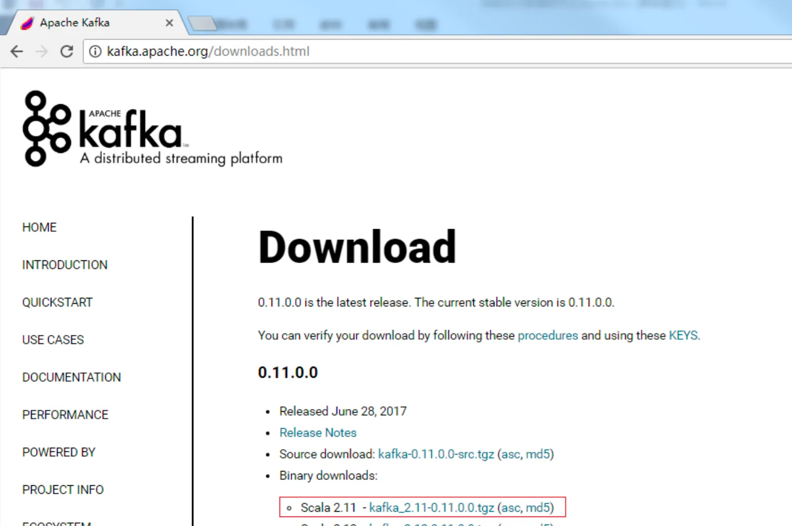

#### 集群部署
1）解压安装包

```shell
tar -zxvf kafka_2.11-0.11.0.0.tgz -C /opt/module
```

2）修改解压后的文件名称

```shell
mv kafka_2.11-0.11.0.0/ kafka
```

3）在/opt/module/kafka目录下创建 logs 文件夹

```shell
mkdir logs
```

4）修改配置文件

```shell
cd config/
vi server.properties
```

输入以下内容：

<!-- 这是一张图片，ocr 内容为： -->
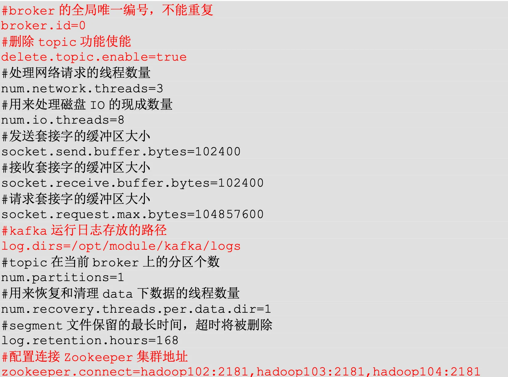

5）配置环境变量

```shell
vi /etc/profile

#KAFKA_HOME
export KAFKA_HOME=/opt/module/kafka
export PATH=$PATH:$KAFKA_HOME/bin

source /etc/profile
```

6）分发安装包

```shell
xsync kafka/
```

注意: 分发之后记得配置其他机器的环境变量

7）分别在 hadoop103 和hadoop104 上修改配置文件 /opt/module/kafka/config/server.properties

中 broker.id=1 、broker.id=2

注: broker.id不得重复

8）启动集群

依次在hadoop102、hadoop103、hadoop104节点上启动kafka

```shell
bin/kafka-server-start.sh -daemon config/server.properties
```

9）关闭集群

```shell
bin/kafka-server-stop.sh stop
```

10） kafka群起脚本

```shell
for i in hadoop102 hadoop103 hadoop104
do 
  echo "============ $i ============"
  ssh $i '/opt/module/kafka/bin/kafka-server-start.sh -daemon /opt/module/kafka/config/server.properties'
done 
```

### Kafka 命令行操作
1）查看当前服务器中的所以topic

```shell
bin/kafka-topics.sh  --zookeeper hadoop102:2181 --list
```

2）创建topic

```shell
bin/kafka-topics.sh  --zookeeper hadoop102:2181 --create --replication-factor 3 --partitions 1 --topic first 
```

:::info
选项说明: 

--topic  定义topic名

--replication-factor   定义副本数

--partitions  定义分区数

:::

3）删除topic

```shell
bin/kafka-topics.sh  --zookeeper hadoop102:2181 --delete --topic first
```

4）发送消息

```shell
bin/kafka-console-producer.sh --broker-list hadoop102:9092 --topic first
> hello world
```

5） 消费消息

```shell
bin/kafka-console-consumer.sh --zookeeper hadoop102:2181 --topic first

bin/kafka-console-consumer.sh --bootstrap-server hadoop102:9092 --topic first

bin/kafka-console-consumer.sh --bootstrap-server hadoop102:9092 --from-beginning --topic first
```

:::info
--from-beginning：会把主题中以往所有的数据都读取出来

:::

6）查看某个topic的详情

```shell
bin/kafka-topics.sh  --zookeeper hadoop102:2181 --describe  --topic first
```

7）修改分区数

```shell
bin/kafka-topics.sh --zookeeper hadoop102:2181 --alter --topic first --partitions 6
```

## kafka架构深入
### kafka工作流程及文件存储机制
<!-- 这是一张图片，ocr 内容为： -->
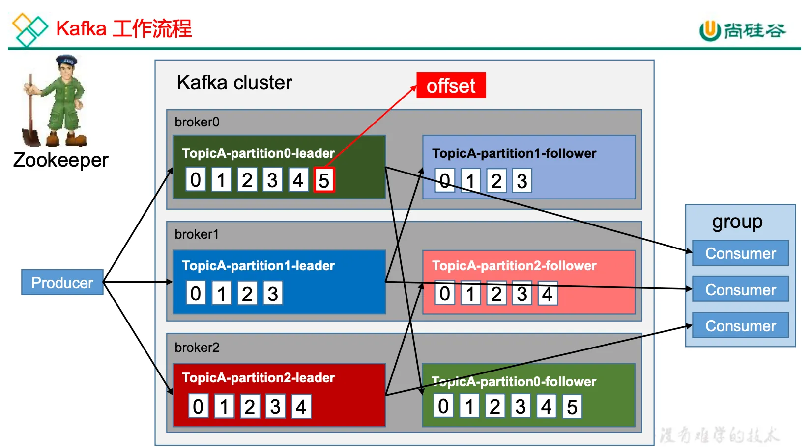

:::info
kafka中消息是以topic进行分类的，生产者生产消息，消费者消费消息，都是面向topic的。

topic是逻辑上的概念，而partition是物理上的概念，每个partition对应于一个log文件，该log文件中存储的就是producer生产的数据。producer生产的数据会被不断追加到该log文件末端，且每条数据都有自己的offset。消费者组中的每个消费者，都会实时记录自己消费到了那个offset，以便出错恢复时，从上次的位置继续消费。

:::

<!-- 这是一张图片，ocr 内容为： -->
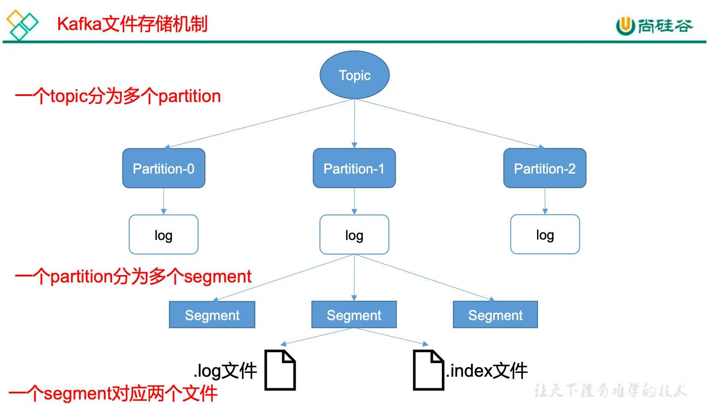

:::info
由于生产者生产的消息会不断追加到log文件末尾，为防止log文件过大导致数据定位效率低下，kafka采取了分片和索引机制，将每个partition分为多个segment。每个segment对应两个文件--“.index”文件和“.log”文件。这些文件位于一个文件夹下，该文件夹的命名规则为：topic名称+分区序号。例如，first这个topic有三个分区，则其对应的文件夹为first-0,first-1,first-2.

:::

<!-- 这是一张图片，ocr 内容为： -->


:::info
index和log文件以当前segment的第一条消息的offset命名。下图为index文件和log文件的结构示意图。

:::

<!-- 这是一张图片，ocr 内容为： -->
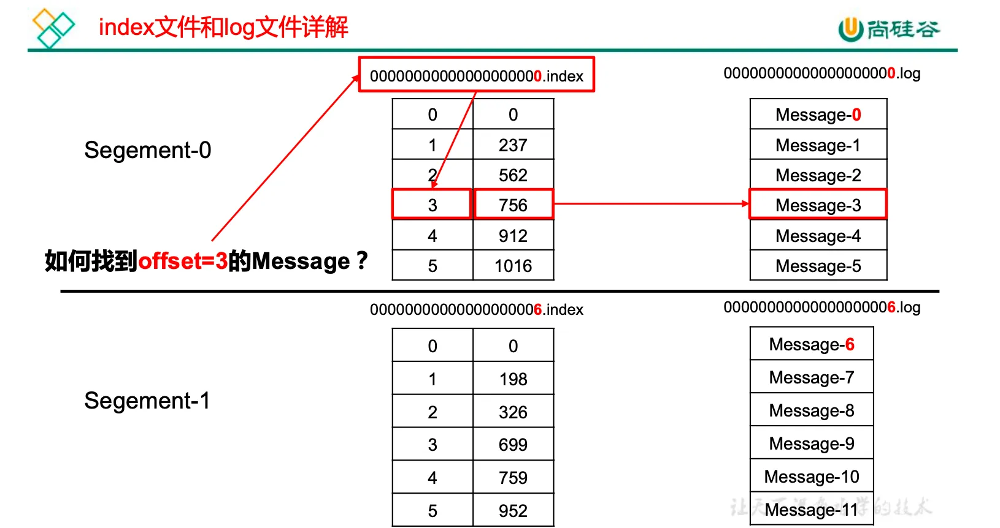

:::info
“.index”文件存储大量的索引信息，“.log”文件存储大量的数据，索引文件中的元数据指向对应数据文件中Message的物理偏移地址。

:::

### Kafka生产者
#### 分区策略
1）分区的原因

:::info
方便在集群中扩展，每个partition可以通过调整以适应它所在的机器，而一个topic又可以有多个Partition组成，一次整个集群就可以适应任意大小的数据了。

可以提高并发，因为可以以Partition为单位读写了。

:::

2）分区的原则

:::info
我们需要将producer发送的数据封装成一个ProducerRecord对象。

:::

<!-- 这是一张图片，ocr 内容为： -->
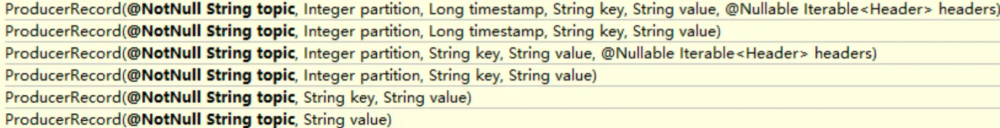

:::info
指明 Partition 的情况下，直接将指明的值直接作为Partition值；

没有指明 Partition 值但有key的情况下，将key的hash值与topic的Partition数进行取余得到Partition值；

既没有Partition 值又没有key值的情况下，第一次调用时随机生成一个整数（后面每次调用在这个整数上自增），将这个值与topic可用的Partition总数取余得到Partition值，也就是常说的round-robin算法。

:::

#### 数据可靠性保证
:::info
为保证producer发送的数据，能可靠的发送到指定的topic，topic的每个Partition收到producer发送的数据后，都需要向producer发送ack（acknowledgement 确认收到），如果producer收到ack，就会进行下一轮的发送，否则重新发送数据。

:::

<!-- 这是一张图片，ocr 内容为： -->
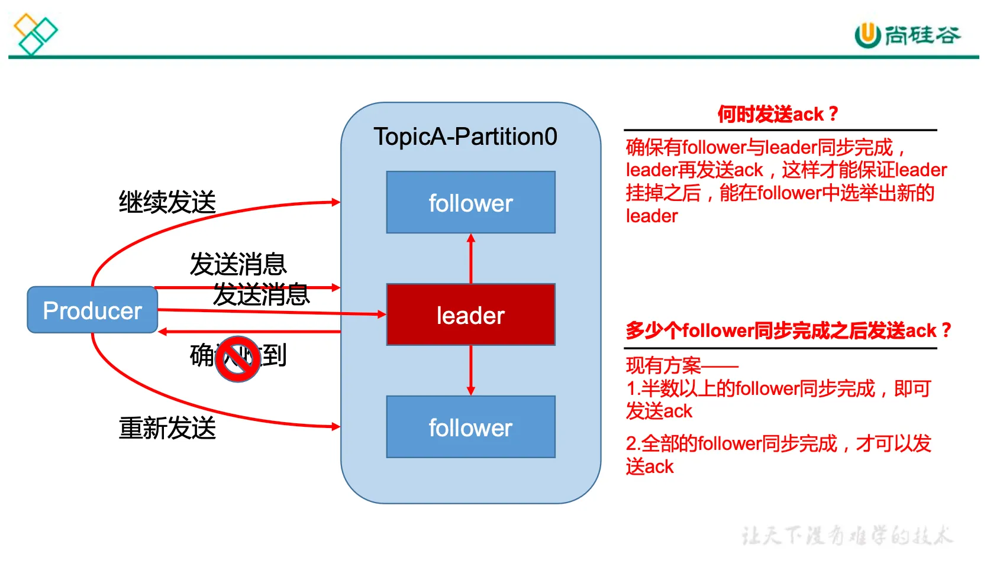

1）副本数据同步策略

| 方案 | 优点 | 缺点 |
| --- | --- | --- |
| 半数以上完成同步，就发送ack | 延迟低 | 选举新的leader时，容忍n台几点的故障，需要2n+1个副本 |
| 全部完成同步，才发送ack | 选举新的leader时，容忍n台节点的故障，需要n+1个副本 | 延迟高 |


:::info
Kafka选择了第二种方案，原因如下：

1. 同样为了容忍n台节点的故障，第一种方案需要2n+1个副本，而第二种方案只需要n+1个副本，而kafka的每个分区都有大量的数据，第一种方案会造成大量数据的冗余。
2. 虽然第二种方案的网络延迟会比较高，但网络延迟对kafka的影响比较小。

:::

2）ISR

:::info
采用第二种方案之后，设想以下情景: leader收到数据，所以follower都开始同步数据，但有一个follower因为某种故障，迟迟不能与leader进行同步，那leader就要一直等下去，直到它完成同步，才能发送ack。这个问题怎么解决？

leader维护了一个动态的in-sync replica set（ISR），意为和leader保持同步的follower集合。当ISR中的follower完成数据的同步之后，leader就会给follower发送ack。如果follower长时间未向leader同步数据，则将该follower提出ISR，该时间阈值由replica.lag.time.max.ms参数设定。leader发生故障之后，就会从ISR中选举新的leader。

:::

3）ack应答机制

:::info
对于某些不太重要的数据，对数据的可靠性要求不是很高，能够容忍数据的少量丢失，所以没必要等ISR中的follower全部接收成功。

所以kafka为用户提供了三种可靠性级别，用户根据对可靠性和延迟的要求进行权衡，选择以下的配置。

acks参数配置：

acks:

0：producer不等待broker的ack，这一操作提供了一个最低的延迟，broker一接收到还没有写入磁盘就已经返回，当broker故障时有可能丢失数据。

1：producer等待broker的ack，Partition的leader落盘成功后返回ack，如果在follower同步成功之前，leader故障，那么将会丢失数据；

<!-- 这是一张图片，ocr 内容为： -->
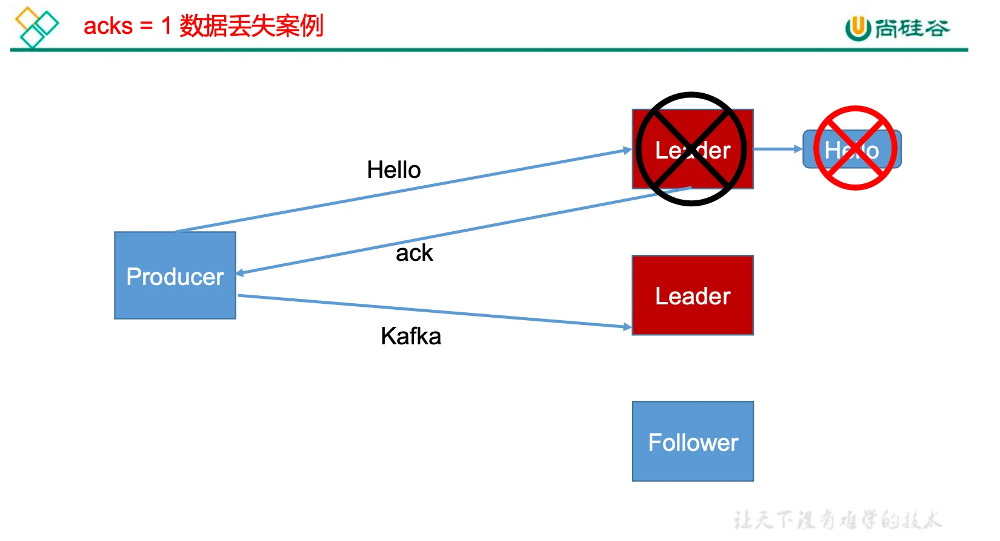

-1：producer等待broker的ack，Partition的leader和follower全部落盘完成之后才会返回ack。但是如果在follower同步完成之后，broker发送ack之前，leader发生故障，那么会造成数据重复。

<!-- 这是一张图片，ocr 内容为： -->
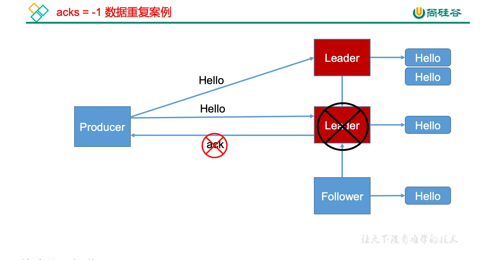

:::

4）故障处理细节

<!-- 这是一张图片，ocr 内容为： -->
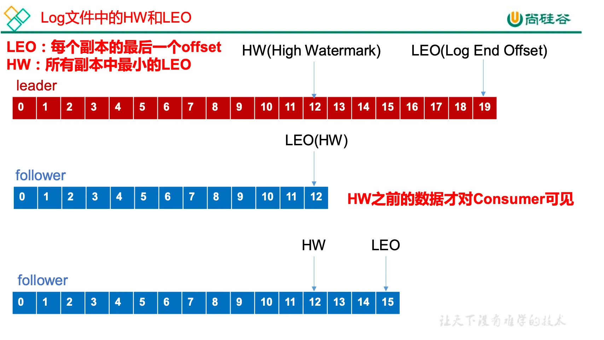

LEO: 指的是每个副本最大的offset：

HW：指的是消费者能见到的最大的offset，ISR队列中最小的LEO。

:::info
（1）follower故障

follower发生故障后会被临时提出ISR，待该follower恢复后，follower会读取本地磁盘记录的上次的HW，并将log文件高于HW的部分截取掉，从HW开始向leader进行同步。等该follower的LEO大于等于该Partition的HW，即follower追上leader之后，就可以重新加入ISR了。

（2）laeder故障

leader发生故障之后，会从ISR中选出一个新的leader，之后为保证多个副本之间的数据一致性，其余的follower会先将各自的log文件高于HW的部分截掉，然后从新的leader数据同步。


注意: 这只能保证副本之间的数据一致性，并不能保证数据不丢失或者不重复。

:::

#### Exactly Once语义
:::info
将服务器的ACK级别设置为 -1，可以保证producer到server之间不会丢失数据，即At Least Once语义。相对的，将服务器ACK级别设置为0，可以保证生产者每条消息只会被发送一次，即At Most Once语义。

At Least Once可以保证数据不丢失，但是不能保证数据不重复；相对的，At Least Once可以保证数据不重复，但是不能保证数据不丢失。但是对于一些非常重要的信息，比如说交易数据，下游数据消费者要求数据既不能重复也不能丢失，即Exactly Once语义。在0.11版本以前的kafka，对此是无能为力的，只能保证数据不丢失，再在下游消费者对数据做全局去重。对于多个下游应用的情况，每个都需要单独做全局去重，这就对性能造成很大影响。

0.11版本之后，引入了一项重大特性：幂等性。所谓的幂等性就是指Producer不论向Server发送多少次重复数据，Server端只会持久化一条。幂等性集合At Least Once语义，就构成了Kafka的Exactly Once语义。

At Least Once + 幂等性 = Exactly Once

要启用幂等性，只需要将Producer的参数中 enable.idompotence 设置为true即可。kafka的幂等性实现其实就是将原来下游需要做的去重放在了数据上游。开启幂等性的Producer在初始化的时候会被分配到一个PID，发往同一Partition的消息会附带 Sequence Number。而Broker端会对 <PID, Partition，SeqNumber>做缓存，当具有相同主键的消息提交时，Broker只会持久化一条。

但是PID重启就会变化，同时不同的Partition也具有不同主键，所以幂等性无法保证跨分区会话的Exactly Once。

:::

### Kafka消费者
#### 消费方式
:::info
consumer采用pull模式从Broker中去读数据。

push模式很难适应消费速率不同的消费者，因为消息发送速率是有Broker决定的。它的目标是尽可能以最快速度传递消息，但是这样很容易造成consumer来不及处理消息，典型的表现就是拒绝服务以及网络拥塞。而pull模式则可以根据consumer的消费能力以适应当前的速率消费消息。

pull模式不足之处是，如果kafka没有数据，消费者可能会陷入循环中，一直返回空数据。针对这一点，kafka的消费者在消费数据会传入一个时长参数timeout，如果当前没有数据可供消费，consumer会等待一段时间之后再返回，这段时间即为timeout。

:::

#### 分区分配策略
:::info
一个consumer group中有多个consumer，一个topic有多个Partition，所以必然会涉及到Partition的分配问题，即确定那个Partition由那个consumer来消费。

kafka有两种分配策略，一个是RoundRobin，一个是Range。

1）RoundRobin

<!-- 这是一张图片，ocr 内容为： -->
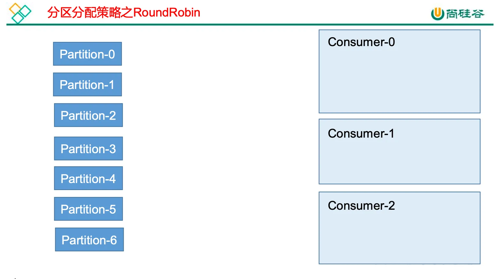

2）Range

<!-- 这是一张图片，ocr 内容为： -->
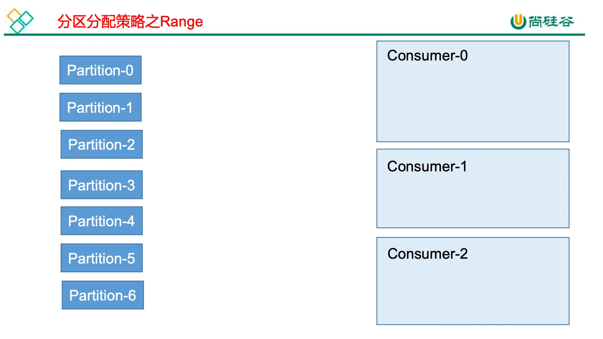

:::

#### offset的维护
:::info
由于consumer在消费过程中可能会出现断点宕机等故障，consumer恢复后，需要从故障前的位置继续消费，所以consumer需要实时记录自己消费到了那个offset，以便故障恢复后继续消费。

<!-- 这是一张图片，ocr 内容为： -->
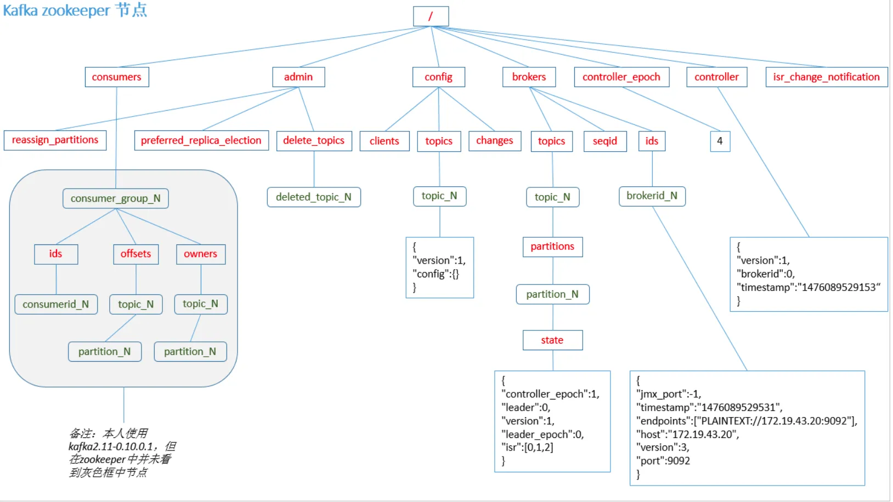

kafka 0.9 版本之前，consumer默认将offset保存在Zookeeper中，从0.9版本开始，consumer默认将offset保存在kafka一个内置的topic中，该topic为 _consumer_offsets。

:::

1）修改配置文件 consumer.properties

```shell
exclude.internal.topics=false
```

2）读取offset

0.11.0.0之前版本

```shell
bin/kafka-console-consumer.sh  --topic  __consumer_offsets --zookeeper hadoop102:2181  --formatter "kafka.coordinator.GroupMetadataManager\$OffsetsMessageFormatter" --consumer.config config/consumer.properties --from-beginning
```

0.11.0.0之后版本(包含)

```shell
bin/kafka-console-consumer.sh  --topic  __consumer_offsets --zookeeper hadoop102:2181  --formatter "kafka.coordinator.group.GroupMetadataManager\$OffsetsMessageFormatter" --consumer.config config/consumer.properties --from-beginning
```

#### 消费者组案例
1）需求：测试同一个消费者组中的消费者，同一时刻只能有一个消费者消费。

2）案例实操

（1）在hadoop102、hadoop103上修改 /opt/module/kafka/config/consumer.properties 配置文件中的 group.id 属性为任意组名。

```shell
vi consumer.properties
group.id=atguigu
```

（2）在hadoop102、hadoop103上分别启动消费者

```shell
bin/kafka-console-consumer.sh --zookeeper hadoop102:2181  --topic first  --consumber.config  config/consumer.properties
bin/kafka-console-consumer.sh --bootstrap-server hadoop102:9092  --topic first  --consumber.config  config/consumer.properties
```

（3）在hadoop104上启动生产者

```shell
bin/kafka-console-producer.sh --broker-list hadoop102:9092 --topic first
```

（4）查看hadoop102和hadoop103的接收者。

同一时刻只有一个消费者收到消息。

### kafka高效读写数据
1）顺序写磁盘

:::info
kafka的Producer生产数据，要写入到log文件中，写的过程是一直追加到文件末端，为顺序写。官网有数据表明，同样的磁盘，顺序写能到600M/s，而随机写只有100k/s。这与磁盘的机械结构有关，顺序写之所以快，是因为其省去了大量磁头寻址的时间。

:::

2）零复制技术

<!-- 这是一张图片，ocr 内容为： -->
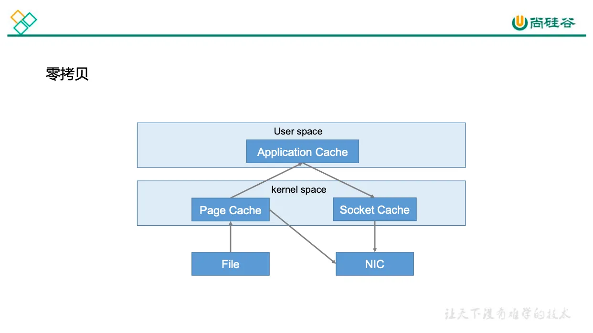

### Zookeeper在kafka中的作用
:::info
kafka集群中有一个broker会被选举为Controller，负责管理集群broker的上下线，所有topic的分区副本分配和leader选举等工作。

Controller的管理工作都是依赖于Zookeeper的。

以下为Partition的leader选举过程：

<!-- 这是一张图片，ocr 内容为： -->
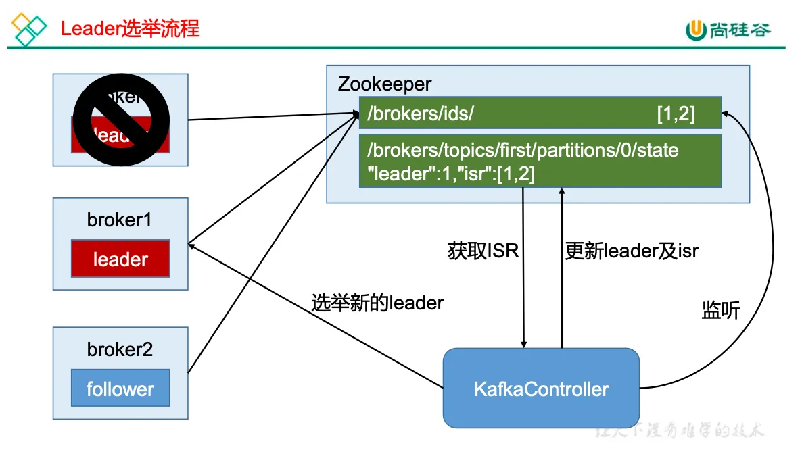

:::

### Kafka事务
:::info
Kafka从0.11版本开始引入了事务支持。事务可以保证kafka在Exactly Once语义的基础上，生产和消费可以跨分区和会话，要么全部成功，要么全部失败。

:::

#### Producer事务
:::info
为了实现跨分区、夸会话的事务，需要引入一个全局唯一的Transaction ID，并将Producer获得的PID和Transaction ID绑定。这样当Producer重启后就可以通过正在进行的Transaction ID获得原来的PID。

为了管理 Transaction，kafka引入了一个新的组件 Transaction Coordinator。Producer就是通过和  Transaction Coordinator 交互获得 Transaction ID对应的任务状态。 Transaction Coordinator 还负责将事务所有写入kafka的一个内部topic，这样即使整个服务重启，由于事务状态得到保存，进行中的事务状态可以得到恢复，从而继续进行。

:::

#### Consumer事务
:::info
上述事务机制主要是从 Producer 方面考虑，对于Consumer而言，事务的保证就会相对较弱，尤其是无法保证Commit的信息被精确消费。这是由于Consumer可以通过offset访问任意消息，而且不同的Segment File生命周期不同，同一事务的消息可能会出现重启后被删除的情况。

:::

## kafka API
### Producer API
#### 消息发送流程
:::info
kafka的Producer发送消息采用的是异步发送的方式。在消息发送的过程中，涉及到了两个线程  ---- main线程和Sender线程，以及一个线程共享变量 ---- RecordAccumulator。main线程将消息发送给RecordAccumulator，Sender线程不断从 RecordAccumulator 中拉取消息发送到kafka broker。

:::

<!-- 这是一张图片，ocr 内容为： -->
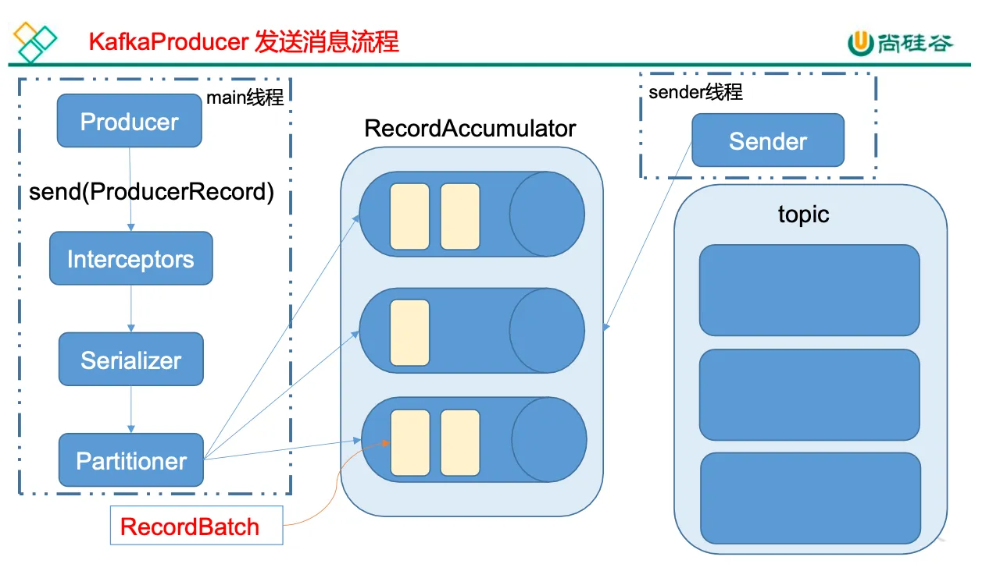

相关参数：

batch.size： 只有数据积累到batch.size之后，sender才会发送数据。

linger.ms： 如果数据迟迟未达到batch.size，sender等待 linger.time之后就会发送数据。

#### 异步发送API
1）导入依赖

```shell
<dependency>
    <groupId>org.apache.kafka</groupId>
    <artifactId>kafka-clients</artifactId>
    <version>0.11.0.0</version>
</dependency>
```

2）编写代码

需要用到的类：

KafkaProducer：需要创建一个生产者对象，用来发送数据

ProducerConfig：获取所需的一系列配置参数

ProducerRecord：每条数据都要封装成一个 ProducerRecord 对象

1. 不带回调函数的API

```java
package com.xy.SmartHome;

import org.apache.kafka.clients.producer.KafkaProducer;
import org.apache.kafka.clients.producer.Producer;
import org.apache.kafka.clients.producer.ProducerRecord;

import java.util.Properties;

public class CustomProducer {

    public static void main(String[] args) {
        Properties props = new Properties();
        // kafka集群，broker-list
        props.setProperty("bootstrap.servers", "hadoop102:9092");
        props.setProperty("acks", "all");
        // 重试次数
        props.setProperty("retries", "1");
        // 批次大小
        props.setProperty("batch.size", "16384");
        // 等待时间
        props.setProperty("linger.ms", "1");

        props.setProperty("key.serializer", "org.apache.kafka.common.serialization.StringSerializer");
        props.setProperty("value.serializer", "org.apache.kafka.common.serialization.StringSerializer");

        Producer<String, String> producer = new KafkaProducer<>(props);

        for (int i = 0; i < 10; i++) {
            producer.send(new ProducerRecord<String, String>("first", Integer.toString(i), Integer.toString(i)));
        }

        producer.close();
    }
}

```

2. 带回调函数的API

:::info
回调函数会在Producer收到ack时调用，为异步调用，该方法有两个参数，分别是 RecordMetadata 和 Exception，如果 Exception 为 null，说明消息发送成功，如果 Exception 不为 null，说明消息发送失败。

注意：消息发送失败会自动重试，不需要我们在回调函数中手动重试。

:::

```java
package com.xy.SmartHome;

import org.apache.kafka.clients.producer.*;

import java.util.Properties;

public class CustomProducer {

    public static void main(String[] args) {
        Properties props = new Properties();
        // kafka集群，broker-list
        props.setProperty("bootstrap.servers", "hadoop102:9092");
        props.setProperty("acks", "all");
        // 重试次数
        props.setProperty("retries", "1");
        // 批次大小
        props.setProperty("batch.size", "16384");
        // 等待时间
        props.setProperty("linger.ms", "1");
        // 缓冲区大小
        props.setProperty("buffer.memory", "33554432");

        props.setProperty("key.serializer", "org.apache.kafka.common.serialization.StringSerializer");
        props.setProperty("value.serializer", "org.apache.kafka.common.serialization.StringSerializer");

        Producer<String, String> producer = new KafkaProducer<>(props);

        for (int i = 0; i < 10; i++) {
            producer.send(new ProducerRecord<String, String>("first", Integer.toString(i), Integer.toString(i)), new Callback() {
                // 回调函数，该方法会在 Producer 收到 ack 时调用，为异步调用
                @Override
                public void onCompletion(RecordMetadata recordMetadata, Exception e) {
                    if (e == null) {
                        System.out.println("offset: " + recordMetadata.offset());
                    } else {
                        e.printStackTrace();
                    }
                }
            });
        }

        producer.close();
    }
}

```

#### 同步发送API
:::info
同步发送的意思就是，一条消息发送之后，会阻塞当前线程，直至返回ack。

由于 send 方法返回的是一个 Future 对象，根据 Future 对象的特点，我们也可以实现同步发送的效果，只需在调用Future对象的get方法即可。

:::

```java
package com.xy.SmartHome;

import org.apache.kafka.clients.producer.*;

import java.util.Properties;
import java.util.concurrent.ExecutionException;

public class CustomProducer {

    public static void main(String[] args) throws ExecutionException, InterruptedException {
        Properties props = new Properties();
        // kafka集群，broker-list
        props.setProperty("bootstrap.servers", "hadoop102:9092");
        props.setProperty("acks", "all");
        // 重试次数
        props.setProperty("retries", "1");
        // 批次大小
        props.setProperty("batch.size", "16384");
        // 等待时间
        props.setProperty("linger.ms", "1");
        // 缓冲区大小
        props.setProperty("buffer.memory", "33554432");

        props.setProperty("key.serializer", "org.apache.kafka.common.serialization.StringSerializer");
        props.setProperty("value.serializer", "org.apache.kafka.common.serialization.StringSerializer");

        Producer<String, String> producer = new KafkaProducer<>(props);

        for (int i = 0; i < 10; i++) {
            producer.send(new ProducerRecord<String, String>("first", Integer.toString(i), Integer.toString(i))).get();
        }

        producer.close();
    }
}

```

### Consumer API
:::info
Consumer 消费数据时的可靠性是很容易保证的，因为数据在Kafka中是持久化的，故不用担心数据丢失问题。

由于 Consumer 在消费过程中可能会出现断电宕机等故障，Consumer 恢复后，需要从故障前的位置继续消费，所以 Consumer 需要实现记录自己消费到了哪个 offset，以便故障恢复后继续消费。

所以 offset 的维护 Consumer 消费数据必须考虑的问题。

:::

#### 自动提交offset
1）依赖导入

```xml
<dependency>
  <groupId>org.apache.kafka</groupId>
  <artifactId>kafka-clients</artifactId>
  <version>0.11.0.0</version>
</dependency>
```

2）编写代码

需要用到的类：

kafkaConsumer：需要创建一个消费者对象，用来消费数据

ConsumerConfig：获取所需的一系列配置参数

ConsumerRecord：每条数据都要封装成一个 ConsumerRecord 对象

为了使我们能够专注于自己的业务逻辑，Kafka提供了自动提交offset的功能。自动提交offset的相关参数：

enable.auto.commit：是否开启自动提交 offset 功能

auto.commit.interval.ms：自动提交offset的时间间隔

以下为自动提交offset的代码：

```xml
package com.xy.SmartHome;

import org.apache.kafka.clients.consumer.ConsumerRecord;
import org.apache.kafka.clients.consumer.ConsumerRecords;
import org.apache.kafka.clients.consumer.KafkaConsumer;
import org.apache.kafka.clients.producer.*;

import java.time.Duration;
import java.util.Arrays;
import java.util.Properties;
import java.util.concurrent.ExecutionException;

public class CustomProducer {

    public static void main(String[] args) throws ExecutionException, InterruptedException {
        Properties props = new Properties();
        // kafka集群，broker-list
        props.put("bootstrap.servers", "hadoop102:9092");

        props.put("group.id", "test");

        props.put("enable.auto.commit", "true");

        props.put("auto.commit.interval.ms", "1000");

        props.put("key.serializer", "org.apache.kafka.common.serialization.StringSerializer");
        props.put("value.serializer", "org.apache.kafka.common.serialization.StringSerializer");

        KafkaConsumer<String, String> consumer = new KafkaConsumer<>(props);

        consumer.subscribe(Arrays.asList("first"));

        while (true) {
            ConsumerRecords<String, String> records = consumer.poll(Duration.ofMillis(100));
            for (ConsumerRecord<String, String> record : records) {
                System.out.println(record);
            }
        }
    }
}

```

#### 手动提交offset
:::info
虽然自动提交offset十分简介便利，但由于其是基于时间提交的，开发人员难以把握offset提交的时机，因为kafka还提供了手动提交offset的API。

手动提交offset的方法有两种：分别是 commitSync（同步提交）和commitAsync（异步提交）。两者的相同点是，都会将本次 poll 的一批数据最高的偏移量提交；不同点是，commitSync 阻塞当前线程，一直到提交成功，并且会自动失败重试（由于不可控因素导致，也会出现提交失败）；而commitAsync 则没有失败重试机制，故有可能提交失败。

:::

1）同步提交offset

由于同步提交offset有失败重试机制，故更加可靠，以下为同步提交offset的示例。

```java
package com.xy.SmartHome;

import org.apache.kafka.clients.consumer.ConsumerRecord;
import org.apache.kafka.clients.consumer.ConsumerRecords;
import org.apache.kafka.clients.consumer.KafkaConsumer;
import org.apache.kafka.clients.producer.*;

import java.time.Duration;
import java.util.Arrays;
import java.util.Properties;
import java.util.concurrent.ExecutionException;

public class CustomProducer {

    public static void main(String[] args) throws ExecutionException, InterruptedException {
        Properties props = new Properties();
        // kafka集群，broker-list
        props.put("bootstrap.servers", "hadoop102:9092");
        // 消费者组，只要group.id相同，就属于同一个消费者组
        props.put("group.id", "test");
        // 关闭自动提交offset
        props.put("enable.auto.commit", "false");

        props.put("auto.commit.interval.ms", "1000");

        props.put("key.serializer", "org.apache.kafka.common.serialization.StringSerializer");
        props.put("value.serializer", "org.apache.kafka.common.serialization.StringSerializer");

        KafkaConsumer<String, String> consumer = new KafkaConsumer<>(props);

        // 消费者订阅主题
        consumer.subscribe(Arrays.asList("first"));

        while (true) {
            // 拉取数据
            ConsumerRecords<String, String> records = consumer.poll(Duration.ofMillis(100));
            for (ConsumerRecord<String, String> record : records) {
                System.out.println(record);
            }
            // 提交offset
            consumer.commitSync();
        }
    }
}

```

2）异步提交offset

:::info
虽然同步提交offset更可靠一些，但是由于其会阻塞当前线程，直到提交成功。因此吞吐量会收到很大的影响。因为更多的情况下，会选用异步提交offset的方式。

以下为异步提交offset的示例：

:::

```java
package com.xy.SmartHome;

import org.apache.kafka.clients.consumer.*;
import org.apache.kafka.clients.producer.*;
import org.apache.kafka.common.TopicPartition;

import java.time.Duration;
import java.util.Arrays;
import java.util.Map;
import java.util.Properties;
import java.util.concurrent.ExecutionException;

public class CustomProducer {

    public static void main(String[] args) throws ExecutionException, InterruptedException {
        Properties props = new Properties();
        // kafka集群，broker-list
        props.put("bootstrap.servers", "hadoop102:9092");
        // 消费者组，只要group.id相同，就属于同一个消费者组
        props.put("group.id", "test");
        // 关闭自动提交offset
        props.put("enable.auto.commit", "false");

        props.put("auto.commit.interval.ms", "1000");

        props.put("key.serializer", "org.apache.kafka.common.serialization.StringSerializer");
        props.put("value.serializer", "org.apache.kafka.common.serialization.StringSerializer");

        KafkaConsumer<String, String> consumer = new KafkaConsumer<>(props);

        // 消费者订阅主题
        consumer.subscribe(Arrays.asList("first"));

        while (true) {
            // 拉取数据
            ConsumerRecords<String, String> records = consumer.poll(Duration.ofMillis(100));
            for (ConsumerRecord<String, String> record : records) {
                System.out.println(record);
            }
            consumer.commitAsync(new OffsetCommitCallback() {
                @Override
                public void onComplete(Map<TopicPartition, OffsetAndMetadata> map, Exception e) {
                    if (e != null) {
                        System.out.println("offset提交失败" + e);
                    }
                }
            });
        }
    }
}

```

3）数据漏消费和重复消费分析

:::info
无论是同步提交还是异步提交offset，都有可能会造成数据的漏消费或者重复消费。先提交offset后消费，有可能造成数据的漏消费；而先消费后提交offset，有可能会造成数据的重复消费。

:::

#### 自定义存储offset
:::info
Kafka 0.9版本之前，offset存储在 Zookeeper，0.9版本及之后，默认将offset存储在Kafka的一个内置topic中。除此之外，kafka还可以选择自定义存储offset。

offset 的维护是相当繁琐的，因为需要考虑到消费者的Rebalance。

当有新的消费者加入消费者组、已有的消费者退出消费者组或者所订阅主题的分区发生变化，就会触发到分区的重新分配，重新分配的过程叫做 Rebalance。

消费者发生 Rebalance 之后，每个消费者消费的分区就会发生变化。因此消费者要首先获取到自己被重新分配到分区，并且定位到每个分区最近提交的offset位置继续消费。

要实现自定义存储 offset，需要借助 ConsumerRebalanceListener，以下为示例代码，其中提交和获取offset的方法，需要根据所选的 offset 存储系统自行实现。

:::

```shell
package com.xy.SmartHome;

import org.apache.kafka.clients.consumer.*;
import org.apache.kafka.clients.producer.*;
import org.apache.kafka.common.TopicPartition;

import java.time.Duration;
import java.util.*;
import java.util.concurrent.ExecutionException;

public class CustomProducer {

    private static Map<TopicPartition, Long> currentOffset = new HashMap<>();

    public static void main(String[] args) throws ExecutionException, InterruptedException {
        Properties props = new Properties();
        // kafka集群，broker-list
        props.put("bootstrap.servers", "hadoop102:9092");
        // 消费者组，只要group.id相同，就属于同一个消费者组
        props.put("group.id", "test");
        // 关闭自动提交offset
        props.put("enable.auto.commit", "false");
        // key和value的序列化类
        props.put("key.deserializer", "org.apache.kafka.common.serialization.StringDeserializer");
        props.put("value.deserializer", "org.apache.kafka.common.serialization.StringDeserializer");

        KafkaConsumer<String, String> consumer = new KafkaConsumer<>(props);

        // 消费者订阅主题
        consumer.subscribe(Arrays.asList("first"), new ConsumerRebalanceListener() {
            @Override
            public void onPartitionsRevoked(Collection<TopicPartition> collection) {
                commitOffset(currentOffset);
            }

            @Override
            public void onPartitionsAssigned(Collection<TopicPartition> collection) {
                collection.clear();
                // 为每个分区分配最新offset
                for (TopicPartition partition : collection) {
                    consumer.seek(partition, getOffset(partition));
                }
            }
        });
        while (true) {
            // 消费者拉取数据
            ConsumerRecords<String, String> records = consumer.poll(Duration.ofMillis(100));
            for (ConsumerRecord<String, String> record : records) {
                System.out.println(record);
                currentOffset.put(new TopicPartition(record.topic(), record.partition()), record.offset());
            }
            // 异步提交
            commitOffset(currentOffset);
        }

    }


    // 获取某分区的最新 offset
    private static long getOffset(TopicPartition partition) {
        // 从消费者端获取offset
        return 0;
    }

    // 提交该消费者所有分区的offset
    private static void commitOffset(Map<TopicPartition, Long> partition) {
        // 提交offset到消费者端
    }
}

```

### 自定义Interceptor
#### 拦截器原理
:::info
Producer拦截器（interceptor）是在kafka 0.10.0版本被引入的，主要用于实现clients端的定制化逻辑控制。

对于 producer 而言，interceptor 使得用户在消息发送前以及 producer 回调用逻辑前有机会对消息做一些定制化需求，比如修改消息等。同时，producer 允许用户指定多个 interceptor 按序作用于同一条消息从而形成一个拦截器（interceptor chain）。interceptor 的实现接口是 org.apache.kafka.clients.producer.ProducerInterceptor，其定义的方法包括：

（1）configure（configs）

获取配置信息和初始化数据时调用。

（2）onSend（ProducerRecord）：

该方法封装进 KafkaProducer.send 方法中，即它运行在用户主线程中。Producer确保在消息被序列化以及计算分区前调用该方法。用户可以在该方法中对消息做任何操作，但最好保证不要修改消息所属的topic和分区，否则会影响目标分区的计算。

（3）onAcknowledgement（RecordMetadata， Exception）：

该方法会在消息从 RecordAccumulator 成功发送到 Kafka Broker 之后，或者在发送过程中失败时调用。并且通常都是在 Producer 回调逻辑触发之前。onAcknowledgement 运行在 Producer 的 IO 线程中。因此不要在该方法中放入很重的逻辑，否则会拖慢Producer的消息发送效率。

（4）close：

关闭 interceptor，主要用于执行一些资源清理工作

如前所述，interceptor 可能被运行在多个线程中，因此在具体实现时用户需要自行确保线程安全。另外倘若指定了多个interceptor，则Producer将按照指定顺序调用它们，并仅仅是捕获每个 interceptor 可能抛出的异常记录到错误日志中而非在向上传递。这在使用过程中需要特别留意。

:::

#### 拦截器案例
1）需求

:::info
实现一个简单的双interceptor组成的拦截链。第一个interceptor会在消息发送前将时间戳信息加到消息 value 的最前部；第二个interceptor会在消息发送后更新成功发送信息数或失败发送消息数。

:::

<!-- 这是一张图片，ocr 内容为： -->
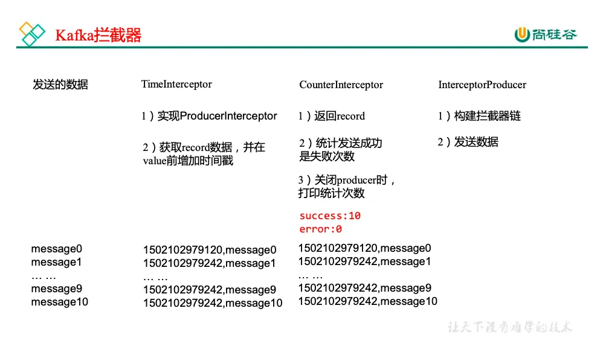
2）案例实操

（1）增加时间戳拦截器

```shell
package com.xy.SmartHome;

import org.apache.kafka.clients.producer.ProducerInterceptor;
import org.apache.kafka.clients.producer.ProducerRecord;

import java.util.Map;

public class TimeInterceptor implements ProducerInterceptor<String, String> {
    @Override
    public void configure(Map<String, ?> map) {

    }

    @Override
    public ProducerRecord<String, String> onSend(ProducerRecord<String, String> producerRecord) {
        return new ProducerRecord(producerRecord.topic(), producerRecord.partition(), producerRecord.timestamp(), producerRecord.key(), System.currentTimeMillis() + "," + producerRecord.value().toString());
    }

    

    @Override
    public void close() {

    }

}

```

（2）统计发送消息成功和发送失败消息数，并在Producer关闭时打印这两个计数器

```shell
package com.xy.SmartHome;

import org.apache.kafka.clients.producer.ProducerInterceptor;
import org.apache.kafka.clients.producer.ProducerRecord;
import org.apache.kafka.clients.producer.RecordMetadata;

import java.util.Map;

public class CounterInterceptor implements ProducerInterceptor<String, String> {

    private int errorCounter = 0;
    private int successCounter = 0;

    @Override
    public void configure(Map<String, ?> map) {

    }

    @Override
    public ProducerRecord<String, String> onSend(ProducerRecord<String, String> producerRecord) {
        return producerRecord;
    }

    @Override
    public void onAcknowledgement(RecordMetadata recordMetadata, Exception e) {
        if (e != null) {
            errorCounter++;
        } else {
            successCounter++;
        }
    }

    @Override
    public void close() {
        System.out.println("errorCounter: " + errorCounter);
        System.out.println("successCounter: " + successCounter);
    }


}

```

（3）Producer 主程序

```shell
package com.xy.SmartHome;

import org.apache.kafka.clients.producer.KafkaProducer;
import org.apache.kafka.clients.producer.Producer;
import org.apache.kafka.clients.producer.ProducerConfig;
import org.apache.kafka.clients.producer.ProducerRecord;

import java.util.ArrayList;
import java.util.List;
import java.util.Properties;

public class InterceptorProducer {

    public static void main(String[] args) {
        Properties props = new Properties();
        // 1. 设置配置信息
        props.put("bootstrap.servers", "hadoop102:9092");
        props.put("acks", "all");
        props.put("retries", 3);
        props.put("batch.size", 16384);
        props.put("linger.ms", 1);
        props.put("buffer.memory", 33554432);
        props.put("key.deserializer", "org.apache.kafka.common.serialization.StringDeserializer");
        props.put("value.deserializer", "org.apache.kafka.common.serialization.StringDeserializer");
        
        // 2. 构建拦截链
        List<String> interceptors = new ArrayList<>();
        interceptors.add("com.xy.SmartHome.CounterInterceptor");
        interceptors.add("com.xy.SmartHome.TimestampInterceptor");
        
        props.put(ProducerConfig.INTERCEPTOR_CLASSES_CONFIG, interceptors);
        
        String topic = "first";
        Producer<String, String> producer = new KafkaProducer<>(props);
        
        // 3. 发送消息
        for (int i = 0; i < 10; i++) {
            producer.send(new ProducerRecord<>(topic, "message" + i));
        }
        
        // 4. 关闭生产者
        producer.close();
        
    }
}

```

3）测试

（1）在kafka上启动消费者，然后运行客户端java程序。

<!-- 这是一张图片，ocr 内容为： -->
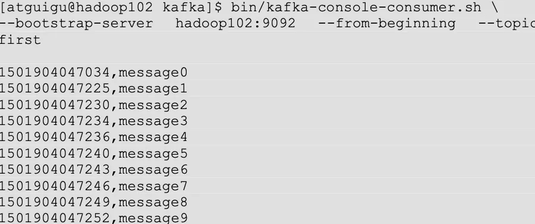
## kafka监控
### Kafka Eagle
:::info
1. 修改kafka启动命令

修改 kafka-server-start.sh 命令中

:::

```shell
if [ "x$KAFKA_HEAP_OPTS" = "x"]; then
  export KAFKA_HEAP_OPTS="-Xmx1G -Xms1G"
fi
```

```shell
if [ "x$KAFKA_HEAP_OPTS" = "x"]; then
  export KAFKA_HEAP_OPTS="-server -Xms2G -Xmx2G -XX:PermSize=128m -XX:+UseG1GC -XX:MaxGCPauseMillis=200  -XX:ParallelGCThreads=8  -XX:ConcGCThreads=5  -XX:InitiatingHeapOccupancyPercent=70"
  export JMX_PORT="9999"
  # export KAFKA_HEAP_OPTS="-Xmx1G -Xms1G"
fi
```

注意：修改之后在启动kafka之前要分发到其他节点

:::info
2. 上传压缩包 kafka-eagle-bin-1.3.7.tar.gz到集群 /opt/software目录
3. 解压到本地

:::

```shell
tar -zxvf kafka-eagle-bin-1.3.7.tar.gz
```

:::info
4. 进入刚才解压的目录

:::

```shell
cd kafka-eagle-bin-1.3.7
ll
```

:::info
5. 将kafka-eagle-web-1.3.7-bin.tar.gz解压至 /opt/module

:::

```shell
tar -zxvf kafka-eagle-web-1.3.7-bin.tar.gz -C /opt/module/
```

:::info
6. 修改名称

:::

```shell
mv kafka-eagle-web-1.3.7/ eagle
```

:::info
7. 给启动文件执行权限

:::

```shell
cd  bin/
ll 
chomd 777 ke.sh
```

:::info
8. 修改配置文件

:::

<!-- 这是一张图片，ocr 内容为： -->
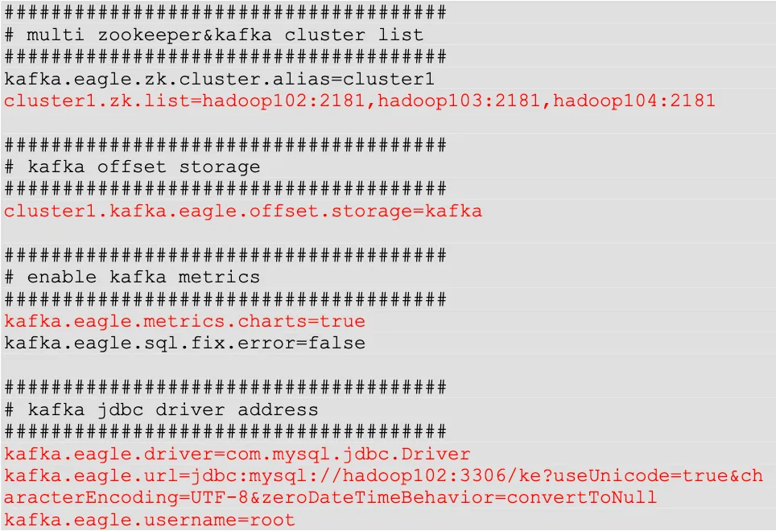
<!-- 这是一张图片，ocr 内容为： -->

:::info
9. 添加环境变量

:::

```shell
export KE_HOME=/opt/module/eagle
export PATH=$PATH:$KE_HOME/bin

source /etc/profile
```

:::info
10. 启动

:::

```shell
bin/ke.sh start

# 启动之前需要先启动zk和kafka
```

:::info
11. 登录页面查看监控数据

:::

[数据监控](http://192.168.9.102:8048/ke)

<!-- 这是一张图片，ocr 内容为： -->
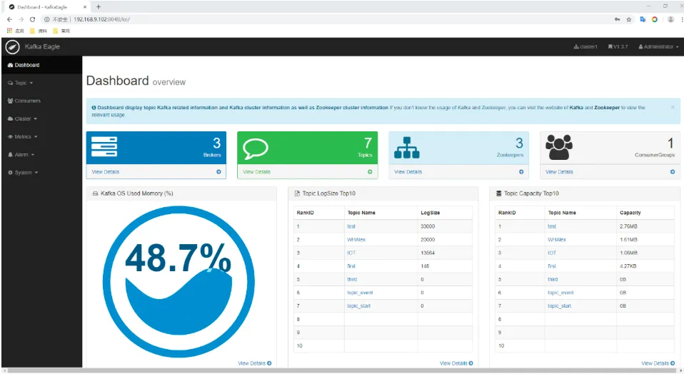
## Flume对接kafka
1）配置 flume（flume-kafka.conf）

```shell
#define
a1.sources = r1
a1.sinks = k1
a1.channels = c1

# source
a1.sources.r1.type = exec
a1.sources.r1.command = tail -F -c +0 /opt/module/data/flume.log
a1.sources.r1.shell = /bin/bash -c 

# sink
a1.sinks.k1.type = org.apache.flume.sink.kafka.KafkaSink
a1.sinks.k1.kafka.bootstrap.servers
hadoop102:9092,hadoop103:9092,hadoop104:9092
a1.sinks.k1.kafka.topic = first
a1.sinks.k1.kafka.flumeBatchSize = 20
a1.sinks.k1.kafka.producer.acks = 1
a1.sinks.k1.kafka.producer.linger.ms = 1

# channel
a1.channels.c1.type = memory
a1.channels.c1.capacity = 1000
a1.channels.c1.transactionCapacity = 100

# bind
a1.sources.r1.channels = c1
a1.sinks.k1.channel = c1
```

2）启动kafkaIDEA消费者

3）进入flume根目录下，启动flume

```shell
bin/flume-ng agent -c conf/ -n a1 -f jobs/flume-kafka.conf
```

4）向 /opt/module/data/flume.log里面追加数据，查看kafka消费者消费情况

```shell
echo hello >> /opt/module/data/flume.log
```

## kafka面试题
### 面试问题： 
1. Kafka中的ISR(InSyncRepli)、OSR(OutSyncRepli)、AR(AllRepli)代表什么？


2. Kafka中的 HW、LEO等分别代表什么？


3. Kafka中是怎么体现消息顺序性的？


4. Kafka中的分区器、序列化器、拦截器是否了解？他们之间的处理顺序是什么？


5. Kafka生产者客户端的整体结构是什么样子的？使用了几个线程来处理？分别是什么？


6. “消费组中的消费者个数如果超过topic的分区，那么就会有消费者消费不到数据”这句话是否争取？


7. 消费者提交消费位移时提交的是当前消费到的最新消息的offset还是offset+1？


8. 有哪些情形会造成重复消费？

  

9. 哪些情景会造成消息漏消费？


10. 当你使用kafka-topics.sh创建(删除)了一个topic之后，Kafka背后会执行什么逻辑？

1). 会在Zookeeper中的/brokers/topics节点下创建一个新的topic节点，如: /brokers/topic/first

2). 触发Controller的监听程序

3). kafka Controller 负责topic 的创建工作，并更新 metadata cache

11. topic 的分区数可不可以增加？如果可以怎么增加？如果不可以，那又是为什么？


12. topic 的分区数可不可以减少？如果可以怎么减少？如果不可以，那又是为什么？


13. Kafka有内部的topic吗？如果有事什么？有什么作用？


14. Kafka分区分配的概念？


15. 简述Kafka的日志目录结构？


16. 如果我指定了一个offset，Kafka Controller 怎么查找到对应的消息？


17. 聊一聊 Kafka Controller 的作用？


18. Kafka中有哪些地方需要选举？这些地方的选举策略又有哪些？


19. 失效副本是指什么？有哪些应对措施？


20. Kafka 的那些设计让它有如此高的性能？


