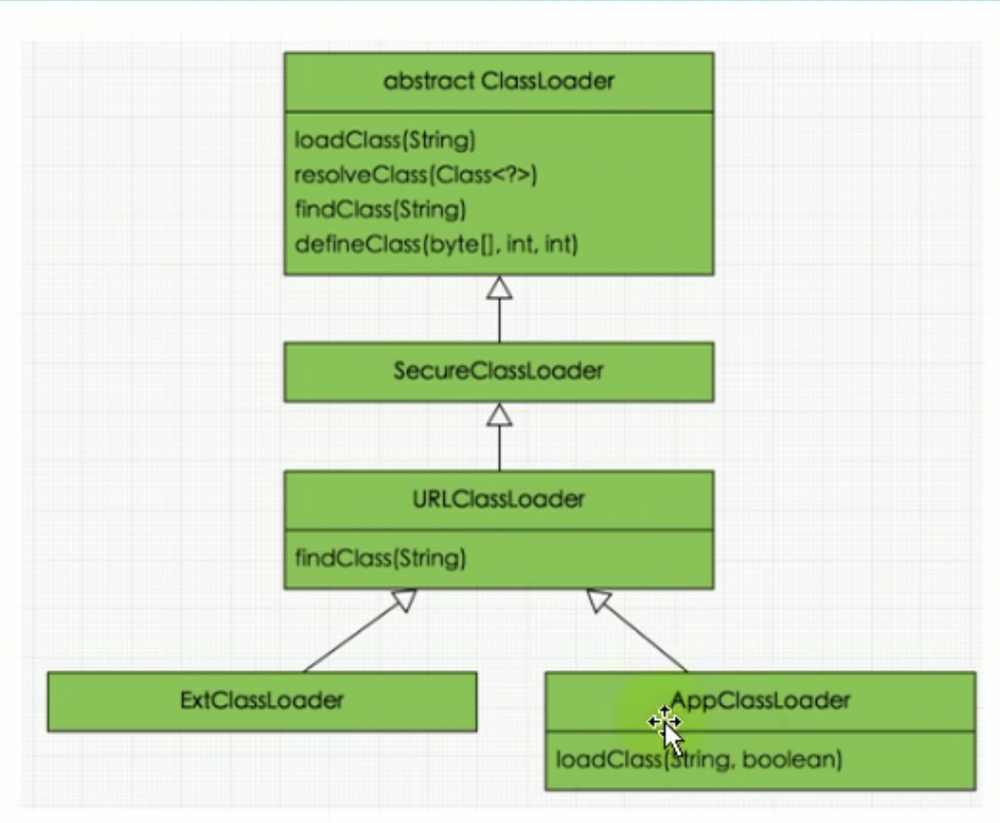
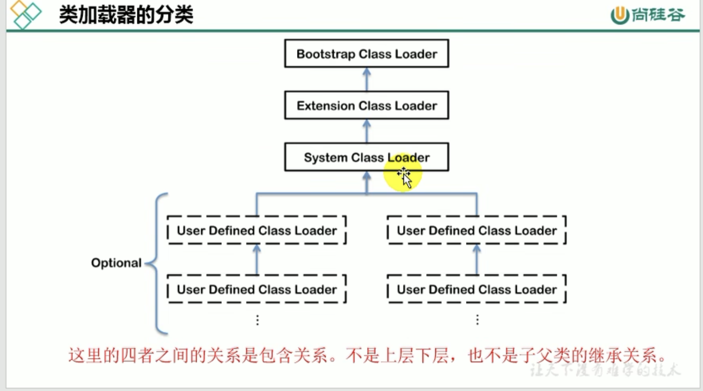
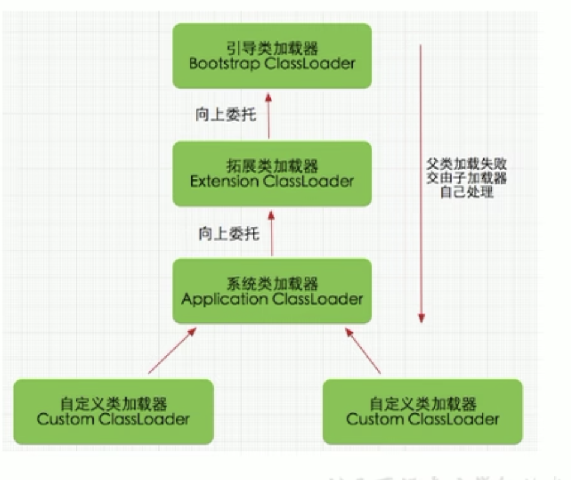
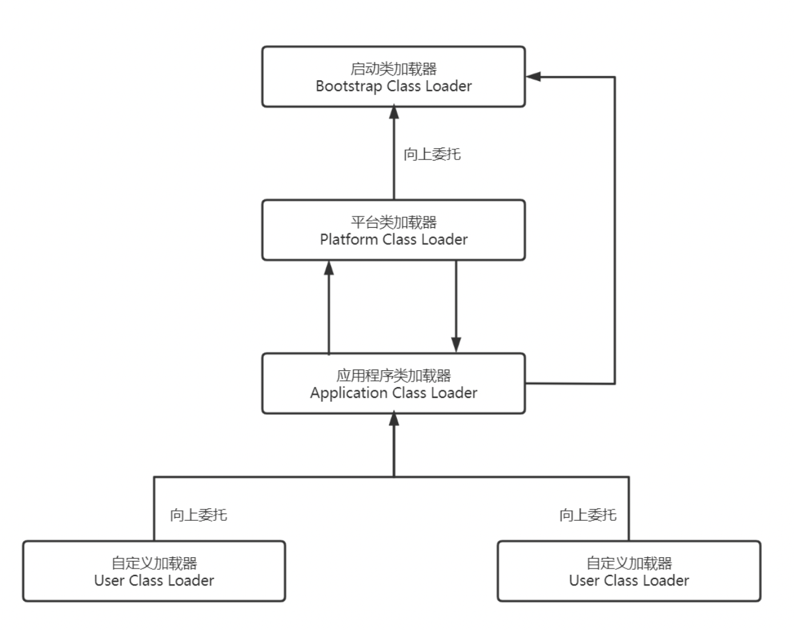

+++
date = '2024-02-21T13:59:00+08:00'
draft = true
title = 'JVM学习笔记'
tags = ["JVM","学习笔记"]
series = ["使用教程"]
categories = ["Java", "JVM"]
+++

# JVM学习笔记

## 类加载器

### 类加载器的介绍

关于类加载器的分类：有如下分类，通过加载器不同作用不同

- **引导类加载器 bootstrap classloader**：用于加载 java 的核心类库，是使用原生代码来实现的，就是C/C++实现的。
- **扩展类加载器 extension classloader**：用于加载 java 的扩展库
- **系统类加载器 system classloader（AppClassLoader）**：它根据 java 应用的类路径 classpath 来加载 java 类
- **自定义类加载器**：用于加载自定义的类

### 双亲委派机制

左侧为JDK1.8以前的委派机制、右侧为JDK1.9以后得委派机制

1.8 及以前的 类加载器收到了类加载请求，首先不会自动去尝试加载这个类，而是把这个类委托给父类加载器去完成。当父类加载器反馈自己无法加载请求时，加载器才回尝试加载。

19 及以后的，因为模块化系统的顺利实施，所以将Extension ClassLoader替换为Platform ClassLoader，启动类加载器和平台类加载器、应用程序类加载器 全部继承于

**双亲委派机制的优点**：
1. 避免了类的重复加载。
2. 保护了程序的安全性，防止核心的API被修改。

举个例子：当一个Application ClassLoader 收到一个类，会去Extension ClassLoader 找是否有加载该类，如果有，结束，如果没有加载，就会到Bootstrap ClassLoader 查询是否加载过该类，如果有，结束。如果没有是否可以加载该类，如果能加载就加载，不能就向下传递。只要中间有加载就结束。

### 沙箱安全机制

1. **类加载体系结构(类的双亲委托机制)**：类加载器上文已经解释过了
2. **class文件检验器**：很简单，就是编译后的文件进行验证
3. **内置于Java虚拟机（及语言）的安全特性**：
   - 结构化内存访问（不使用指针，一定程度上让黑客无法篡改内存数据）
   - 自动垃圾收集
   - 数组边界检查
   - 空引用检查
   - 数据类型安全
4. **安全管理器及Java API**：securityMananger，相当于提供一个API进行保证文件的安全

## 内存区域和内存溢出问题

运行时数据区如下图所示：

### 详细的分解

**线程独有的**

1. **程序计数器**：用来控制程序的运行的，里面存放着选取那一条字节码指令，每一个线程都有一个程序计数器。
2. **java的栈**：它的生命周期和线程的生命周期一致，局部变量表中存放的是基本数据类型、对象引用（slot）存储。内存机制中的变量槽的使用很大程度的降低了资源的使用。
3. **本地方法栈**：为使用本地的本地的方法服务。和java的栈作区分。

**线程共享的**

4. **java的堆**：jvm中最重要的一部分，堆空间是所有线程共享的一部分，java的对象几乎都在堆内存中分布。这部分也还是GC管理的区域，这其中分代理论占据了绝大多数。这其中的内存是逻辑上连续的，物理上不一定连续。
5. **java的方法区**：发放区同样是多个线程共有的，同样不需要连续的物理内存空间，主要存储被虚拟机加载的类型信息、常量、静态变量、即时编译器编译的代码缓存。
6. **运行时常量池**：属于方法区的一部分，用于存储常量池表，用于存放编译期生成的各种字面量、符号引用。
7. **直接内存**：不属于虚拟机运行时数据区的一部分。可以使用native函数直接进行堆外内存直接分配。直接存储不会收到java堆大小的限制，但是会收到物理内存的限制。

栈内存用来存放基本类型的变量和引用变量。

jvm的GC主要针对的是堆的垃圾回收，栈的处理基本不需要gc。

## GC的算法

1. **引用计数**:（reference counting）在创造对象的时候，就给对象赋予一个数值，每当有一个指向它的引用被删除时，计数器减一，计数器为0时，进行GC。
2. **标记清除**: (mark-sweep)依据引用次数进行判断是否有引用，如果被引用次数为0，就标识可以被回收。
3. **拷贝算法**: (copying)拷贝算法实现的是使用一半，另外一半不使用，存在空间浪费问题，但是效率非常的高。
4. **标记整理算法**: (mark-compact)效率偏低。

### 具体的垃圾回收器

**分区模型**：ParNew、CMS、Serial、serial Old、parallel Scavenge、parallel Old

**分代模型**：G1、ZGC、Shenandoah、Epsilon(特殊的一种算法)

### 堆内存

- **新生代**：eden(伊甸园区)、survivor1、survivor2，使用复制算法
- **老年代**：tenured，使用MC(标记压缩)、MS(标记清除)

### 一个对象从创建到消亡

创建在Eden区、保存至survivor1区、保存至survivor2区、中间可能有survivor1和2之间成长、保存至老年代。

JVM的优化重点是STW

### 收集器的配合

- parNew + CMS
- Serial + Serial Old（单线程拷贝算法）
- Parallel Scavenge + Parallel Old（多线程拷贝算法 jdk1.8）
- G1
- ZGC
- Shenandoah

### 单个GC收集器

**Serial** 最基本、发展最悠久的收集器 单线程收集器
- 优点：简单高效、拥有很高的单线程收集效率。
- 缺点：收集过程会有STW
- 算法：复制算法
- 范围：新生代

**Serial Old** 单线程收集器
- 优点：不用复制，开销小
- 缺点：会产生大量可见的内存碎片
- 算法：标记清除算法
- 范围：老年代

**CMS**：garbagefirst GarbageFirst

**ParNew**:CMS
