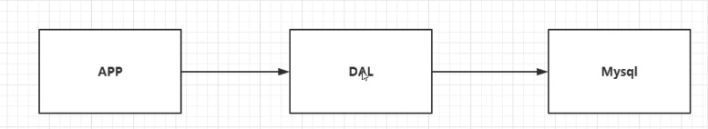
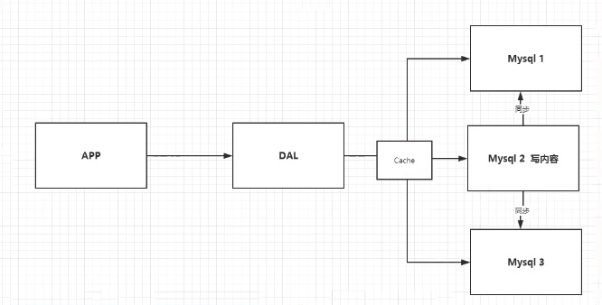

+++
date = '2023-03-05T10:00:00+08:00'
draft = true
title = 'Redis学习笔记'
tags = ["Redis","学习笔记"]
series = ["使用教程"]
categories = ["数据库", "Redis"]
+++

# Redis学习笔记

## 1. 铺垫

### 1 单机MySQL的时代

网站访问量不会很大，单个数据库完全足够。那时候更多的是使用静态网站。

### 2 数据量增长

1. 如果数据量比较大，一个机器放不下了。
2. 数据索引，一个机器放不下了。
3. 访问量一个服务器承受不了（数据库是读写混合的）。

解决的方式：使用Memcached ( 缓存 ) + Mysql + 垂直拆分 (读写分离)

### 3 mysql集群(水平拆分)

节点node开始出现，集群化。涉及的锁：表锁和行锁。

### 4 数据量更多

新型数据库开始出现。

