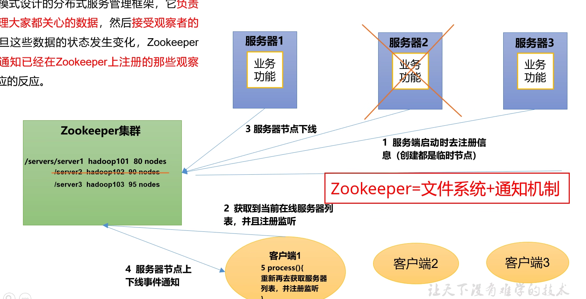
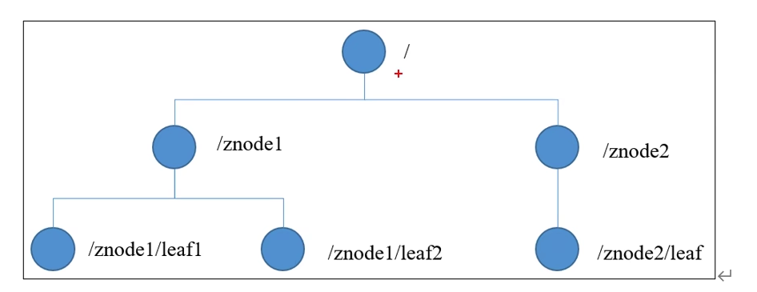

+++
date = '2026-10-21T10:00:00+08:00'
draft = true
title = 'ZooKeeper 学习笔记'
tags = ["ZooKeeper","学习笔记"]
series = ["学习笔记"]
categories = ["分布式", "ZooKeeper"]
+++

# ZooKeeper 学习笔记

## 1. 概述

ZooKeeper是一个开源的分布式的，为分布式框架提供协调服务的Apache项目。

Zookeeper从设计模式角度来理解：是一个基于观察者模式设计的分布式服务管理框架，它负责存储和管理大家都关心的数据，然后接受观察者的注册，一旦这些数据的状态发生变化，Zookeeper就将负责通知已经在Zookeeper上注册的那些观察者做出相应的反应。

### 1.1 特点

- Zookeeper有一个leader(领导者)和多个follower(跟随者)组成的集群。
- 集群中只要有半数以上节点存活，Zookeeper集群就能正常服务。所以Zookeeper适合安装奇数台服务器。
- 全局数据一致，每个server保存一份相同的数据副本，Client无论链接到那个Server，数据都是一致的。
- 更新请求顺序执行，来自同一个Client的更新请求按照其发送顺序依次执行。
- 数据更新原子性，依次数据更新要么成功，要么失败。
- 实时性，在一定时间范围内，Client能读取到最新数据。

### 1.2 数据存储结构

Zookeeper数据模型的结构与Unix文件系统很类似，整体上可以看作是一棵树，每个节点称做一个ZNode。每一个ZNode默认能够存储 1 MB 的数据，每个ZNode都可以通过其路径唯一标识。

Zookeeper适合存储少量数据，类似作为索引功能使用。

### 1.3 应用场景

提供的服务包括：统一命名服务、统一配置管理、统一集群管理、服务器节点动态上下线、软负载均衡等。

#### 1.3.1 统一命名服务

在分布式环境下，经常需要对应用/服务进行统一命名，便于识别。例如：IP不容易记住，而域名容易记住。

#### 1.3.2 统一配置管理

分布式环境下，配置文件同步非常常见。一般要求一个集群中，所有节点的配置信息是一致的，如kafka集群。对配置文件修改后，希望能够快速同步到各个节点上。各个客户端服务器监听配置的 Znode，进行数据同步。

#### 1.3.3 统一集群管理

分布式环境中，实现掌握每个节点的状态是必要的。所以可以根据节点实时状态做出一些调整。Zookeeper可以实现实时监控节点状态变化，可以将节点的信息写入Zookeeper上的一个 ZNode上。监听这个ZNode可获取它的实时状态变化。

#### 1.3.4 服务器动态上下线

客户端能实时洞察到服务器上下线的变化。

#### 1.3.5 软负载均衡

在Zookeeper中记录每台服务器的访问数，让访问数最少得服务器去处理最新的客户端请求。
