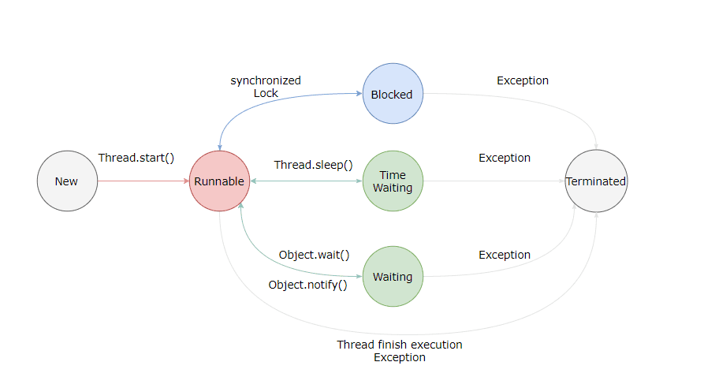

+++
date = '2024-05-22T15:14:00+08:00'
draft = true
title = '记录学习的一些知识点'
tags = ["Java","学习笔记"]
series = ["使用教程"]
categories = ["Java", "综合"]
+++

# 记录学习的一些知识点

## 1 java基础

很想知道一点，为什么要去做这些控制，其实很多思考是依照实际的问题演化出来的，但是我们作为一个单纯学习理论的人来说，很难去了解为什么，所以高并发，异步请求，时间限制这些我们几乎没有涉及。

同时我们再网络通信，计算机底层架构中几乎无用武之地，但是这却是奠基的基础。

## 2 java集合框架

## 3 java多线程与并发

首先全局的了解并发的知识体系，同时了解并发理论基础和线程基础，并发关键字等，这些是你理解java并发框架的基础。

### 3.1 java并发基础理论

#### 为什么需要多线程

多线程的出现是要解决什么问题的?

CPU、内存、I/O设备的速度是有极大差异的，为了合理利用CPU的高性能，平衡这三者之间的速度差异，计算机体系结构、操作系统、编译程序都做出了贡献，主要体现为：

1. CPU增加了缓存，以平衡与内存的速度差异。// 导致可见性问题
2. 操作系统增加了进程、线程，以分时复用CPU，进而平衡CPU与I/O设备的速度差异。// 导致原子性问题
3. 编译程序优化指令执行次序，使得缓存能够得到更加合理的利用。// 导致有序性问题

#### 3.1.2 线程基础

线程的状态有如下几个状态：
1. 新建 (New)
2. 可运行(Runnable)
3. 阻塞(Blocking)
4. 无限期等待(Waiting)
5. 限期等待(Timed Waiting)
6. 死亡(Terminated)

线程的使用方式：
1. 实现Runnable接口
2. 实现Callable接口
3. 继承Thread类

#### 3.1.3 java中所有的锁

1. **悲观锁、乐观锁**
   - 悲观锁认为自己在使用数据的时候一定有别的线程来修改数据，因此在获取数据的时候会先加锁。synchronized 和 Lock 的实现类都是悲观锁。
   - 乐观锁认为自己在使用数据时不会有别的线程修改数据，所以不会添加锁，只是在更新数据的时候去判断之前有没有别的线程更新了这个数据。

2. **自旋锁、适应性自旋锁**
   - 自旋锁是一种基于忙等待的锁机制，它是一种轻量级的锁实现方式。
   - 适应性自旋锁是通过上一次获取这个锁的频率来判断这个锁的使用频率。

3. **无锁、偏向锁、轻量级锁、重量级锁**（锁升级的过程）

4. **公平锁、非公平锁**
   - 公平锁是指多个线程按照申请锁的顺序来获取锁
   - 非公平锁是指多个线程加锁时直接尝试获取锁

5. **可重入锁、非可重入锁**
   - 可重入锁是一种特殊的互斥锁，它允许同一线程多次获取同一个锁。

6. **独享锁(排他锁)、共享锁**
   - 独享锁是指该锁一次只能被一个线程所持有。
   - 共享锁是指该锁可被多个线程所持有。

#### 3.1.4 synchronized 关键词详解

- 一把锁只能同时被一个线程获取，没有获得锁的线程只能等待；
- 每个实例都对应有自己的一把锁(this),不同实例之间互不影响；
- synchronized修饰的方法，无论方法正常执行完毕还是抛出异常，都会释放锁

#### 3.1.5 volatile 关键词详解

#### 3.1.6 final 关键词详解

### 3.2 JUC教程

#### 3.2.1 JUC原子类

juc中多数类是通过volatile和CAS来实现的，CAS本质上提供的是一种无锁的方案，而synchronized和lock是互斥锁方案；java原子类本质上是使用的cas，而cas是unsafe实现的。

## 4 java IO/NIO/AIO

### 4.1 java IO - 分类

字符流和字节流的区别：
1. 字节流读取单个字节，字符流读取多个字符。
2. 字节流用来处理二进制文件，字符流用来处理文本文件。

## 5 数据库

### 5.1 数据库的事务

#### 5.1.1 数据库的事务是如何实现的

依照银行从A账户向B账户转账为例。

1. **使用redo log(重做日志)和redo log buffer(重做日志缓冲区)**
   - 首先事务开启，将从A账号减少资金语句放入buffer pool中，记录A账号现在资金到redo log buffer中
   - 将A账号资金增加语句放入buffer pool中，记录B账号现在资金到redo log buffer中
   - 然后提交事务，将redo log buffer数据放入redo log中

2. **使用undo log(回滚日志)和undo log buffer(回滚日志缓冲区)**
   - 首先事务开启，记录A账号原有资金到undo log buffer中，记录B账号原来资金到undo log buffer中
   - 然后提交事务，将undo log buffer数据放入undo log中

- redo log 持久性
- undo log 原子性
- mvcc(多版本并发控制) 隔离性
- redo log 放入日志，然后写入磁盘，这就改随机写变为顺序写。

#### 5.1.2 事务特性

A 原子性  C 一致性  I 隔离性  D 持久性

#### 5.1.3 并行事务会引发的问题

1. **脏读**：当读到一个未提交事务的数据，就是意味着脏读了。
2. **不可重复读**：在一个事务中多次读取同一个数据，如果出现前后两次读到的数据不一样的情况。
3. **幻读**：在一个事务中多次查询符合条件的「记录数量」，如果前后两次查询到的记录数量不一致。

补充一下：不可重复读和幻读都是两次读取数据数据不一致，不可重复读是 update，幻读是 insert

#### 5.1.5 数据库的锁

1. **表锁**：表级锁是mysql中锁定粒度最大的一种锁
2. **页锁**：页级锁是mysql中锁定粒度介于行级锁和表级锁中间的一种锁
3. **行锁**：行级锁是mysql中锁粒度最大的一种锁
   - Record Lock(记录锁)：把仅仅一条记录锁上。
   - Gap Lock(间隙锁)：锁定一个范围，但是不包含记录本身。防止幻读
   - Next-Key Lock(组合锁)：锁定一个范围，并且锁定记录本身。

## 6 redis

### 6.1 redis基础

### 6.2 缓存穿透

缓存穿透是指缓存和数据库中都没有的数据，而用户不断发起请求。

**解决方案**：
1. 接口层增加校验，如用户鉴权校验。
2. 从缓存取不到的数据，在数据库中也没有取到，这时可以将key-value 设置为 key-null
3. 布隆过滤器。

### 6.3 缓存击穿

缓存击穿是指缓存中没有但数据库中有的数据，这时由于并发用户特别多，同时读缓存没读到的数据，又同时去数据库取数据，引起数据库压力瞬间增大。

**解决方案**：
1. 设置热点数据永远不过期。
2. 接口限流与熔断，降级。
3. 加互斥锁。

### 6.4 缓存雪崩

缓存雪崩是指缓存中数据大批量到过期时间，而查询数据量巨大，引起数据库压力过大甚至down机。

**解决方案**：
1. 缓存数据的过期时间设置随机。
2. 如果缓存数据库是分布式部署，将热点数据均匀分布在不同的缓存数据库中。
3. 设置热点数据永不过期。

### 6.5 缓存污染

缓存污染问题说的是缓存中一些只会被访问一次或者几次的数据，被访问完后，再也不会被访问到，但这部分数据依然留存在缓存中，消耗缓存空间。

### 6.6 数据库和缓存一致性

不管是先写mysql数据库，再删除redis缓存；还是先删除缓存，再写数据库，都有可能出现数据不一致的情况。

**解决方案**：

**队列 + 重试机制**：
1. 更新数据库数据
2. 缓存因为种种问题删除失败
3. 将需要删除的key发送至消息队列
4. 自己消费信息，获取需要删除的key
5. 继续重试删除操作，直到成功

**异步更新缓存**：
1. 读取redis，热数据基本都在redis
2. 增删改都是操作mysql
3. 更新redis数据，mysql的数据操作binlog，来更新到redis

### 6.7 选举机制

Leader选举、故障转移

## 7 Spring

### 7.1 Core Container（Spring的核心容器）

Spring的核心容器是其他模块建立的基础，由Beans 模块、Core 核心模块、Context 上下文模块和 SpEL 表达式语言模块组成。

- **Beans 模块**：提供了框架的基础部分，包括控制反转和依赖注入。
- **Core 核心模块**：封装了 Spring 框架的底层部分，包括资源访问、类型转换及一些常用工具类。
- **Context 上下文模块**：建立在 Core 和 Beans 模块的基础之上，集成 Beans 模块功能并添加资源绑定、数据验证、国际化、Java EE 支持、容器生命周期、事件传播等。
- **SpEL 模块**：提供了强大的表达式语言支持。

### 7.2 Data Access/Integration（数据访问／集成）

数据访问／集成层包括 JDBC、ORM、OXM、JMS 和 Transactions 模块。

### 7.3 Web模块

### 7.4 AOP、Aspects、Instrumentation和Messaging

---

大纲：https://www.processon.com/view/link/61b2313b0e3e74683770741d

引用：
- https://www.xiaolincoding.com/mysql/transaction/mvcc.html
- https://pdai.tech/md/db/nosql-redis/db-redis-x-cache.html
- IOC和AOP的博文：https://zhuanlan.zhihu.com/p/355778555
