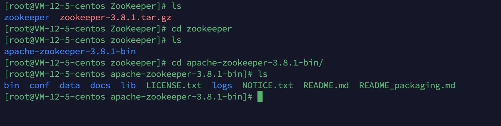

+++
date = '2025-12-10T12:31:52+08:00'
draft = true
title = 'Zookeeper安装教程'
tags = ["Zookeeper", "安装教程"]
series = ["安装教程"]
categories = ["中间件","Zookeeper"]
+++

# Zookeeper安装教程
## 软件下载
因为公司需要使用 KafKa 来进行接数据，所以需要安装，但是前置条件是需要安装这个 ZooKeeper

:::tips
1.  需要提前安装 java
2.  准备Zookeeper安装包(bin的)
3.  参考资料   [https://blog.csdn.net/Eternal_Blue/article/details/94762494](https://blog.csdn.net/Eternal_Blue/article/details/94762494)

:::

## 软件安装
   

1. 将压缩文件解压后

```shell
tar -zxvf zookeeper-3.8.1.tar.gz
```

2. 创建两个文件夹 data、logs

```shell
cd zookeeper
cd apache-zookeeper-3.8.1-bin
mkdir data
mkdir logs
```

3. 将 conf文件夹下的  zoo_sample.cfg 改名字为 zoo.cfg

将zoo.cfg的<font style="color:rgb(150, 152, 150);">  
</font><font style="color:rgb(150, 152, 150);">	dataDi</font><font style="color:rgb(196, 196, 200) !important;">r=/usr/local/zookeeper/apache-zookeeper-</font><font style="color:rgb(222, 147, 95);">3.5.5</font><font style="color:rgb(196, 196, 200) !important;">/</font><font style="color:rgb(178, 148, 187);">data  改为你创建的那个 data文件夹</font>

```shell
cd conf 
mv zoo_sample.cfg zoo.cfg
// 修改配置
dataDir=/usr/local/zookeeper/apache-zookeeper-3.5.5/data
```

4. 启动命令

```shell
cd ..
bin/zkServer.sh start
```

5. 使用JPS命令就可以查询到进程信息，QuorumPeerMain就是Zookeeper的进程

```shell
jps
```

补充命令

重启命令    bin/zkServer.sh restart

停止命令    bin/zkServer.sh stop

客户端启动  bin/zkCli.sh
