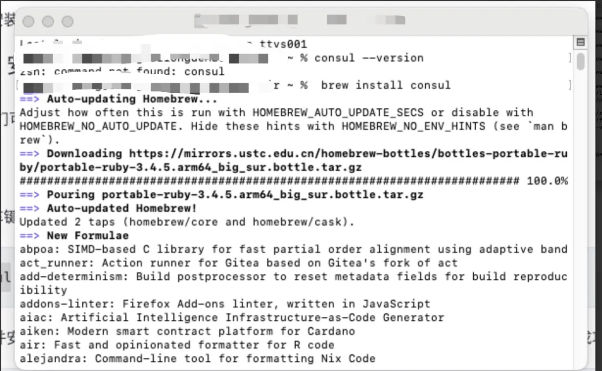
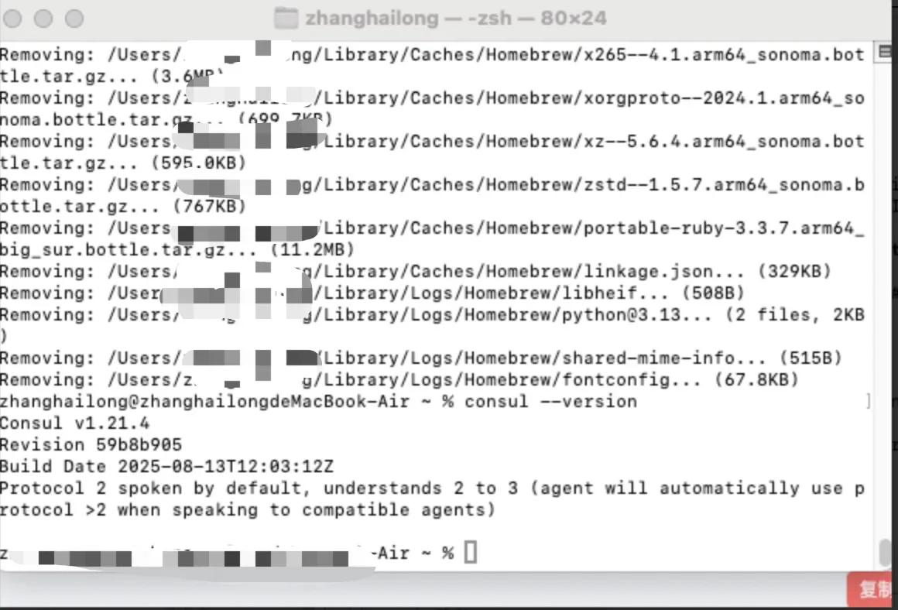

+++
date = '2025-12-15T11:06:52+08:00'
draft = true
title = 'consul安装教程'
tags = ["consul","安装教程"]
series = ["安装教程"]
categories = ["自动部署", "consul"]
+++


## mac安装教程
### <font style="color:rgb(45, 48, 55);">安装 Homebrew</font>
```shell
/bin/bash -c "$(curl -fsSL https://raw.githubusercontent.com/Homebrew/install/HEAD/install.sh)"
```

### <font style="color:rgb(45, 48, 55);">使用 Homebrew 安装 Consul</font>
```shell
brew install consul
consul --version
```






### 启动consul
```shell
consul agent -dev
```

页面地址

> [http://localhost:8500/ui/dc1/services](http://localhost:8500/ui/dc1/services)
>

### <font style="color:rgb(45, 48, 55);">配置 Consul</font>
```shell
sudo mkdir /etc/consul.d
cd /etc/consul.d
sudo vim config.json

{
  "datacenter": "dc1",
  "data_dir": "/tmp/consul",
  "log_level": "INFO",
  "node_name": "consul-node-1",
  "server": true,
  "bootstrap_expect": 1,
  "ui": true,
  "client_addr": "0.0.0.0",
  "bind_addr": "0.0.0.0",
  "advertise_addr": "127.0.0.1"
}

// 重启
consul agent -config-file=/path/to/config.json
```


## linux的安装教程
下载地址

> [https://developer.hashicorp.com/consul/install#linux](https://developer.hashicorp.com/consul/install#linux)
>

系统使用的centos

```shell
unzip consul_1.21.4_linux_amd64.zip 
```


```shell
vim /etc/profile 

export CONSUL_HOME=/soft/consul/consul       
export PATH=$PATH:CONSUL_HOME

source /etc/profile

consul -v
```

```shell
nohup ./consul agent -dev -client 0.0.0.0 -ui &
```


