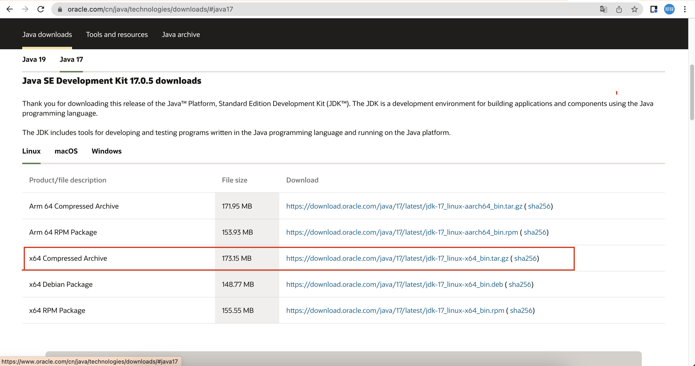
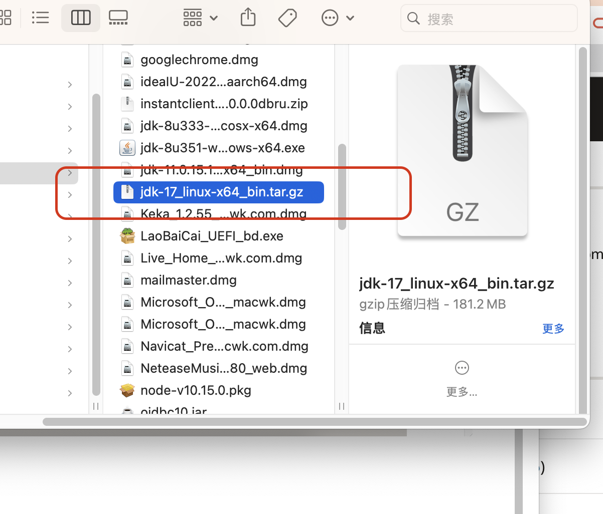
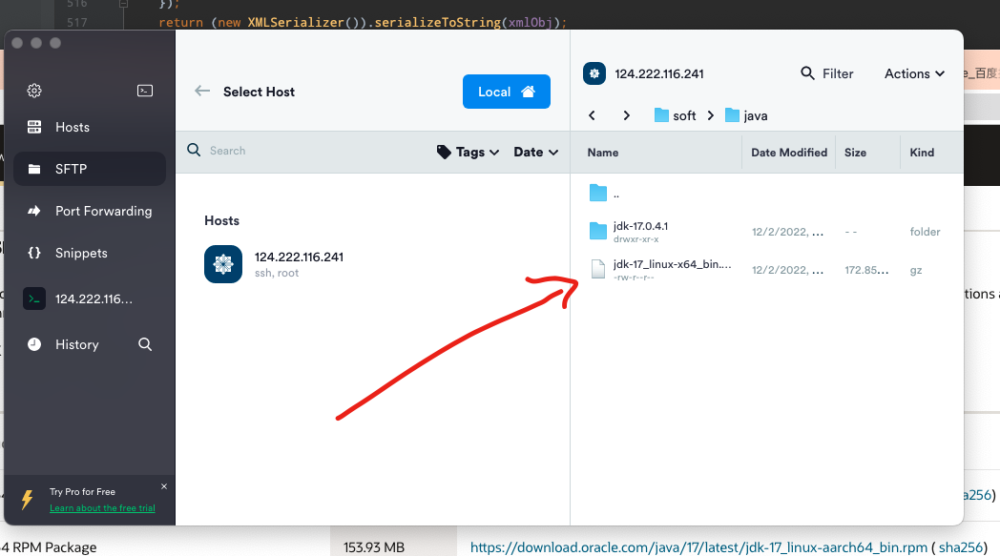
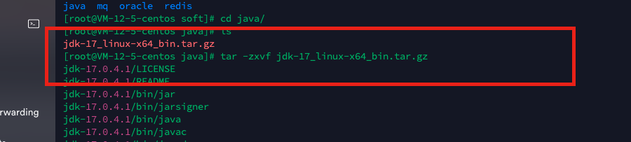

+++
date = '2022-12-02T10:00:00+08:00'
draft = true
title = 'jdk安装教程'
tags = ["jdk","安装教程"]
series = ["使用教程"]
categories = ["Java", "jdk"]
+++

# jdk安装教程

基于Cen8的jdk安装教程

## 1 软件下载

### 1.1 下载

访问 https://www.oracle.com/cn/java/technologies/downloads/#java17 ，选择下载，需要输入账号、密码。可以使用QQ邮箱进行申请账号。



### 1.2 上传到服务器

我使用的是Termius 将文件直接拖拽上去就可以了。



## 2 软件安装

将文件进行解压



### 2.1 修改配置文件

将这行代码放入其中，使用 i 可以进行插入：

```bash
export JAVA_HOME=/path/to/your/jdk
export PATH=$JAVA_HOME/bin:$PATH
```

JAVA_HOME的路径是你jdk解压的路径。

结尾的时候点击ESC，然后输入：wq退出vim。

### 2.2 让配置文件生效

输入这条命令让配置生效：

```bash
source /etc/profile
```

## 3 软件测试



```bash
update-alternatives --config java  # 切换java版本
```
