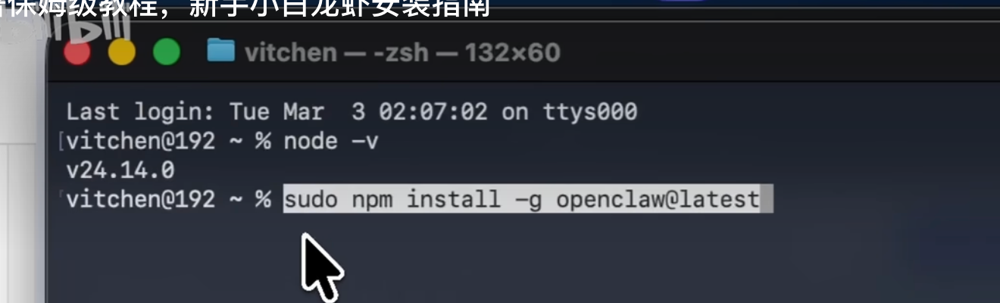
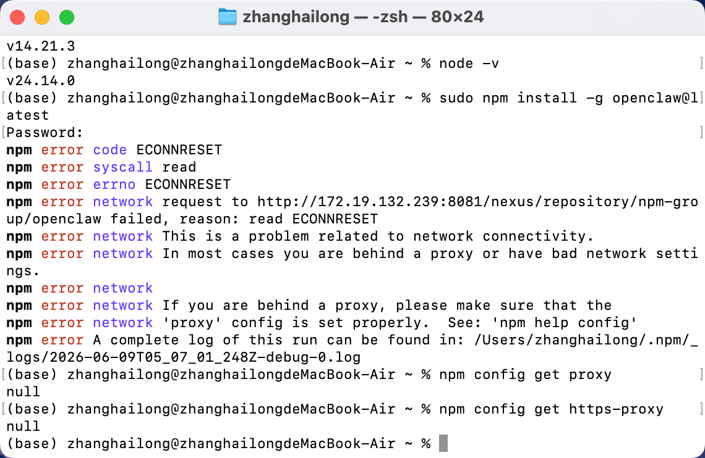
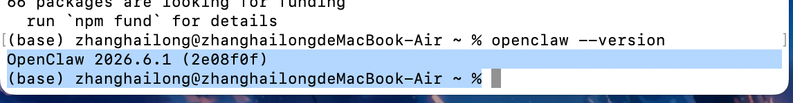
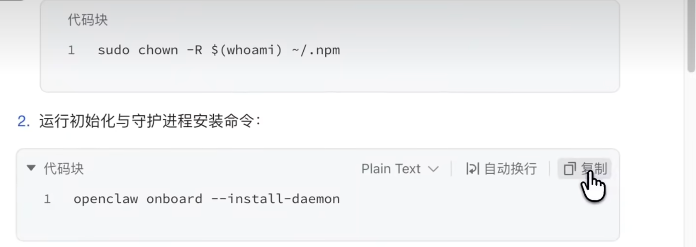

+++
date = '2026-10-21T09:39:00+08:00'
draft = true
title = 'open claw安装教程'
tags = ["openclaw","安装教程"]
series = ["安装教程"]
categories = ["AI工具", "openclaw"]
+++

# open claw安装教程

基于硅基流动的ai模型

## 1 环境配置

### 1.1 下载node

本文使用的是 node-v24.14.0.pkg

## 2 安装

```bash
sudo npm install -g openclaw@latest
```

第一次执行命令报错

```bash
# 查看当前代理（应该能看到 172.19.132.239:8081）
npm config get proxy
npm config get https-proxy

# 删除里面的东西
vi ~/.npmrc
```

此时openclaw已经安装成功，以为我这个是做的更新

## 配置权限

### 1 设置npm权限

```bash
sudo  chown -R $(whoami)  ~/.npm

sudo chown -R $(whoami) ~/.openclaw
```

### 2 运行初始化与守护进程安装命令

```bash
openclaw onboard --install-daemon
```








