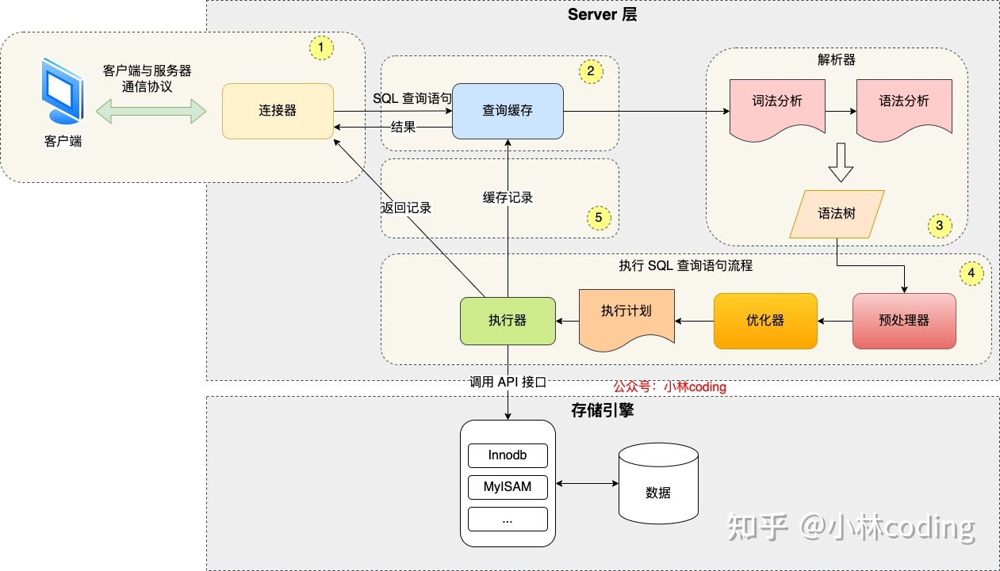
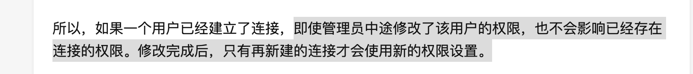

+++
date = '2026-10-21T10:00:00+08:00'
draft = true
title = 'SQL执行过程'
tags = ["SQL","问题排查"]
series = ["问题排查"]
categories = ["数据库", "MySQL"]
+++

# SQL的执行过程

## 1. 执行顺序

1. 从分层上看分为 Server层和存储引擎这两层
2. Server 层负责建立连接、分析和执行 SQL
3. 存储引擎层负责数据的存储和提取

存储引擎主要有 InnoDB、MyISAM、Memory

## 2. 连接器

就是建立访问数据库的连接，需要看连接是走的什么协议，正常的是用TCP协议，经过三次握手，建立连接。

## 3. 查询缓存

如果sql语句是查询语句，就会先去查询缓存，如果缓存里面有数据，看看之前有没有执行过这一条命令，查询缓存为 Key-value键值对的方式保存在内存中，key为sql查询语句，value为sql的查询结果。如果命中了查询缓存就将查询结果返回，如果没有命中，就继续往下执行。

**注意**：MySQL 8之后就没有缓存查询了。

## 4. 解析sql

执行sql查询之前，会对sql语句做解析，这个工作交由（解析器）来完成。

### 4.1 解析器

首先进行词法分析，mysql回根据你输入的字符串识别关键字，构建出sql语法树，这样方便后面模块获取sql类型、表明、字段名、where条件等等。

第二就是语法分析，语法解析器会根据语法规则，判断你输入的这个sql语句是否满足mysql的语法。

## 5. 执行sql

- **prepare 阶段**，也就是预处理阶段；
- **optimize 阶段**，也就是优化阶段；
- **execute 阶段**，也就是执行阶段；

### 5.1 预处理器

- 检查sql查询语句中的表或者字段是否存在
- 将 select * 中的 * 扩展为表上的所有列

### 5.2 优化器

- 经过sql查询语句先指定一个执行计划，这个由优化器来完成。
- 优化器主要讲sql查询语句的执行方案确定下来。
- 在这里会有涉及索引的东西。

### 5.3 执行器

- 确定下执行方案，Mysql就会真正开始执行语句了。在执行过程中，执行器就会和存储引擎交换，交换是以记录为单位的。
- 主键索引查询
- 全表扫描
- 索引下推

### 5.4 主键索引查询

- 执行器第一次查询，会调用 read_first_record 函数指针指向的函数，因为优化器选择的访问类型为 const，这个函数指针被指向为 InnoDB 引擎索引查询的接口，把条件 id = 1 交给存储引擎，让存储引擎定位符合条件的第一条记录。
- 存储引擎通过主键索引的 B+ 树结构定位到 id = 1的第一条记录，如果记录是不存在的，就会向执行器上报记录找不到的错误，然后查询结束。如果记录是存在的，就会将记录返回给执行器；
- 执行器从存储引擎读到记录后，接着判断记录是否符合查询条件，如果符合则发送给客户端，如果不符合则跳过该记录。
- 执行器查询的过程是一个 while 循环，所以还会再查一次，但是这次因为不是第一次查询了，所以会调用 read_record 函数指针指向的函数，因为优化器选择的访问类型为 const，这个函数指针被指向为一个永远返回 -1 的函数，所以当调用该函数的时候，执行器就退出循环，也就是结束查询了。

### 5.5 全表扫描

- 执行器第一次查询，会调用 read_first_record 函数指针指向的函数，因为优化器选择的访问类型为 all，这个函数指针被指向为 InnoDB 引擎全扫描的接口，让存储引擎读取表中的第一条记录；
- 执行器会判断读到的这条记录的 name 是不是 iphone，如果不是则跳过；如果是则将记录发给客户的；
- 执行器查询的过程是一个 while 循环，所以还会再查一次，会调用 read_record 函数指针指向的函数，因为优化器选择的访问类型为 all，read_record 函数指针指向的还是 InnoDB 引擎全扫描的接口，所以接着向存储引擎层要求继续读刚才那条记录的下一条记录；
- 一直重复上述过程，直到存储引擎把表中的所有记录读完，然后向执行器（Server层）返回了读取完毕的信息；
- 执行器收到存储引擎报告的查询完毕的信息，退出循环，停止查询。

### 5.6 索引下推

联合索引当遇到范围查询 (>、<) 就会停止匹配，也就是 age 字段能用到联合索引，但是 reward 字段则无法利用到索引。

**不使用索引下推（MySQL 5.6 之前的版本）时**：
- Server 层首先调用存储引擎的接口定位到满足查询条件的第一条二级索引记录
- 存储引擎根据二级索引的 B+ 树快速定位到这条记录后，获取主键值，然后进行回表操作，将完整的记录返回给 Server 层
- Server 层在判断该记录的 reward 是否等于 100000，如果成立则将其发送给客户端；否则跳过该记录
- 接着，继续向存储引擎索要下一条记录

**使用索引下推后**：
- Server 层首先调用存储引擎的接口定位到满足查询条件的第一条二级索引记录
- 存储引擎定位到二级索引后，先不执行回表操作，而是先判断一下该索引中包含的列（reward列）的条件是否成立。如果条件不成立，则直接跳过该二级索引。如果成立，则执行回表操作，将完成记录返回给 Server 层
- Server 层在判断其他的查询条件是否成立，如果成立则将其发送给客户端；否则跳过该记录

